# A differential low-noise voltage preamplifier, DC–10 MHz, with paralleled JFETs

Design study and ngspice simulations of a successor to the SR560 class of laboratory preamplifiers.

> This note was created with significant AI assistance. It may contain errors, so check the cited datasheet pages, tables and scripts before relying on a figure. None of the circuits has been built yet: every result here is verified only in simulation. The note itself is dedicated to the public domain under CC0 1.0; no copyright is reserved. The manufacturers' SPICE models are not covered and not included: each remains under its vendor's terms, and each must be downloaded from its vendor to reproduce the simulations (`sim/models/README.md`).

This note works out, and checks in ngspice, a differential voltage preamplifier meant to replace an SRS SR560 or an NF 5307 on the bench: DC-coupled, gains from 1 to 100 000, two configurable filters, a 50 Ω output, and the lowest input voltage noise that the input impedance allows. It starts from the physics of the noise floor (Section 1), reproduces the SR560 from its schematics as the benchmark (Section 2), surveys today's low-noise JFETs and shows how to choose among them (Section 3), describes the new design block by block (Section 4), explains how it was simulated and which vendor models had to be corrected (Section 5), and presents the results (Section 6). Section 7 lists what is not verified, and the Appendix collects the ngspice pitfalls met on the way.

**In short.** The new design has two switchable front ends of the same current-feedback topology (Section 4.2):

- **H** (high impedance): two JFE2140 halves per side at 5 mA each. Input noise **1.08 nV/√Hz** white (gain ≥ 1000; 1.11 at 1 kHz, 2.8 at 10 Hz), a bias current of about 2 pA per input (two JFETs at about 1 pA each at their 3.9 V of $V_{DS}$: SLPS730B Fig. 6-6; 1 pA typical, 10 pA maximum at 2 V, p. 5), and an effective input capacitance of 20 pF set by the input network ($C_P + C_Z$ = 10 + 10 pF; 20.1 pF at 1 kHz and 19.9 pF at 1 MHz in simulation) rather than by the 26 pF of JFETs, which bootstrapping hides (0.05 pF at 1 kHz and at 100 kHz, 0.11 pF at 1 MHz; `sim/results/zin_numbers.json`).
- **L** (low impedance): twelve JFE150 per side at 5 mA each. Input noise **0.42 nV/√Hz** white (0.43 at 1 kHz, 0.96 at 10 Hz; gain 1000). It has the lower noise for source resistances up to about 96 Ω at 10 MHz, 0.70 kΩ at 1 MHz and 27–70 kΩ at 1 kHz and 10 Hz, where the two inputs' curves cross (interpolated in `scripts/numbers_s1_3.py` between the grid points of Section 6.2, Table 10: 30–100 Ω, 300 Ω–1 kΩ and 10–100 kΩ), and H above them. Between about 3 kΩ and 200 kΩ at 1 kHz the two differ by less than 1 %.

The full chain reaches −3 dB at 14.82–14.84 MHz (H, gain ≥ 100), 24.9–25.0 MHz (H with the front end at ×10: gain ≤ 10 and the high-reserve mode) and 16.5 MHz (L), and at 10 MHz it is 0.37 dB (H, gain ≥ 100), 0.41–0.42 dB (H, front end at ×10) and 0.82 dB (L) below its midband gain (Table 11, `sim/results/chain_ac.json`). Against the SR560 reproduced in the same simulator (5.7 nV/√Hz at 1 kHz, 3.2 nV/√Hz white, −3 dB at 0.73–0.79 MHz), H is $5.7/1.11$ = 5.1 times quieter at 1 kHz and L $5.7/0.43$ = 13.3 times (gain 1000), with $14.82/0.73$ = 20 times (H, gain 100) and $16.5/0.73$ = 23 times (L, gain 1000) the reproduced SR560's bandwidth at the same gain, and 15–17 times the 1 MHz of the SR560's manual (printed p. 5; 12–14 times the 1.2 MHz typical of its data sheet, p. 3; `scripts/numbers_s1_3.py`). Against the NF 5307, the DC–10 MHz differential amplifier that matches the remembered 1980s NF unit (specified at 4 nV/√Hz, about 3 nV/√Hz in NF's own plot; Section 2.4), H is $2.8/1.08$ to $3.1/1.08$ = 2.6–2.9 times quieter than the plotted white noise and $4/1.11$ = 3.6 times quieter than the specification at 1 kHz, at the same input capacitance class, and L $2.8/0.42$ to $3.1/0.42$ = 6.7–7.4 and $4/0.43$ = 9.3 times. The median common-mode rejection over 12 Monte Carlo trials with 0.1 % resistors (σ 0.05 %), a 0.01 % network in the difference amplifier (σ 0.005 %) and matched JFETs (`scripts/cmrr_mc.py`) is 124 dB at 1 kHz and, with the inputs driven directly, 95 dB at 1 MHz (H; L 98 dB), against about 85 dB at 1 MHz and a gain of 100 in NF's plot for the 5307 (its web data sheet, `refs/commercial_preamps/NF_Corporation/NF_5307_datasheet_fig46.jpg`, read by eye). Distortion at 1 Vpp is 0.0009 % at 1 MHz and 0.012 % at 10 MHz (H, gain 100), and a 10 V step slews at 312 V/µs.

Three findings of the work are worth knowing beyond this design:

1. **The noise is set by the JFETs, and the best JFETs of 2026 are two to three times as good per unit of capacitance as the LSK389.** The figure of merit for a given input-capacitance budget is $e_n\sqrt{C_{iss}}$ (Eq. (6)). On data-sheet typical values it is 8.0 for the LSK389, 3.2 for the JFE2140, 3.9 for the JFE150, 2.7 for the LSBF862 and 2.5 for the discontinued BF862, in nV·√pF/√Hz (Table 3), so the LSK389's is 2.04 (JFE150), 2.47 (JFE2140) and 2.95 (LSBF862) times theirs, and 1.49–2.16 times with the 1.17 nV/√Hz measured in Cordell's application note (Section 3.3; `sim/results/jfet_table3.json`).
2. **Several vendor SPICE models have the wrong 1/f noise, and some the wrong white noise or capacitance, by large factors** (Section 5.3, Table 7; `sim/results/model_defects.json`). TI's JFE2140 model has 14 times too little 1/f noise power; Linear Systems' LSBF862 model has 50 times too much; LTspice's 2N5564 card has a KF that is a million times too large through a unit-prefix error; TI's THS4021, THS4031 and THS3091 macromodels overstate the voltage noise at 10 Hz by 4.6–5.7 times, and the first two the current noise at 10 Hz by 16 times; the THS3091 model has 0.11 times the data sheet's white inverting-input current noise; and the LM7171 model 0.48 times its white voltage noise. Every one was corrected against its data sheet before use.
3. **An AC loop-gain check broken at the feedback resistor can miss an instability.** The first version of both front ends oscillated in common mode, at 293 MHz (H) and 276 MHz (L) with 50 Ω sources (283 MHz for H with its inputs tied to ground through 1 mΩ; `sim/results/osc_check.json`), inside the loop op amp's own local loop, which a Middlebrook injection at $R_F$ does not see. A transient run found it, and a return ratio taken at the op amp's output pin explains it. A capacitor from each summing node to ground cures it, at the cost of half the bandwidth (at a total gain of 100 the chain's falls from 30.1 to 14.82 MHz, $14.82/30.1$ = 0.49) and a rise of the noise above a few MHz (Section 4.3). Section 4.3.1 then examines the fix and its alternatives:
   - **Robustness.** The fix keeps a modulus margin of at least 0.61 at nominal values but only 0.47 if $C_{node}$ comes out 30 % low, so $C_{node}$ should be fitted 1.2–1.5 times larger: the E12 values 270–330 pF for H and 560–680 pF for L (Table 6a, `sim/results/stability_corners.json`; Section 4.3.1).
   - **A lower first-stage gain** does not help. Made with a larger $R_G$, it buys bandwidth at a noise cost that comes entirely from $R_G$: its own thermal noise, and the larger weight it gives the noise currents at the summing and source nodes. Made with a smaller $R_F$, it buys no bandwidth and raises the noise above 1 MHz. Neither changes the common-mode margin.
   - **A unity-gain-stable low-voltage op amp** (ADA4899 on ±5 V) gives 20 dB of common-mode gain margin, 19 MHz and no high-frequency noise penalty (`sim/results/lv_option.json`), but its rails limit the front end: it delivers at most 6.0 V of differential output, where a total gain of 100 needs 10 V, and its common-mode range is −3.2 V to +0.09 V at 1 V of output, the full scale at total gains of 1000 and up, and empty at 10 V (estimated from the operating point, `sim/results/lv_option_range.json`). Its model's 1/f is unverified.
   - **Design rules and a bench test plan** to catch such a mode.

---

## 1. What sets the noise floor of a voltage preamplifier

### 1.1 One JFET

In saturation, a JFET's drain current noise is the thermal noise of its channel, $\overline{i_d^2} = 4kT\gamma g_m$ per hertz, plus flicker noise. Referred to the gate, it is a voltage noise

$$
e_n^2(f) = \frac{4kT\gamma}{g_m} + \frac{K_F}{4\beta f}, \qquad g_m = 2\sqrt{\beta I_D},
\tag{1}
$$

where $\gamma$ is 2/3 for a long channel (Spieler 1999, p. 3; Leach 1994, p. 1531) and $\beta$ is the square-law coefficient of $I_D = \beta (V_{GS}-V_{TO})^2$. The second term is the SPICE flicker-noise model ($K_F I_D^{A_F}/f$ with $A_F$ = 1), which is independent of the drain current once referred to the gate. Real low-noise JFETs are noisier than the first term with $\gamma$ = 2/3: the gate and source resistances and short-channel effects add to it. The JFE150 at 5 mA and 5 V, for example, has $g_m$ = 25.9 mS in TI's model (`sim/results/jfet_calibration.json`), so $\sqrt{4kT\cdot\frac23/g_m}$ = 0.65 nV/√Hz at 27 °C (`scripts/noise_theory.py`; ngspice gives 0.70 nV/√Hz with the card's source resistance, Section 3.4), against 0.8 nV/√Hz in its data sheet (Table 6.5 of SLPS732B). The white noise falls as $I_D^{-1/4}$, so each doubling of the current multiplies it by $2^{-1/4}$ = 0.84, a gain of only 16 %, and the data sheets show it levelling off above a few milliamperes (Figure 5).

The gate current $I_G$ adds a current noise $i_n = \sqrt{2qI_G}$: 0.57 fA/√Hz at 1 pA, 18 fA/√Hz at 1 nA (`scripts/noise_theory.py`). It matters only where $i_n\lvert Z_s\rvert$ approaches $e_n$, i.e. for source impedances above $e_n/i_n$: with $e_n$ = 1 nV/√Hz, 1.77 MΩ at 1 pA and 55.9 kΩ at 1 nA of gate current. The gate current of a JFET grows steeply with the drain-gate voltage through impact ionization; the TI parts stay near 1 pA up to about 5 V of drain-source voltage and reach 0.4–4 nA at 10 V for drain currents of 1–10 mA (SLPS732B Fig. 6-5 for the JFE150, SLPS730B Fig. 6-6 for the JFE2140, read off the curves), which is one reason to cascode them (Section 4.2).

### 1.2 Paralleled JFETs

$N$ identical JFETs in parallel, each at the same drain current, have $N$ times the transconductance, $N$ times the flicker-noise current and $N$ times the capacitance:

$$
e_{n,N} = \frac{e_1}{\sqrt N}, \qquad C_{in,N} = N C_1, \qquad i_{n,N} = \sqrt N\, i_1 .
\tag{2}
$$

Both terms of Eq. (1) fall by $1/N$ in power: the 1/f term because $\beta$ scales with the total gate width (Radeka 2020, pp. 459–460; Leach 1994, Eqs. (64)–(65)). Paralleling is therefore the only way to lower the voltage noise below a single device's floor, and it costs capacitance, current and gate leakage in proportion. Paralleled JFETs share the current only as well as their threshold voltages match. A standard deviation of 85 mV in $V_{TO}$, the value the Monte Carlo of Section 6.4 assumes for unsorted JFE150 (about $0.6\ \mathrm{V}/7$ = 86 mV: the data sheet's $V_{GS(off)}$ range of −1.5 to −0.9 V, SLPS732B p. 5, taken as ±3.5σ, an assumption), shifts each device's current by $\Delta I/I = 2\Delta V_{TO}/(V_{GS}-V_{TO})$ = $2 \times 85/407$ = 42 % at 5 mA (`scripts/noise_theory.py`), so the devices of one side must come from one $V_{GS}$ bin (Section 4.6).

### 1.3 The source decides

Seen from a source impedance $Z_s$, an amplifier with series voltage noise $e_n$, parallel current noise $i_n$ and input capacitance $C_{in}$ adds to the source's own thermal noise

$$
v_n^2 = e_n^2\,\lvert 1 + j\omega C_{in} Z_s\rvert^2 + i_n^2 \lvert Z_s\rvert^2 + 4kT\,\mathrm{Re}(Z_s).
\tag{3}
$$

The first term is the $e_nC$ problem: the channel noise that drives $C_{in}$ through $Z_s$. With a resistive source $R_s$ and $N$ paralleled devices, the amplifier's part $(e_1^2/N)(1 + \omega^2N^2C_1^2R_s^2)$ is smallest at

$$
N_{opt} = \frac{1}{\omega C_1 R_s}, \qquad e_{n,\min}^2 = 2 e_1^2\, \omega C_1 R_s ,
\tag{4}
$$

the point where the array's reactance equals the source resistance. This is the frequency-domain form of capacitive matching (Spieler 1999, pp. 4–6; O'Connor et al. 1997, slide 2): at constant current density, the optimum input capacitance equals the source's capacitance, $C_{in} = C_{det}$; at constant total current, $C_{det}/3$ (also Brookhaven's ICFA95 slides, Eq. (3)), a result derived for MOSFETs in strong inversion, whose $g_m \propto \sqrt{I_D C_{gs}}$ scales as the JFET's $g_m = 2\sqrt{\beta I_D}$ does with $\beta \propto C$. Figure 1b evaluates Eq. (4) for the JFE150. At 1 kHz, a single JFET is never too large for any practical source, and the optimum count is limited by current and board space. At 10 MHz, twelve JFE150 per side, the L front end's array, is the optimum for $R_s = 1/(2\pi \cdot 10\ \mathrm{MHz} \cdot 12 \cdot 24\ \mathrm{pF})$ = 55 Ω, and beyond $1/(2\pi \cdot 10\ \mathrm{MHz} \cdot 24\ \mathrm{pF})$ = 663 Ω of source resistance the optimum is a single device or fewer (`scripts/noise_theory.py`). The noise figure for a resistive source follows from Eq. (3):

$$
F = 1 + \frac{e_n^2 + i_n^2 R_s^2}{4kTR_s}, \qquad R_{opt} = \frac{e_n}{i_n}.
\tag{5}
$$

### 1.4 A figure of merit for a capacitance budget

If the input capacitance may not exceed $C$, a part with single-device capacitance $C_1$ can be paralleled $N = C/C_1$ times, and Eq. (2) gives

$$
e_n(C) = e_1\sqrt{\frac{C_1}{C}} = \frac{e_1\sqrt{C_1}}{\sqrt C}.
\tag{6}
$$

So for every capacitance budget the part with the lowest $e_1\sqrt{C_1}$, taken at its own best current, gives the lowest noise. Lines of constant $e_n\sqrt{C}$ are straight lines of slope −1/2 on a log-log plot of $e_n$ against $C$ (Figure 4). A differential input has two such inputs in series, so its noise is $\sqrt2\,e_n$ of one side (Leach 1994, Eq. (68)), 3 dB worse than a single-ended input with the same JFETs; this is the price of true differential operation, and Figure 1a includes it.

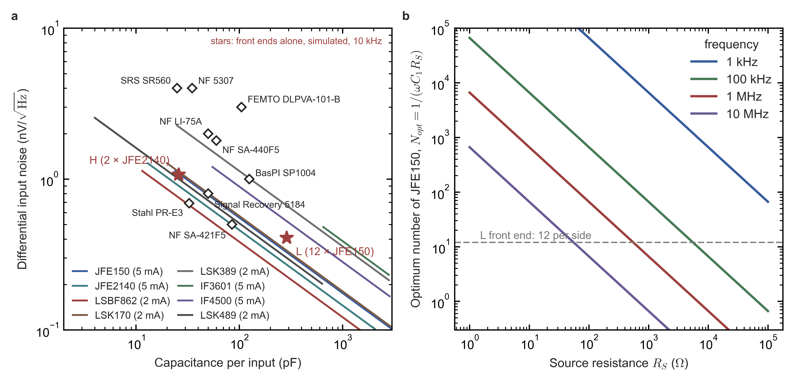

*Figure 1. (a) Differential input noise against the capacitance per input for paralleled JFETs of eight types at their data-sheet operating points (Eqs. (2) and (6), with the √2 of a differential input), the commercial instruments of Table 2 (diamonds: their specified $e_n$ and input capacitance; the FEMTO DLPVA-101-B at its differential 3.0 nV/√Hz, the Stahl PR-E3 with its two single-ended channels connected in parallel, 0.69 nV/√Hz at 2 × 16.4 = 32.8 pF, data sheet v3.12 p. 5) and the two new front ends (stars: the front end alone, simulated at 10 kHz, 1.07 nV/√Hz for H and 0.41 nV/√Hz for L, `sim/results/curves_noise.npz`, plotted at the JFETs' own 26 and 288 pF; with the input network the effective input capacitance is 20 pF for H and 250 pF for L, `sim/results/zin_numbers.json`). (b) The optimum number of JFE150 per input against the source resistance at four frequencies, Eq. (4).*

### 1.5 What else adds noise in a feedback front end

Everything between the JFETs and the output adds its own noise, divided by the gain that precedes it. In the current-feedback front end of this note (Section 4.2) the gain-setting resistor $R_G$ sits directly between the two source nodes, so its thermal noise $\sqrt{4kTR_G}$ appears at the input almost in full, with the weight $(G-1)/G$ of Eq. (9): $\sqrt{4kTR_G}$ is 0.41 nV/√Hz for H's 10.1 Ω and 0.20 nV/√Hz for L's 2.49 Ω. It is the second-largest contributor in both, after the JFETs. The drain resistors $R_D$ that supply the JFETs' current inject their current noise $\sqrt{4kT/R_D}$ into the summing node. The loop must cancel it with a JFET current, which moves the source node by $\sqrt{4kT/R_D}/g_m$. The same current must also flow through $R_F$, and the gain refers that to the input as $\sqrt{4kT/R_D}\,R_F/G \approx \sqrt{4kT/R_D}\,R_G/2$, per side. The loop op amps' input current noise does the same, and so does their voltage noise wherever it drives a capacitance at the summing node, $e_{n,A}\,\omega C_{node}$. Spinelli and Haberman (2024, Eqs. (16)–(18)) keep only the $1/g_m$ part of this weight (Section 4.2, Eq. (9), and Figure 6b). These terms favour a large total $g_m$, i.e. many JFETs at high current, and a small $R_G$. A resistor that sets a current $I$ with a voltage $V$ across it, like $R_D$, has a noise current $\sqrt{2V_T/V}$ times the shot noise of that current (Eq. (12a)), so it wants a large voltage. Section 6.1 gives the simulated breakdown.

---

## 2. The benchmark: the SR560 and its peers

### 2.1 The SR560 read from its schematics

The SR560 (manual Rev. 3.1, schematics on PDF pp. 47–56) is a DC-coupled preamplifier with a gain of 1 to 50 000 (manual, printed p. 5), two first-order filters (6 dB/octave, data sheet p. 3) and a 50 Ω output (R438, 49.9 Ω, to J405 on sheet 560_4F, PDF p. 50). Its signal path, as read from sheets 560_1F to 560_4F, is:

- **Front end** (Figure 2): one NPD5564 dual JFET (U106, a 2N5564 pair) in a differential pair at about 4.5 mA per side, with 110 Ω source resistors (R113, R114) and 909 Ω degeneration (R115, R128) to the tail. A gain relay K102 joins the tops of R115 and R128 for a gain of 10 or leaves them apart for a gain of 2. An OP37 (U102) takes the difference of the two 499 Ω drain loads (R131, R117) and closes the loop to source B through R118 (1 kΩ), so the front end's gain is set by resistors, not by the JFETs' $g_m$. An LF411 (U103) servos the tail current so that the drains sit at the 6.2 V zener reference.
- **Gain stage U105**: an LT1028 at a gain of 10.09 behind a DG444-switched attenuator (taps 1, 0.501, 0.200).
- **Filter 1 and filter 2**: RC sections selected by 74HC4051 multiplexers, each buffered by an LF356 and followed by an OP37 at a gain of 5.23 with its own attenuator.
- **U402**: an LT1028 at a gain of 5.23 with an attenuator; then the vernier, an AD7528 multiplying DAC with an LF411; then the output stage U403 (OP37) driving an LM6321 buffer at a gain of 5.22, and a 49.9 Ω output resistor.

The front end is the classic "designs by the masters" circuit that *The Art of Electronics* discusses in its Section 8.6.4 (3rd ed., p. 512; the book's text could not be read for this note, so nothing here relies on it). Its noise comes from three places: the single JFET pair, the 220 Ω of source resistors in the differential path, and the drain loads and OP37 behind a modest gain.

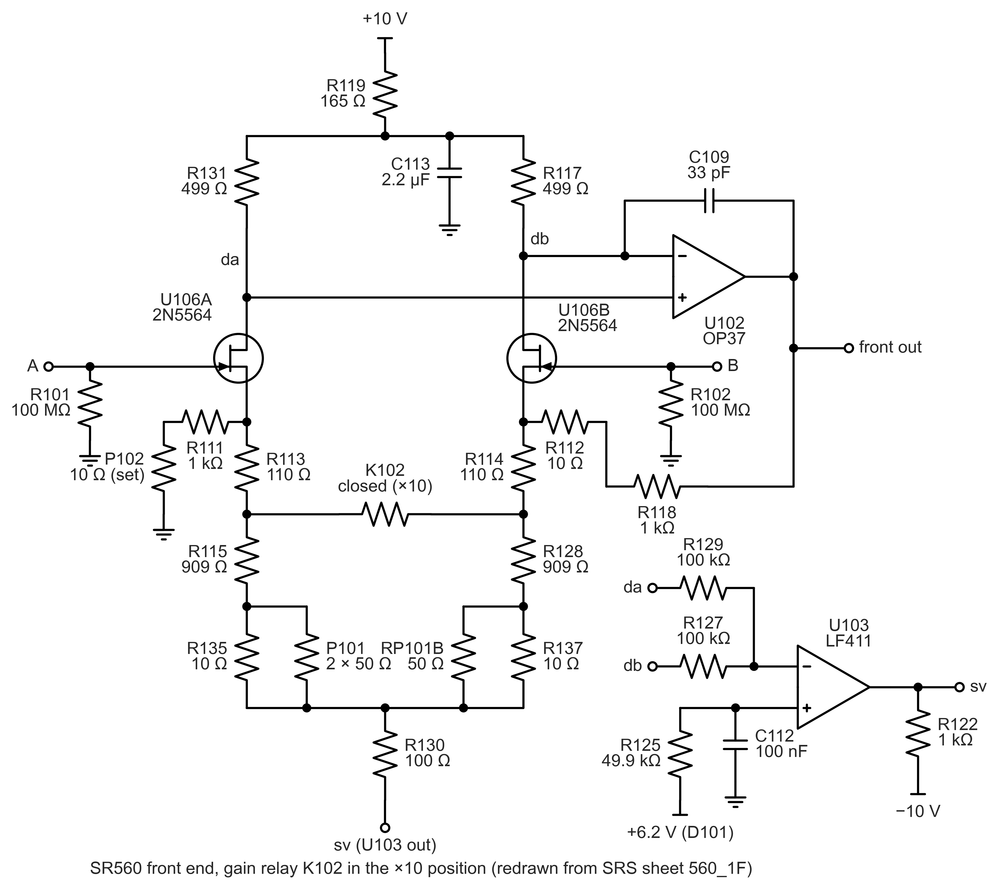

*Figure 2. The SR560's front end in the ×10 position of K102, redrawn from SRS sheet 560_1F and checked part by part against the simulated netlist (`scripts/sr560_frontend.py`). R120, R121, C108 (offset trim), R116, C116 (×2 path), C110 and R136 are in the netlist but not drawn.*

### 2.2 The SR560 reproduced in ngspice

The whole signal path was rebuilt as a netlist (`scripts/sr560_chain.py`), with the NPD5564 modelled by Linear Systems' 2N5564 card recalibrated to Vishay's 2N5564 data sheet (Section 3.4), the op amps as behavioural models with their data sheets' typical noise, bandwidth and slew rate, and the switches as their on-resistances. The gain allocation is not documented by SRS; the one used here (front end ×10 from a gain of 100 up in the low-noise mode, gain placed as late as possible in the high-reserve mode) reproduces the manual's table of noise against gain (Table 1).

*Table 1. The SR560 reproduction against its manual: input noise at 1 kHz (nV/√Hz) in the low-noise and high-reserve modes. Manual: the table on printed p. 21. Model: `sim/results/sr560_chain.json`, with its white level (100 kHz) for the low-noise mode.*

| Gain | 1 | 2 | 5 | 10 | 20 | 50 | 100–50 000 |
|---|---|---|---|---|---|---|---|
| Low noise, manual | 60 | 40 | 25 | 13 | 11 | 10 | 4 |
| Low noise, model, 1 kHz | 52 | 36 | 17 | 11.5 | 9.9 | 9.4 | 5.7 |
| Low noise, model, 100 kHz | 51 | 35 | 16 | 10.4 | 8.7 | 8.2 | 3.2 |

| Gain | 10 | 20 | 50 | 100 | 200 | 500 | 1000 | 2000 |
|---|---|---|---|---|---|---|---|---|
| High reserve, manual | 25 | 25 | 25 | 20 | 18 | 15 | 15 | 10 |
| High reserve, model, 1 kHz | 35 | 25.5 | 22 | 19.9 | 16.6 | 16.4 | 9.4 | 9.4 |

The model is within 30 % of the manual in 11 of the 15 columns ($e_\mathrm{model}/e_\mathrm{manual} - 1$, `scripts/numbers_s1_3.py`); the exceptions are the low-noise gain of 5 (−32 %) and gains of 100 and above (+43 to +44 %), and the high-reserve gains of 10 (+40 %) and 1000 (−37 %). At the gains of 100 and above, the model gives 5.7 nV/√Hz at 1 kHz and 3.2 nV/√Hz white, against the manual's "about 4 nV/√Hz" (the noise of a 1 kΩ resistor, printed p. 20) and the typical curve on the same page, which shows about 5 nV/√Hz at 1 kHz. Below 100 Hz the model is noisier than the SR560's typical curve: 48 against 11 nV/√Hz at 10 Hz (Figure 3b). The reason is the transistor model. The only 2N5564 noise curve available, Vishay's (70254 Rev. E, p. 5), has an excess noise with a corner of 5–15 kHz (where the curve is √2 times its 100 kHz level: about 5 kHz at 10 mA and 15 kHz at 1 mA, read by eye, `refs/datasheets/jfet/survey_InterFET_NXP_others.md` Section 3.1) that is not 1/f-shaped, so the KF fitted at 1 kHz extrapolates too steeply to low frequencies; SRS's NPD5564 lots evidently have less excess noise. The benchmark comparison is therefore made at 1 kHz and in the white region.

The front end's noise at 1 kHz splits into its JFETs (5.1 nV/√Hz), R113 + R114 (1.7), the drain loads (1.4), the OP37 (1.1) and the feedback and offset resistors (0.4 each); with the gain of 10.16 that the model reproduces, the white floor is 3.2 nV/√Hz. Its −3 dB bandwidth is 2.44 MHz, and the CMRR with ideal matching is 102.6 dB at 1 kHz (`sim/results/sr560_frontend.json`).

The chain's −3 dB bandwidth is 0.73–0.79 MHz at every gain (Figure 3c), against 1 MHz at 1 Vpp output in the manual (printed p. 5) and 1.2 MHz typical in the data sheet (p. 3). The shortfall lies in the op-amp models' high-frequency response as a whole, not in the LF356 and LF411 alone: making those two ten times faster gives 0.92–0.96 MHz, while giving every op amp the open-loop gain and phase of its data sheet gives 1.36–1.52 MHz, consistent with the SR560's 1 MHz (`scripts/sr560_bw_check.py`, `sim/results/sr560_bw_check.json`; the open-loop curves fitted to the data sheets' gain and phase plots: OP37 TPC 18, p. 8; LT1028 G20, p. 8; LF356 Fig. 26, p. 12; LF411 Fig. 11, p. 7). With ideal op amps the passive networks, mostly R229 and C201 at U201, take 1.4 dB at 0.73 MHz and leave 1.11–1.14 MHz. Three details of the netlist differ from the schematics: C406 (82 pF across U403, sheet 560_4F) and R422 (4.22 kΩ from U402's inverting input to the offset-cancellation output) are missing, and the parts list gives C301 as 47 pF where the schematic draws, and the netlist uses, 6.8 pF (manual PDF pp. 35–36 and 50). With C406 added and C301 at 47 pF, the data-sheet op amps give 1.04–1.16 MHz; R422 changes U402's gain, which the vernier's calibration absorbs, not the bandwidth. The CMRR of the reproduced chain with ideal matching is 105, 102.5, 86.5, 67.7 and 61.6 dB at 10 Hz, 1 kHz, 10 kHz, 100 kHz and 1 MHz (`sim/results/sr560_chain.json`), against a specification falling at 6 dB per octave above 1 kHz from more than 90 dB in the manual (printed p. 5) or from 100 dB in the data sheet (p. 3, at a gain of 100 in the low-noise mode).

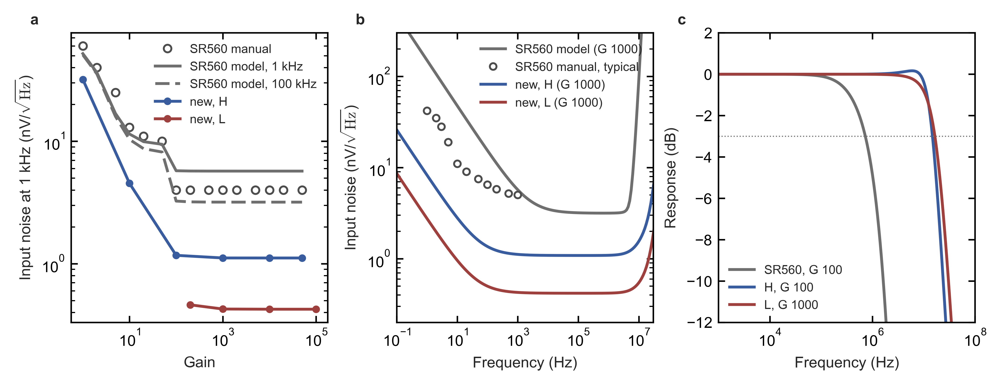

*Figure 3. The benchmark. (a) Input noise at 1 kHz against gain: the SR560's manual (circles), its reproduction at 1 kHz and 100 kHz, and the new design's H and L inputs. (b) Input noise spectra at a gain of 1000, with the SR560 manual's typical curve (printed p. 20, read by eye). (c) Frequency response at a gain of 100 (SR560 and H) and 1000 (L), normalised at 1 kHz.*

### 2.3 What limits the SR560, and what a successor can change

Three choices set the SR560's floor, and each can be changed today:

1. **One JFET pair.** A single 2N5564 pair at 4.5 mA gives 1.28 nV/√Hz white per device, $\sqrt2 \times 1.28$ = 1.8 nV/√Hz differential (the model's targets: 1.28 nV/√Hz white and 3.6 nV/√Hz at 1 kHz, set by eye between Vishay's 1 mA and 10 mA curves, 70254 Rev. E p. 5; log–log interpolation to 4.5 mA gives 1.25–1.28 and 3.42–3.44, `sim/results/jfet_model_check.json`). Paralleled modern JFETs give 0.9 nV/√Hz differential ($\sqrt2 \times 0.9/\sqrt2$) with two JFE2140 halves per side (H) and 0.33 nV/√Hz ($\sqrt2 \times 0.8/\sqrt{12}$) with twelve JFE150 per side (L), by Eq. (2) and the data sheets' 0.9 and 0.8 nV/√Hz at 5 mA (Table 3; `scripts/noise_theory.py`).
2. **Resistors in the differential path.** R113 and R114 (2 × 110 Ω) add 1.7 nV/√Hz. In the current-feedback topology of Section 4.2, the only resistor in the differential path is $R_G$, 10.1 Ω (H) or 2.49 Ω (L).
3. **Bandwidth.** The SR560's 1 MHz is set by its LF356 buffers, LT1028 and OP37 stages; current-feedback and fast voltage-feedback op amps raise it 15- to 25-fold (14.82–25.0 MHz for this design's chain at its gains, `sim/results/chain_ac.json`).

### 2.4 Commercial instruments and the remembered NF amplifier

Table 2 collects the commercial voltage preamplifiers found in the survey (`refs/commercial_preamps/survey.md`, with the document and page of every figure).

*Table 2. Commercial voltage preamplifiers (specified or typical values from their documents; $C_{in}$ per input as connected). This design: Sections 4 and 6, `scripts/numbers_s1_3.py`.*

| Instrument | $e_n$ (nV/√Hz) | $C_{in}$ (pF) | Band | Coupling | Note |
|---|---|---|---|---|---|
| SRS SR560 | 4 | 25 | DC–1 MHz | DC | 1 kHz, gains ≥ 100 |
| NF 5307 | 4 | < 35 | DC–10 MHz | DC | specification (1 kHz, gain 1000); about 3 (2.8–3.1) in NF's plot at a gain of 100 |
| NF SA-440F5 | 1.8 | 60 | DC–20 MHz | DC | |
| NF SA-421F5 | 0.5 | 85 | 30 Hz–30 MHz | AC | |
| NF LI-75A | 2 | 50 | DC–1 MHz | DC | |
| FEMTO DLPVA-101-B | 2.0 (3.0 differential) | 105 | DC–100 kHz | DC | |
| Signal Recovery 5184 | 0.8 | 50 | 0.5 Hz–1 MHz | AC | |
| Stahl PR-E3 | 0.69 | 32.8 | 0.5 kHz–4 MHz | AC | both channels tied, 2 × 16.4 pF (data sheet v3.12, p. 5) |
| BasPI SP1004 | 1.0 | 125 | DC–1 MHz | DC | |
| **This design, H** | **1.08** | **20 (network; 26 pF of JFETs, bootstrapped)** | **DC–14.82 MHz** | **DC** | **gain ≥ 1000** |
| **This design, L** | **0.42** | **250 (network; 288 pF of JFETs)** | **DC–16.5 MHz** | **DC** | **quieter than H below 96 Ω (10 MHz) to 70 kΩ (10 Hz) of source** |

The DC–10 MHz NF differential amplifier with a 2SK389-class input that was remembered from the 1980s, and remembered as measuring about 3 nV/√Hz (a recollection; no document found), matches the NF 5307 in every attribute found except its date. The 5307 is DC–10 MHz, differential, FET-input by NF's own comparison chart, specified at 4 nV/√Hz typical (1 kHz, gain 1000; NF's specification sheet) and plotted at about 3 nV/√Hz (2.8–3.1, read by eye) at a gain of 100 (manual Fig. 4.7, PDF p. 37), with an input capacitance below 35 pF (33 pF typical; manual Section 3.2.1, PDF p. 21). Its earliest date found is the 1998 copyright of its manual; no NF document names its input transistor (survey Section 1.2). Either the remembered unit is the 5307 or an undocumented predecessor. In either case its noise, about 3–4 nV/√Hz, is the figure to beat. The H input beats it by a factor of $2.8/1.08$ to $3.1/1.08$ = 2.6–2.9 against the plotted white noise and $4/1.11$ = 3.6 against the specification at 1 kHz, at a similar input capacitance; the L input by $2.8/0.42$ to $3.1/0.42$ = 6.7–7.4 and $4/0.43$ = 9.3, at a larger one (gain 1000, `scripts/numbers_s1_3.py`).

---

## 3. Choosing JFETs today

### 3.1 The parameters, and how to use them

A JFET for a low-noise front end is chosen from its data sheet in this order:

1. **$e_n$ against $I_D$** (the noise curve or table at the drain current the board can afford). The white level falls as $I_D^{-1/4}$ (Eq. (1)) until the gate and source resistances take over; read it at the planned current, not at the data sheet's headline point.
2. **$C_{iss}$ and $C_{rss}$ at the planned $V_{DS}$.** $C_{iss}$ enters the $e_nC$ term of Eq. (3) and the capacitance budget of Eq. (6); $C_{rss}$ is multiplied by the voltage gain to the drain unless the drain is cascoded, and it is the part of the input capacitance that a cascode alone cannot remove. Data sheets quote $C_{iss}$ at different biases ($V_{GS}$ = 0 for the LSK389 and LSBF862, 100 µA and 500 µA for the LSK170 and LSK489, $V_{DS}$ = 5 V for the JFE150 and JFE2140 and 2 V for the JFE2325; their p. 2 or p. 5, and item C13 of `refs/datasheets/jfet/survey_TI_LIS_Toshiba_onsemi.md`), so cross-vendor comparisons need care.
3. **The figure of merit $e_1\sqrt{C_1}$** (Eq. (6)), computed from items 1 and 2: the lower it is, the less noise per unit of input capacitance. For a fixed total current instead of a fixed capacitance, the figure is $e_1\sqrt{I_D}$.
4. **The 1/f noise**, as the density at 10 Hz or the corner frequency. TI gives 10 Hz values in its tables; Linear Systems gives them for some parts.
5. **The gate current at the planned drain voltage.** Read the $I_G$ against $V_{DG}$ curves, not $I_{GSS}$: impact ionization raises $I_G$ by orders of magnitude above a part-specific voltage (about 6 V for the TI parts: SLPS732B Fig. 6-5, SLPS730B Fig. 6-6). A cascode that holds $V_{DS}$ at 3–5 V keeps it in the picoampere range (about 1 pA in the same figures).
6. **$I_{DSS}$ and $V_{GS(off)}$ ranges.** The operating current must lie well below the lowest $I_{DSS}$ of the grade; the $V_{GS(off)}$ spread sets how much binning paralleled parts need (Section 4.6). Matched duals specify $\lvert V_{GS1} - V_{GS2}\rvert$ (JFE2140: 4 mV maximum and 10 µV/°C maximum drift, 1 mV and 1.7 µV/°C typical; SLPS730B p. 5), which sets the differential offset and its drift.
7. **Availability and package.** Several of the best historical parts (2SK170, 2SK369, BF862) are discontinued; second sources (LSK170, LSBF862, IF170) exist for some.

### 3.2 The survey

Table 3 and Figure 4 summarise the survey (`refs/datasheets/jfet/survey_*.md`, with the document, page and figure of every value).

*Table 3. Low-noise JFETs: typical data-sheet values (maxima where marked max). $e_n$ at 1 kHz (or the white level where stated) at $I_D$; $e_n$ at 10 Hz (at $I_D$ unless stated); $C_{iss}$ at the data sheet's conditions; figure of merit $e_n\sqrt{C_{iss}}$ in nV·√pF/√Hz (`scripts/jfet_data.py`, `sim/results/jfet_table3.json`).*

| Part | Vendor | Status | $e_n$ | $I_D$ (mA) | $e_n$ 10 Hz | $C_{iss}$ (pF) | FOM | Note |
|---|---|---|---|---|---|---|---|---|
| LSBF862 | Linear Systems | active | 0.8 | 2 | 1.4 | 11.5 | 2.7 | single; $e_n$ at 10 kHz |
| BF862 | NXP | discontinued | 0.8 | $I_{DSS}$, 10–25 | – | 10 | 2.5 | single; at 100 kHz and $V_{GS}$ = 0 (NXP p. 4) |
| JFE2140 | TI | active | 0.9 | 5 | 2.4 (2 mA) | 13 | 3.2 | matched dual |
| LSK489 | Linear Systems | active | 1.8 | 2 | 3.5 | 4 | 3.6 | dual, low capacitance |
| JFE150 | TI | active | 0.8 | 5 | 1.8 | 24 | 3.9 | single; $C_{iss}$ at 5 V |
| JFE2325 | TI | active (new) | 4.3 | 0.385 ($I_{DSS}$) | – | 0.85 | 4.0 | dual, self-biased; $e_n$ at 10 kHz, gate grounded |
| LSK170 | Linear Systems | active | 0.9 | 2 | 1.4 | 20 | 4.0 | single |
| IF170 | InterFET | active | 1.0 | 2 | 1.70 (5 mA) | 20 max | 4.5 | 2SK170 type |
| 2SK170 | Toshiba | discontinued | 0.95 | 1 | – | 30 | 5.2 | |
| IF9030 | InterFET | active | 0.7 | 5 | – | 60 max | 5.4 | |
| IF150 | InterFET | active | 3.4 | 0.5 | 5.5 | 2.9 | 5.8 | low capacitance |
| IF4500 | InterFET | active | 0.85 | 5 | 1.1 | 55 | 6.3 | $C_{iss}$ off its curve at $V_{GS}$ = 0, 10 V (table: 35 max) |
| 2SK369 | Toshiba | discontinued | 0.78 | 3 | – | 75 | 6.8 | |
| LSK389 | Linear Systems | active | 1.6 | 2 | 3.2 | 25 | 8.0 | dual; 1.17 measured in its app note (A-weighted, with the test amplifier's second stage; Cordell Rev. A4, Table 1, p. 5) |
| IF3601 | InterFET | active | 0.34 | 5 | 0.60 | 650 | 8.7 | IF3602 dual |
| 2N5564 | Vishay | discontinued | 3.9 | 2 | 12 | 10 | 12 | SR560's NPD5564; at 1 kHz |
| U401 | Vishay | discontinued | 4.3 | 0.2 | 10 | 4 | 8.6 | dual |

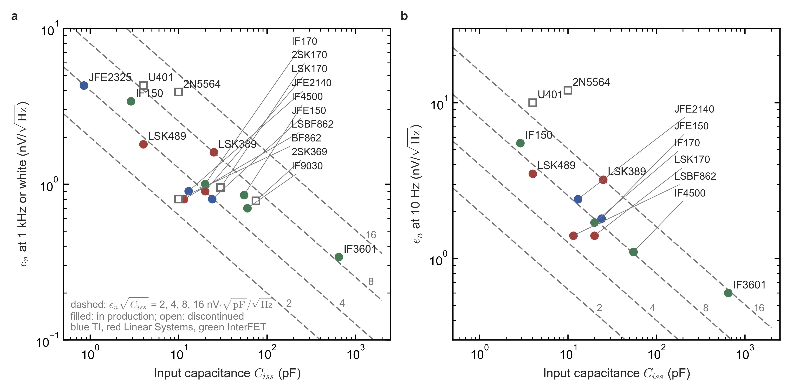

*Figure 4. The surveyed JFETs: (a) $e_n$ at 1 kHz or white, (b) at 10 Hz, against $C_{iss}$. Dashed lines: constant $e_n\sqrt{C_{iss}}$; paralleling moves a part along such a line (arrow direction: $N$ devices give $e_n/\sqrt N$ at $NC$). Filled: in production; open: discontinued.*

### 3.3 What is better than the LSK389

On data-sheet values the LSK389 has a figure of merit of 8.0 ($1.6\sqrt{25}$; 5.85 with the 1.17 nV/√Hz measured in Cordell's application note, Table 1, p. 5, A-weighted with the test amplifier's second stage). Parts that are better by a factor of 1.79–2.95 per unit of capacitance on data-sheet values (1.31–2.16 against the measured 1.17; `sim/results/jfet_table3.json`), all in production:

- **JFE2140** (TI, matched dual, 13 pF, 0.9 nV/√Hz at 5 mA, FOM 3.2). Two halves per side give $0.9/\sqrt2$ = 0.64 nV/√Hz per side at 26 pF (Eq. (2)), against about 1.17–1.6 nV/√Hz for one LSK389 half at 25 pF. Its matching (≤ 4 mV, ≤ 10 µV/°C; SLPS730B p. 5) suits a DC-coupled differential input. Its gate current rises above about 6 V of $V_{DS}$ (SLPS730B Fig. 6-6), so it needs a cascode. It is the H front end's device, and the same part Spinelli and Haberman (2024) used, two per side at 7 mA, in their current-feedback amplifier of 0.9 nV/√Hz at 1 kHz (their Table 1, p. 2), designed for DC–100 kHz (their Section III, p. 4).
- **JFE150** (TI, single, 24 pF at 5 V, 0.8 nV/√Hz at 5 mA, FOM 3.9, 1.8 nV/√Hz at 10 Hz). The L front end's device: cheap, in SOT-23, with the best 1/f among the active TI parts.
- **LSBF862** (Linear Systems' BF862 second source, 11.5 pF, 0.8 nV/√Hz at 2 mA, FOM 2.7). The lowest figure of merit, used here as the cascode device; as an input device it suits the smallest capacitance budgets, but it is a single, not a matched dual.
- **LSK170 / IF170** (2SK170 types, FOM 4.0–4.5, the IF170's with its maximum $C_{iss}$) and **LSK489** (4 pF, FOM 3.6, low $C_{rss}$: 2 pF typical in its data sheet, p. 2, and 1.5 pF in Cordell's application note, p. 2).

For the lowest absolute noise regardless of capacitance, the IF3601/IF3602 (0.34 nV/√Hz, 650 pF) remain unmatched per device, but they are no better per unit of capacitance than the LSK389 (FOM 8.7). Twelve JFE150 per side give $0.8/\sqrt{12}$ = 0.23 nV/√Hz per side and 0.33 nV/√Hz differential at 288 pF per input, against 0.34 and $\sqrt2 \times 0.34$ = 0.48 nV/√Hz at 650 pF for one IF3601 per side, and with lower 1/f per unit of capacitance: $1.8\sqrt{24}$ = 8.8 against $0.60\sqrt{650}$ = 15.3 nV·√pF/√Hz at 10 Hz (`scripts/numbers_s1_3.py`): the L front end is in effect a modern IF3601 built from twelve small parts.

TI's newest part, the **JFE2325** (dual, 0.85 pF, 4.3 nV/√Hz at 10 kHz with the gate grounded, i.e. at $I_{DSS}$, 0.385 mA typical, SLPS816A p. 5; self-biased gate), is aimed at high-impedance sensors and has a figure of merit of 4.0, as good as the LSK170's. It is the part of choice for a third, ultra-low-capacitance input (a few pF), which this note does not develop.

### 3.4 Calibrating the JFET models

ngspice's JFET model gives the channel the thermal noise $8kTg_m/3$, the thermal noise of RS and RD, and KF flicker noise (its "standard thermal and flicker noise model", ngspice-46 User's Manual, Section 7.4.4, p. 154; the JFE150 card alone gives 0.7045 nV/√Hz at 5 mA in ngspice, and $\sqrt{4kT(2/(3g_m) + R_S)}$ = 0.7042 nV/√Hz with $g_m$ = 25.93 mS and RS = 4.2 Ω, `scripts/numbers_s1_3.py`). Each part was calibrated to its data sheet (`scripts/models.py`): a resistor RX in series with the gate is chosen so that the white noise at the data sheet's operating point equals the typical value, $R_X = (e_w^2 - e_m^2)/4kT$ with $e_m$ the card's own white noise; KF is chosen so that the noise at 10 Hz (or the data sheet's low-frequency point) equals the typical value, $K_F = (e_{lf}^2 - e_w^2)\,g_m^2 f_{lf}/I_D$; and CGS and CGD are solved from the data sheet's $C_{iss}$ and $C_{rss}$ at its bias (Table 4). The JFE2325's table gives no low-frequency value, so its KF is fitted, as the JFE2140's, at 10 Hz, to the gate-grounded curve of SLPS816A Fig. 5-24 (32 nV/√Hz, read by eye); the card's own KF has 3.2 times that curve's 1/f power. Figure 5 checks the JFE150 and JFE2140 against their data sheets' noise curves over two decades of current; `sim/results/jfet_model_check.json` checks every calibrated model at its calibration point, and the JFE2325 against Fig. 5-24 from 1 Hz to 100 kHz.

*Table 4. Calibration of the JFET models (data sheets' typical values; `sim/results/jfet_calibration.json`). The $C_{rss}$ targets of the JFE150 and JFE2140 are read from the pixels of SLPS732B Fig. 6-12 (p. 7) and SLPS730B Fig. 6-17 (p. 8) at 5 V: 4.13–4.18 and 3.91–3.94 pF, depending on the axis calibration, against the 4.1 and 3.9 pF used (`scripts/ti_plot_check.py`); read by eye, they had been taken as 4.5 and 4.2 pF.*

| Part | Card | RX (Ω) | KF (card → calibrated) | CGS / CGD (pF, at $V_{GS}$ = 0) | Targets |
|---|---|---|---|---|---|
| JFE150 | TI SLPM349I | 8.67 | 3.25e-18 → 3.50e-18 | 20.3 / 6.3 → 25.7 / 11.5 | 0.8 / 1.8 nV at 1 kHz / 10 Hz, 5 mA, 5 V; $C_{iss}$ 24, $C_{rss}$ 4.1 pF |
| JFE2140 | TI SLPM355 | 5.91 | 0.2e-18 → 2.90e-18 | 9.2 / 3.5 → 10.6 / 11.0 | 1.1 / 2.4 nV, 2 mA, 10 V; $C_{iss}$ 13, $C_{rss}$ 3.9 pF |
| LSBF862 | Linear Systems Rev 2 | 0 (clipped) | 8.75e-17 → 1.74e-18 | 8 / 3.5 → 10.5 / 14.3 | 0.8 / 1.4 nV, 2 mA, 8 V, achieved 0.90 / 1.46 (the card alone gives 0.90, and KF was fitted for 0.8); $C_{iss}$ 11.5, $C_{rss}$ 3.5 pF |
| 2N5564 | LTspice standard.jft | 46.8 | 6.786e-11 → 4.30e-16 | 9.76 / 8.67 → 7.7 / 10.0 | 1.28 nV white, 3.6 nV at 1 kHz, at the SR560's 4.5 mA and 5.5 V (set by eye between Vishay's 1 and 10 mA curves, 70254 Rev. E p. 5); $C_{iss}$ 10, $C_{rss}$ 2.5 pF at 15 V (p. 2) |
| JFE2325 | TI SLVMF24 | 143.1 | 40e-18 → 12.6e-18 | 0.65 / 0.30 → 0.75 / 0.20 | 4.3 nV at 10 kHz (p. 5) and 32 nV at 10 Hz (Fig. 5-24), gate grounded ($V_{GS}$ = 0: the card's $I_{DSS}$, 0.378 mA), 2.5 V; $C_{iss}$ 0.85, $C_{rss}$ 0.1 pF at 2 V |

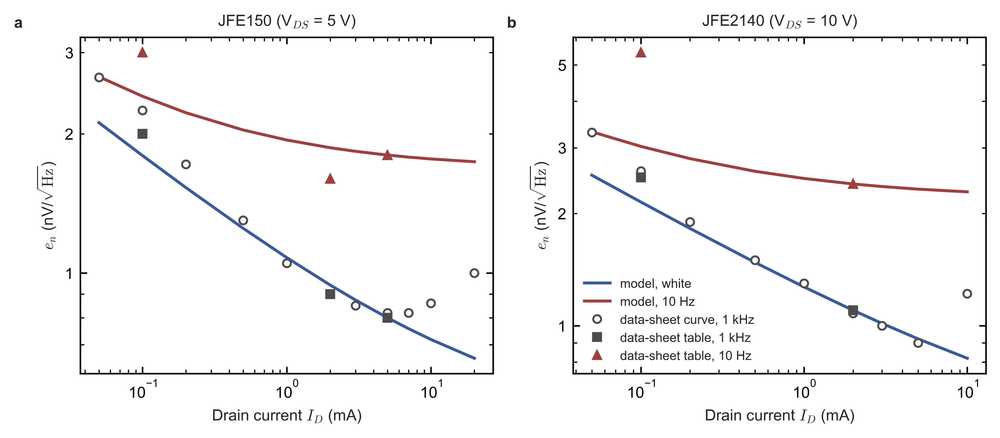

*Figure 5. The calibrated JFE150 and JFE2140 models against their data sheets (`sim/results/jfet_model_check.json`): white and 10 Hz noise against drain current, with the data sheets' noise curves (SLPS732B Fig. 6-11, SLPS730B Fig. 6-16, read by eye) and table values.*

The CGD values come out larger than the data sheets' $C_{rss}$ because ngspice's JFET keeps the junction grading exponent at 0.5 whatever M the card gives (its gate capacitances vary as the −1/2 power of the junction voltage, ngspice-46 User's Manual, Section 7.4.4, p. 153; its parameter table, p. 154, has no grading coefficient, and `scripts/models.py` removes the vendors' M), so a capacitance fitted at 5 V must be larger at zero bias. The calibration fits the two capacitances at the bias where the data sheet gives them, which is what matters for the circuit.

---

## 4. The new design

### 4.1 Overview

The preamplifier has two inputs, A and B, and measures A − B. A relay selects one of two front ends, H or L, which share everything downstream. The chain is:

1. **Input network** per input: the connector, relay and protection capacitance $C_P$, a damping network $R_Z$ + $C_Z$ to ground (Section 4.4), and a bias resistor to ground.
2. **Front end**, H or L (Section 4.2): differential gain 10 or 100 (H, by relay) or 201 (L); its two outputs follow the input's common mode.
3. **S2**, a unity-gain difference amplifier (LM7171, four 499 Ω resistors of a 0.01 % network), which removes the common mode.
4. **F1**, a first filter (off, or one RC section, low-pass or high-pass, buffered by a THS4031).
5. **S3**, a 249 Ω attenuator (taps 1, 1/2, 1/5, …, 1/100) and a THS4021 at a gain of 10.
6. **F2**, a second filter as F1.
7. **S4**, as S3.
8. **S5**, an attenuator (1, 2/5 or 1/5) and a THS3091 at a gain of 5, with 49.9 Ω in series to the 50 Ω output.

The total gain is

$$
G = G_{FE}\,(10\,a_3)\,(10\,a_4)\,(5\,a_5),
\tag{7}
$$

with $a_3$ and $a_4$ from the 1-2-5 set between 1 and 1/100. The allocation follows two rules (`scripts/chain.py`, `allocate`): the gain is put as early as possible, for the lowest noise, but no stage after the front end may run at a higher signal level than the output, so that nothing clips before the output does. In the low-noise mode H_LN the front end runs at 100 from a total gain of 100 up and at 10 below; in the high-reserve mode H_HR it stays at 10, giving $20\log_{10}(100/10)$ = 20 dB more headroom at the input for 2.3–2.5 times the noise at 1 kHz and 100 kHz, at total gains of 100 and 1000 (Table 9; `scripts/numbers_s4a.py`); L runs at 201 at every gain from 200 up.

*Table 5. The two front ends (`scripts/frontend.py`, `CASES`). The operating-point values come from `frontend.check_op`, collected with the JFET capacitances in `scripts/numbers_s4a.py` (`sim/results/numbers_s4a.json`).*

| | H (gain 10 / 100) | L (gain 201) |
|---|---|---|
| Input JFETs per side | 2 × JFE2140 (one half of each of two duals) | 12 × JFE150 |
| Drain current per JFET | 5 mA | 5 mA |
| $g_m$ per JFET at the operating point | 17.3 mS | 25.7 mS |
| $V_{GS}$, $V_{DS}$ | −0.36 V, 3.9 V | −0.56 V, 3.85 V |
| Cascode | LSBF862 per JFET, gate bootstrapped 3.5 V above the source node | the same |
| Bootstrap | $R_{BS}$ 3.5 kΩ ∥ $C_{BS}$ 1 µF, $I_{BS}$ 1 mA through $R_{UP}$ 10.9 kΩ from +15 V | the same |
| Summing node, $R_D$ | +9 V, 600 Ω from +15 V | +9 V, 100 Ω from +15 V |
| Loop op amp | THS4021 | THS4021 |
| $R_F$, $R_G$ | 500 Ω; 111 Ω (×10) or 10.1 Ω (×100) | 249 Ω; 2.49 Ω |
| $C_I$, $C_X$, $C_{node}$ | 13 / 1 pF (×10) or 9 / 5 pF (×100); 220 pF | 22 / 8 pF; 470 pF |
| Current sink | MMBT3904, $R_T$ 182 Ω (2 V) to −15 V | PZT3904 (SOT-223), $R_T$ 98.4 Ω (6 V, 1 W) to −15 V (Section 4.2.1) |
| Input network | $C_P$ 10 pF; $R_Z$ 2.2 kΩ + $C_Z$ 10 pF; 100 MΩ bias | $C_P$ 30 pF; $R_Z$ 47 Ω + $C_Z$ 220 pF; 10 MΩ bias |
| JFET capacitance per input, $NC_{iss}$ | 26 pF: 2 × 13 pF at $V_{DS}$ = 5 V (TI SLPS730B, p. 5); 25 pF in the model at the operating point | 288 pF: 12 × 24 pF at $V_{DS}$ = 5 V (TI SLPS732B, p. 5); 279 pF in the model |

### 4.2 The current-feedback JFET front end

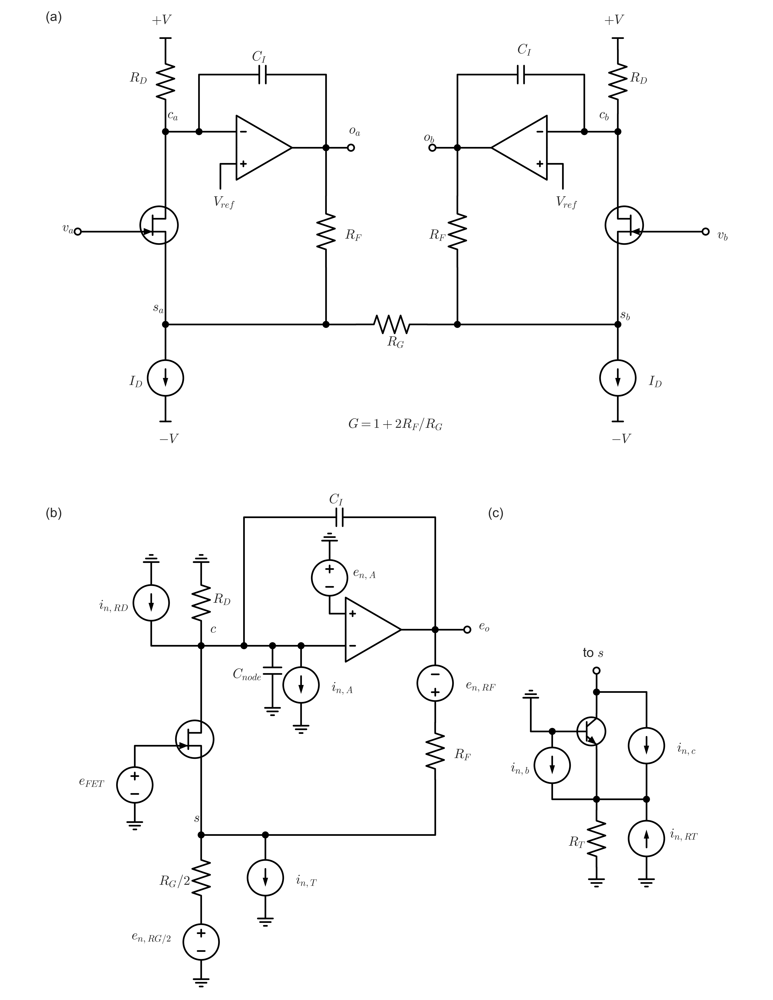

*Figure 6. The current-feedback topology, redrawn after Spinelli and Haberman (2024), Figs. 2 and 4, in this note's symbols. (a) Its basic form, both sides, one JFET per side. Each op amp holds its JFET's drain, the summing node $c$, at $V_{ref}$ by driving the source node $s$ through $R_F$, so the JFET's current, set by $R_D$, and with it $V_{GS}$ stay constant: the source follows the gate. The differential input then appears across $R_G$, and its current flows through both $R_F$, so $G = 1 + 2R_F/R_G$. $I_D$ is a DC current sink. Figures 7 and 8 show the front ends as built, with paralleled JFETs, cascodes and the bootstrap. (b) The differential half-circuit with the noise generators of Eq. (9). The supplies and $V_{ref}$ are AC ground, and in differential mode the midpoint of $R_G$ is a virtual ground, so each side sees $R_G/2$. The generators are: the JFETs' voltage noise $e_{FET}$; at the summing node, $R_D$'s noise current $i_{n,RD}$ and the op amp's current and voltage noise $i_{n,A}$ and $e_{n,A}$, the latter also driving $C_{node}$; at the source node, the sink's noise current $i_{n,T}$; and the noise voltages of $R_F$ and $R_G/2$. The current sink, $C_{node}$ and $i_{n,T}$ are additions to their figures. (c) A current sink's noise generators, which are not in their figures: the base current's shot noise $i_{n,b}$ from base to emitter, the collector current's $i_{n,c}$ from collector to emitter, and $R_T$'s thermal noise current $i_{n,RT}$. The base is held at AC ground by the servo's filter, so for noise the transistor is a common-base stage from its emitter node to the source node: $i_{n,b}$ and $i_{n,RT}$ pass in full, $i_{n,c}$ only in part (Eq. (12), Section 6.1).*

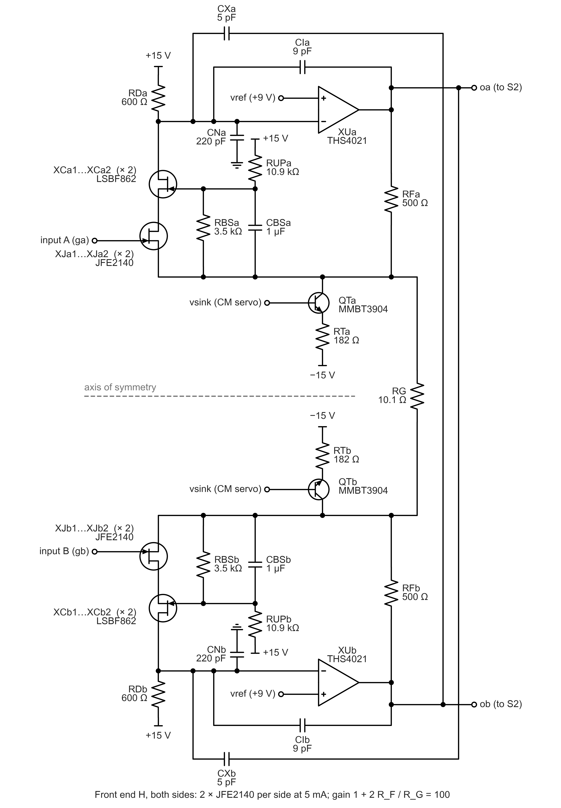{.tall}

*Figure 7. The H front end at a gain of 100, both sides. Side A (input A, top) and side B (input B, bottom) are mirror images about the dashed axis. The only parts that join them are $R_G$, between the two source nodes across the axis, and the cross-coupled capacitors: $C_{Xa}$ runs from output b to side A's summing node, and $C_{Xb}$ from output a to side B's (the two wires that cross without a dot on the right). Each side's two JFE2140 halves, one from each of two matched duals, and their two LSBF862 cascodes are drawn as one, with the count beside them. vref (+9 V) and vsink (the common-mode servo's output) are the same nets on both sides, and oa and ob lead to the difference amplifier S2. Drawn and checked part by part, value by value and pin by pin against the simulated netlist (`scripts/make_schematics.py`).*

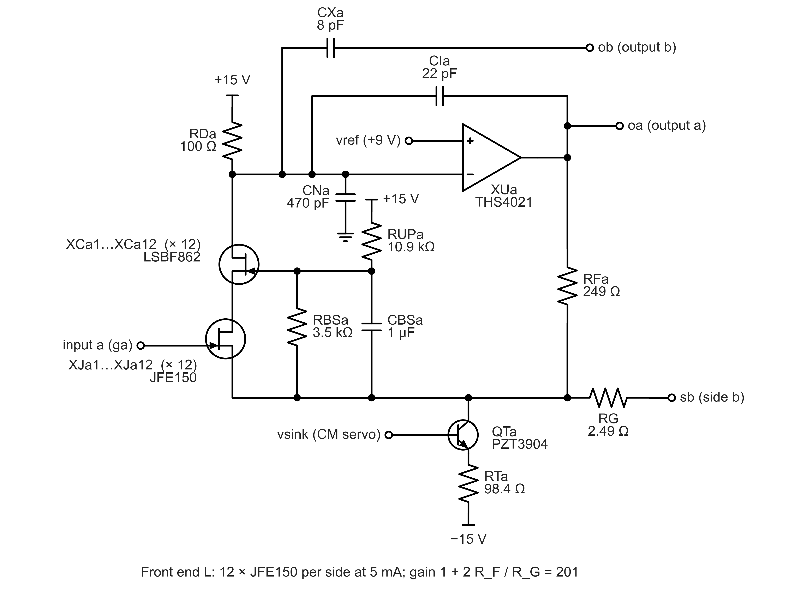

*Figure 8. Side A of the L front end, which has the same topology as H: twelve JFE150 and twelve LSBF862 cascodes per side. Side B is its mirror image as in Figure 7; ob and sb lead to it.*

The topology is the current-feedback instrumentation amplifier, in which each input device has its own loop (Figure 6a). Analog Devices introduced it in 1968 in its Model 601 data amplifier and later integrated it, beginning with the AD524 of 1983 (Spinelli and Haberman 2024, p. 2, citing Demrow 1968). It is built here with paralleled discrete JFETs (Spinelli and Haberman 2024 built it with JFE2140s for DC–100 kHz, p. 4). The two sides are identical and work independently, except through $R_G$ and the cross-coupled $C_X$ (Figure 7). Each side works as follows:

- **The JFETs' current is held constant.** The JFET drains, through their cascodes, feed the summing node $c$, which the op amp XUa holds at +9 V through its integrating capacitor $C_I$. $R_D$ from +15 V supplies the JFETs' DC current, 6 V / $R_D$, so the op amp carries only the signal. Since the summing node does not move, the integrator forces the JFETs' current to equal the current in $R_D$, at every frequency within the loop's bandwidth.
- **So the source follows the gate.** A constant drain current means a constant $V_{GS}$: the source node $s$ follows the input gate exactly, and the differential input voltage appears across $R_G$, which joins the two source nodes.
- **The op amp supplies $R_G$'s current through $R_F$.** The current $(v_A - v_B)/R_G$ in $R_G$ must come from the op amps' outputs through the two $R_F$, since the JFETs' current cannot change. The outputs therefore differ by

$$
v_{oa} - v_{ob} = \left(1 + \frac{2R_F}{R_G}\right)(v_A - v_B),
\tag{8}
$$

  which depends only on resistors, not on the JFETs' transconductance. The outputs also follow the input's common mode with unity gain; S2 removes it.
- **A current sink** (an NPN with $R_T$ to −15 V: an MMBT3904 for H, a PZT3904 for L) takes the JFETs' and the bootstrap's DC current out of each source node. A slow common-mode servo sets the two sinks' common base reference (below). The sinks dissipate 0.17 W per side for H and 0.96 W for L, which decides their parts and their layout (Section 4.2.1).

**The common-mode servo.** Each source node obeys Kirchhoff's current law,

$$
I_{sink} = N I_D + I_{BS} + I_{R_F},
\tag{8a}
$$

where the integrator fixes the JFETs' current $NI_D = (V_P - V_{ref})/R_D$ and $R_{UP}$ fixes the bootstrap current $I_{BS}$. Whatever the sink takes beyond these two must therefore come from the op amp through $R_F$, and the output sits at $v_o = v_s + R_F I_{R_F}$. Nothing else in the loop defines this DC level, and a sink is a current source of only modest accuracy. An error $\varepsilon$ moves the output by $\varepsilon\,(NI_D + I_{BS})\,R_F$: 1 % of H's 11 mA is 110 µA, which moves the output by 55 mV; in L's 61 mA sink it moves the output by 152 mV. In H, the sink's $V_{BE}$ falls by 1.7 mV/K (the MMBT3904 model at its operating point, `fe_closed_forms.json`), so its current rises by 1.7 mV / 2 V ≈ 0.09 % per kelvin; the outputs move by 4.9 mV per kelvin, in H and in L alike (the simulated drift of Section 4.6). An error of 3 %, an assumed figure, would put H's outputs 0.17 V and L's 0.46 V away from the sources.

The servo removes this error. It senses the common part of the DC voltage across the two feedback resistors,

$$
e = \tfrac12\left[(v_{oa} - v_{sa}) + (v_{ob} - v_{sb})\right] = \tfrac12 R_F\,(I_{R_F,a} + I_{R_F,b}),
\tag{8b}
$$

integrates it, and lowers or raises the sinks' common base reference (vsink in Figure 7) until $e$ = 0. The mean DC current in $R_F$ is then zero, and the outputs' mean sits at the sources' mean, $V_{S0}$ above the input's common mode: +0.36 V for H and +0.56 V for L. The sign is such that outputs above their sources (current flowing from the op amps into the source nodes) make the integrator lower the sinks' reference, so the sinks take less current.

What the servo does not do:

- **It does not correct a difference between the sinks.** It moves both sinks together. A mismatch $\Delta I$ between the two sinks' currents appears as a differential output offset $\Delta I\,R_F$: an assumed 0.05 % of 11 mA, 5.5 µA, gives 2.75 mV at H's outputs, 27.5 µV referred to the input. The offset trim of Section 4.6 removes it.
- **It does not act on signals.** An input common-mode signal moves the sources and the outputs together, so $e$ does not change. Its loop crosses over at about 0.4 Hz (below), far below any signal of interest.
- **Its noise moves both sinks together,** i.e. in common mode. S2 rejects it; only the sinks' mismatch converts a small part of it to a differential signal.

In the simulations the servo is ideal. $e$ drives a transconductance of 1 µS into 1 µF, which gives an integrator with unity gain at 1 µS/(2π × 1 µF) = 0.16 Hz, and its output sets vsink through 1 kΩ and 10 µF, a 1/(2π × 1 kΩ × 10 µF) = 16 Hz filter that keeps the integrator's noise from the sinks. A change of the base reference changes each sink's current by $\Delta V/R_T$ and each output by $(R_F/R_T)\,\Delta V$: 500 Ω/181.8 Ω = 2.75 V per volt for H, 249 Ω/98.4 Ω = 2.53 for L. The servo loop therefore crosses over at 2.75 × 0.16 Hz = 0.44 Hz for H (0.40 Hz for L), where the 16 Hz filter takes 1.6° of phase, leaving 88° of phase margin (`scripts/numbers_s4a.py`).

The servo's output must be limited, here to between $V_M$ + 1 V and $V_M + V_{RT}$ + 3 V: $V_M$ + 5 V for H and $V_M$ + 9 V for L. The sinks' bases sit at $V_M$ + 2.8 V in H and $V_M$ + 6.9 V in L (operating points in `sink_power.json`). Without the limit, ngspice also found a latched state in which the integrator had driven the sinks' bases above their collectors. In that state the sinks are saturated, raising the base no longer lowers the current, the loop's sign reverses, and the integrator stays at its limit. A build needs the same limit and a defined start-up state. It would use:

- a precision, low-offset op amp as the integrator, comparing the average of the two outputs with the average of the two source nodes;
- four equal resistors of about 100 kΩ for the two averages; they load the nodes negligibly, and each adds $\sqrt{4kT/100\ \mathrm{k\Omega}}$ = 0.4 pA/√Hz into a low-impedance source node;
- its output range limited by its supply or by a clamp, then the RC filter to the sinks' bases.

**Cascode and bootstrap.** Each JFET has its own LSBF862 cascode. The cascodes' gates sit at a bootstrap node held 3.5 V above the source node by $R_{BS}$ = 3.5 kΩ carrying $I_{BS}$ = 1 mA from $R_{UP}$, and bypassed by $C_{BS}$ = 1 µF. The input JFETs' $V_{DS}$ is therefore constant (3.9 V) whatever the input does. This does three things. It keeps $V_{DS}$ below the TI parts' impact-ionization threshold of about 6 V, so the gate current stays in the picoampere range (Section 1.1). It removes the Miller multiplication of $C_{gd}$. And, because the drain follows the gate, it removes $C_{gd}$ from the input altogether above the bootstrap's corner, $1/(2\pi R_{BS}C_{BS})$ = 1/(2π × 3.5 kΩ × 1 µF) = 45 Hz. A JFET cascode was chosen over an NPN because an NPN's base current (48 µA at 5 mA in the MMBTH10 model) has a shot noise that the bootstrap network turns into 0.26 nV/√Hz at the input (H at a gain of 100 with MMBTH10 cascodes, 10 kHz; `scripts/numbers_s4a.py`), while a JFET cascode has none.

**Why the summing node sits at +9 V.** The summing node's DC level is the top of a stack that starts at the input's common-mode voltage (`scripts/fe_closed_forms.py`):

- the source node sits $V_{GS}$ above the input: 0.36 V for H, 0.56 V for L (operating point);
- the bootstrap holds the input JFETs' drains $V_{DS,J}$ = 3.9 V above their sources, in both;
- the LSBF862 cascodes need $V_{DS,c,min}$ = 1 V. Their saturation voltage is $V_{DS,sat} = V_{GS,c} - V_{TO}$, with $V_{GS,c} = V_{TO} + \sqrt{I_D/\beta}$: 0.43 V at 5 mA from the card's $V_{TO}$ = −0.79 V and β = 26.6 mA/V². The rest of the 1 V is room for the signal.

The upper end of the input's common-mode range is therefore

$$
V_{CM,max} = V_{ref} - V_{GS} - V_{DS,J} - V_{DS,c,min},
\tag{8c}
$$

+3.7 V for H and +3.6 V for L. $R_D$, from +15 V, still has $V_P - V_{ref}$ = 6 V across it, and a large voltage across $R_D$ keeps its current noise $\sqrt{4kT/R_D}$ small for a given current (Section 1.5 and Eq. (12a)). The SR560 does the same with a shorter stack: its LF411 servo holds the 2N5564 drains at the 6.2 V zener reference, 5.4 V above the sources in its reproduction (Section 2), with no cascode and no bootstrap, and its OP37 works at that level. A lower summing node is possible only by giving up common-mode range or bootstrap voltage, which is the low-voltage op-amp option of Section 4.3.1, or with a folded cascode.

**Noise.** Adapting Spinelli and Haberman's (2024) Eq. (18), with $N$ JFETs per side,

$$
e_i^2 \approx \frac{2e_{FET}^2}{N} + 4kTR_G + 2\left(\frac{1}{Ng_m} + \frac{R_F}{G}\right)^2\left[\frac{4kT}{R_D} + i_{n,A}^2 + \left(e_{n,A}\,\omega C_{node}\right)^2\right] + 2\left(\frac{R_F}{G}\right)^2 i_{n,T}^2 + \frac{8kTR_F}{G^2}
\tag{9}
$$

where $i_{n,T}$ is the noise current of a source node's current sink (Eq. (12), Figure 6c); the cascodes and the bootstrap add small terms not written here. The first two terms dominate: at 10 kHz the JFETs give 0.94 nV/√Hz and $R_G$ 0.40 nV/√Hz for H at a gain of 100 (Table 6c), and 0.33 and 0.20 nV/√Hz for L (`sim/results/curves_noise.npz`). The next two are the noise currents that enter a summing node or a source node (Figure 6b):

- **A current $i$ entering the summing node** must be cancelled by a JFET current, which moves the source node by $i/(Ng_m)$. The same current must also flow through $R_F$, and the gain refers that to the input as $iR_F/G \approx iR_G/2$.
- **A current entering the source node**, such as the sinks', meets only the second part.

Both weights are small here, because $Ng_m$ is large (2 × 17.3 = 35 mS per side for H and 12 × 25.7 = 308 mS for L, Table 5) and $R_G$ is small. In the models each JFET's source resistance (8 Ω in the JFE2140 card, 4.2 Ω in the JFE150's) adds to its $1/g_m$, so that the effective $Ng_m$ is 30.2 mS for H and 277 mS for L; with it, Eq. (9) gives the weight that the simulated noise of $R_D$ shows to within 0.3 % (37.97 against 38.08 Ω for H at a gain of 100, `scripts/numbers_s4b_5.py`). For H at a gain of 100 the simulated contributions at 10 kHz are 0.28 nV/√Hz from $R_D$, 0.13 from the op amps and 0.08 from the sinks. They grow when the gain is lowered with a larger $R_G$ (Section 4.3.1, Table 6c).

Spinelli and Haberman's Eqs. (16)–(18) keep only the $1/g_m$ part. Solving their Fig. 4 for a current at the drain node gives $1/g_m + R_B/G_n$, where $R_B$ and $G_n$ are their names for $R_F$ and $G$. The second part, $R_B/G_n$ = 500 Ω/1001 = 0.50 Ω, is negligible against their $1/g_m$ ≈ 1/(30 mS) = 33 Ω, at their gain of 1001 with $R_A$ = 1 Ω and $R_B$ = 500 Ω (p. 5).

#### 4.2.1 The current sinks: heat, drift and the L design

Each source node's DC current, the JFETs' plus the bootstrap's, 11.0 mA per side for H and 61.1 mA for L, leaves through its sink to −15 V; with the sink's base current, $R_T$ carries $I_T$ = 11.1 mA and 61.9 mA (operating point, `scripts/numbers_s4a.py`). With $R_T = V_{RT}/(NI_D + I_{BS})$, the sink transistor and $R_T$ together dissipate, and the transistor's junction rises above ambient by,

$$
P_T + P_{RT} = (V_S - V_M)\,I_T, \qquad \Delta T_J = P_T\,R_{\theta JA},
\tag{9a}
$$

0.17 W per side for H and 0.96 W for L, whatever the design. A design only chooses where the heat goes (operating points from `scripts/sink_power.py`; Eqs. (9a)–(9c) in `scripts/fe_closed_forms.py`).

**The L sinks of the first design would not survive.** An MMBT3904 with 2 V across $R_T$ takes 0.84 W of the 0.96 W. The part is rated 225 mW on an FR-5 board at 25 °C, with $R_{\theta JA}$ = 556 K/W (onsemi MMBT3904LT1/D, Rev. 15, p. 1), so its junction would rise by 466 K. The H sinks, at 148 mW, are within the rating but rise by 82 K.

**The design for L** (Table 5a). The PZT3904 is the same die in SOT-223. Its data sheet lists the same electrical characteristics as the MMBT3904L's, so the simulated model still applies. It is rated 1.5 W at 25 °C, with $R_{\theta JA}$ = 83.3 K/W on FR-4 with 713 mm² of 1-oz copper on its collector tab (onsemi PZT3904T1/D, Rev. 7, pp. 1–2). More voltage across $R_T$ moves heat from the transistor into the resistor, at a cost in common-mode range, whose lower end the sinks set at

$$
V_{CM,min} = V_E + V_{CE,min} - V_{GS}, \qquad V_{CE,min} = 0.5\ \mathrm{V},
\tag{9b}
$$

with the sink's emitter at $V_E \approx V_M + V_{RT}$, and $V_{CE,min}$ a design margin above the data sheets' $V_{CE(sat)}$ of at most 0.2 V at 10 mA and 0.3 V at 50 mA, both with $I_B = I_C/10$ (onsemi MMBT3904LT1/D and PZT3904T1/D, p. 2). The design takes 6 V:

- **A PZT3904 with $R_T$ = 98.4 Ω (6.0 V) to −15 V.** The transistor dissipates 0.59 W, and its junction rises by 49 K on the data sheet's copper. $R_T$ dissipates 0.38 W: a 1 W part with low TCR, the two sides' from one batch.
- **The lower end of L's common-mode range moves from −13.0 V to −9.0 V.**
- **The drift per kelvin of temperature difference between the two sinks falls from 62 to 24 µV/K** (Section 4.6).
- **The loop margins, the bandwidth and the noise are unchanged.** The rejection of the −15 V rail falls by 2.0 dB at 1 kHz, to 120.3 dB, and by 3.6 dB at 1 MHz, to 98.4 dB.

If L needs more common-mode range, 4 V is the alternative: −11.0 V, with 0.71 W in the transistor and a rise of 59 K.

*Table 5a. Sinks for L (61.9 mA per side) with more voltage across $R_T$ (`scripts/sink_power.py`, `sim/results/sink_power.json`). Columns: the transistor's dissipation and its junction's rise in SOT-23 (556 K/W) and SOT-223 (83.3 K/W); $R_T$'s dissipation; the lower end of the common-mode range; the input-referred drift per kelvin of temperature difference between the two sinks; and the chain's rejection of the −15 V rail at a gain of 1000.*

| $V_{RT}$ | Transistor | Rise, SOT-23 / SOT-223 | $R_T$ | $V_{CM,min}$ | Drift | Rejection of −15 V, 1 kHz / 1 MHz |
|---|---|---|---|---|---|---|
| 2 V (first design) | 837 mW | 466 K / 70 K | 125 mW | −13.0 V | 62 µV/K | 122 / 102 dB |
| 4 V | 712 mW | 396 K / 59 K | 251 mW | −11.0 V | 34 µV/K | 121 / 99 dB |
| **6 V (this design)** | 587 mW | 326 K / 49 K | 377 mW | −9.0 V | 24 µV/K | 120 / 98 dB |
| 8 V | 461 mW | 256 K / 38 K | 503 mW | −6.9 V | 20 µV/K | 120 / 98 dB |

**Layout.** The SOT-223's tab is its collector, i.e. the source node. Its heat-spreading copper is therefore capacitance from the source node to ground, and a difference $\Delta C$ between the two sides converts common mode into a differential current with the weight $R_F/G$ of Eq. (9):

$$
C_{tab} = \frac{\varepsilon_0\varepsilon_r A}{d}, \qquad \mathrm{CMRR} \approx \frac{1}{\omega\,\Delta C\,R_F/G}.
\tag{9c}
$$

- **The capacitance** is 139 pF for the data sheet's 713 mm² over a ground plane $d$ = 0.2 mm below, with $\varepsilon_r$ = 4.4 (both assumed).
- **The loop does not mind.** With 300 pF on each source node, L's margins and bandwidth are unchanged (`python sink_power.py tab`), because the JFETs' own gate-source capacitance already sits there.
- **The common-mode rejection does.** 1 pF of difference limits it to 102 dB at 1 MHz in L, and to 90 dB in H at a gain of 100. The two tabs' copper must therefore be mirror images, matched to 0.7 % (1 pF of 139 pF), or the ground plane must be cut out beneath them.
- **The heat belongs away from the JFETs.** The sinks, their $R_T$, and L's $R_D$, which dissipates $(V_P - V_{ref})NI_D$ = 0.36 W per side, should sit away from the JFET array. The two sinks should sit side by side, so that they share one thermal environment.

### 4.3 The loops, and why the first version oscillated

**Two loops share the op amp.** Each op amp closes an outer loop through $R_F$, the source node and the JFETs, which sets the front end's bandwidth, and a local loop through its own feedback capacitance to its inverting input. With $R_F$ much larger than the source node's impedance, the outer loop gain in differential and common mode is

$$
T_{DM} \approx \frac{k_{DM}}{j\omega (C_I - C_X) R_F}, \qquad T_{CM} \approx \frac{1}{j\omega (C_I + C_X) R_F}, \qquad k_{DM} = \frac{g_m}{g_m + 2/R_G},
\tag{10}
$$

where $g_m$ is the total transconductance of one side and $C_X$ is a capacitor from each output to the other side's summing node. In differential mode the source node is loaded by $R_G/2$ to a virtual ground, so only the fraction $k_{DM}$ of the op amp's current reaches the JFETs; in common mode $R_G$ carries no current and all of it does. For H at a gain of 100, $k_{DM}$ = 0.15, so without $C_X$ the common-mode loop has $1/k_{DM}$ = 6.7 times the differential loop's gain, and it was unstable with the $C_I$ of 1.1 pF that the differential loop wanted (Figure 9a, d: phase margin −93° at 189 MHz). The cross-coupled $C_X$ subtracts from $C_I$ in differential mode and adds to it in common mode, so the two loops' crossovers can be equalised: $(C_I + C_X)/(C_I - C_X) = 1/k_{DM}$.

**The local loop.** The THS4021 is decompensated: it is stable only at gains of 10 V/V or more (TI SLOS265F, p. 1), i.e. at a noise gain of about 10 or more. Its local loop's feedback fraction at high frequency is $\beta = C_{fb}/(C_{fb} + C_{node})$, with $C_{fb} = C_I + C_X$ in common mode and $C_I - C_X$ in differential mode, and $C_{node}$ the summing node's capacitance to ground. In the first version ($C_I$ = 6.19 pF, $C_X$ = 4.42 pF, no added $C_{node}$), the summing node had only its own 10.1 pF (the cascodes' $C_{gd}$ and the op amp's input, $C_{par}$ of Eq. (10a)), so $\beta_{CM}$ = 10.61/(10.61 + 10.1) = 0.51. The outer loops had 72° and 77° of phase margin when broken at $R_F$, and the AC responses and noise spectra looked normal. But a transient run with the inputs quiet showed both outputs swinging 1.0 V peak to peak in common mode at 283 MHz with the inputs tied to ground through 1 mΩ, the bench of the first runs (293 MHz with 50 Ω sources and the input network; `sim/results/osc_check.json`). The return ratio taken at the op amp's output pin, which every loop passes through, showed why: a common-mode crossover at 452 MHz with −81° of phase margin (Figure 9b, e).

**The cure and its price.** A capacitor $C_{node}$ from each summing node to ground lowers $\beta_{CM}$ below 0.1: with 220 pF, to 14/(14 + 220 + 10.1) = 0.057 for H. In differential mode, however, the same capacitor lowers $\beta_{DM}$ to $(C_I - C_X)/(C_I + C_X + C_{node} + C_{par})$ = 4/244 = 0.016, and the op amp's local bandwidth $\mathrm{GBW}\cdot\beta_{DM}$ falls toward the outer loop's crossover, where it adds phase lag. Since $\beta_{DM}/\beta_{CM}$ is about $k_{DM}$ once the crossovers are equalised, the differential local bandwidth cannot exceed about $\mathrm{GBW}\cdot k_{DM}\cdot 0.1$. A scan of $C_I + C_X$, $C_I - C_X$ and $C_{node}$ (`scripts/comp_search.py`, about 120 sets) gave the values of Table 5 and the margins of Table 6. At a total gain of 100 the chain's bandwidth falls from 30.1 MHz with the first front end (`da_compare_before_cnode.json`) to 14.82 MHz (`chain_ac.json`); the front ends alone now reach 15 MHz (H at 100), 26 MHz (H at 10) and 17 MHz (L). The loop op amps' voltage noise, which now drives $C_{node}$, raises the noise above a few MHz: at 10 MHz it is 1.50 nV/√Hz for H and 0.50 for L, against white floors of 1.07 and 0.41 (Eq. (9), last term; `fe_gain_options.json`, `sink_power.json`). A transient run with the final values shows no oscillation (≤ 1 µV peak to peak at the outputs, `scripts/osc_check.py`; for L with trapezoidal integration, because Gear integration stops partway through, a numerical failure described in the Appendix); the same bench, 50 Ω sources and the input network, run with the first versions oscillated in common mode at 293 MHz with 1.0 V peak to peak (H) and at 276 MHz with 0.78 V (L).

*Table 6. Loop margins of the final front ends and of H's first version: the outer loop broken at $R_F$ (crossover, phase margin, gain margin) and the complete loop broken at the op amp's output pin (`scripts/collect_curves.py`, `loop`; `sim/results/curves_loop.npz`). Each crossover and its phase margin are read at the first point of the sweep past the crossing. L with its 6 V sinks (Section 4.2.1).*

| | Outer loop, DM | Outer loop, CM | At op-amp output, DM | At op-amp output, CM |
|---|---|---|---|---|
| H, gain 100 | 8.9 MHz, 61°, 21 dB | 21 MHz, 63°, 13 dB | 19.6 MHz, 60°, 19 dB | 59 MHz, 57°, 8.4 dB |
| H, gain 10 | – | – | 52 MHz, 62°, 9.8 dB | 59 MHz, 57°, 8.4 dB |
| L | 10.6 MHz, 66°, 19 dB | 20 MHz, 63°, 12 dB | 27 MHz, 63°, 17 dB | 59 MHz, 51°, 10 dB |
| H, first version | 21 MHz, 72° | 28 MHz, 77° | 90 MHz, 65° | **452 MHz, −81°: oscillates** |

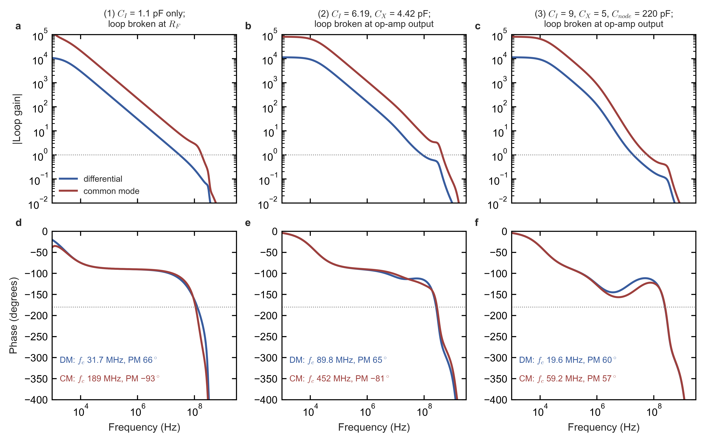

*Figure 9. The front end's compensation in three steps (H, gain 100): (a, d) without the cross-coupled capacitors ($C_I$ = 1.1 pF only, loop broken at $R_F$), the common-mode outer loop is unstable, −93° at 189 MHz; (b, e) with them but without $C_{node}$, the outer loops are stable but the op amp's own common-mode loop is not, −81° at 452 MHz, which only a loop broken at the op amp's output shows; (c, f) the final values. The crossovers and phase margins printed in (d)–(f) follow Table 6's convention (`scripts/make_figures.py`, from `curves_loop.npz`).*

The remaining common-mode gain margin, 8.4 dB for H and 10 dB for L where the phase crosses −180° (251 and 204 MHz, interpolated between the points of `curves_loop.npz`), depends on the THS4021 model's behaviour far above its specified bandwidth and on the layout's capacitance at the summing node. Section 4.3.1 examines how robust it is and what else could be done.

#### 4.3.1 Mitigations: making the front end's stability robust

An instability that the AC response, the noise analysis and a loop gain broken at $R_F$ all fail to show is the most dangerous kind, because every routine check of the design passes. This section collects what was done about it, how much margin the fix leaves, which other cures exist and what each costs, and the rules and bench tests that should catch such a mode in a future design or a built board.

**The root cause in one line.** A decompensated op amp (the THS4021 is stable at gains of 10 V/V or more, SLOS265F p. 1) closes its own local loop through its feedback capacitors. In common mode that loop's feedback fraction at high frequency is

$$
\beta_{CM} = \frac{C_I + C_X}{C_I + C_X + C_{node} + C_{par}},
\tag{10a}
$$

where $C_{par}$ is the summing node's own capacitance: the cascodes' $C_{gd}$ at their bias, 4.3 pF each ($V_{GD}$ = −5.0 V; the LSBF862 card's CGD = 14.3 pF and PB = 0.5 V in $\mathrm{CGD}/\sqrt{1 - V_{GD}/\mathrm{PB}}$, ngspice's grading exponent 0.5), and the THS4021's input capacitance of 1.5 pF (SLOS265F p. 7), 10.1 pF in all for H. With no added $C_{node}$, $\beta_{CM}$ was 10.61/(10.61 + 10.1) = 0.51, far above the 0.1 that the op amp tolerates (1/10, from its minimum stable gain). The cross-coupled $C_X$, introduced to tame the outer common-mode loop, is what makes the local common-mode feedback capacitance large. In differential mode the same capacitor subtracts, $\beta_{DM} = (C_I - C_X)/(C_I + C_X + C_{node} + C_{par})$. Once the two outer loops are equalised, $\beta_{DM}/\beta_{CM} \approx k_{DM}$ (Eq. (10)), so the local loop's differential bandwidth is at most about

$$
f_{local,DM} \approx \mathrm{GBW}\;k_{DM}\;\beta_{CM,\max} \approx 2\ \mathrm{GHz} \times 0.15 \times 0.1 \approx 30\ \mathrm{MHz}
\tag{10b}
$$

for H at a gain of 100, with the THS4021's gain–bandwidth product of 2 GHz (SLOS265F p. 1; `scripts/numbers_s4a.py`). This bound, not the JFETs, limits the front end's bandwidth once $C_{node}$ makes the common-mode loop stable. The adopted H values do not equalise the outer loops: their $D/S$ = 4/14 = 0.29 is about twice $k_{DM}$, which slows the differential outer loop (8.9 against 21 MHz, Table 6) and raises the differential local bandwidth to $\mathrm{GBW}\,\beta_{DM}$ = 2 GHz × 0.0164 = 33 MHz.

**How robust the adopted fix is.** Table 6a gives the complete loop's margins, broken at the op amp's output, for the final values and for corners of the parts and the layout (`scripts/stability_corners.py`). Alongside the phase and gain margins it gives the modulus margin $\min\lvert 1+T\rvert$: the closest approach of the return ratio to −1. Its inverse is the peak of the loop's sensitivity function, and this note takes 0.5 (a 6 dB peak) as its minimum for a robust loop, a design rule (rule 4 below). The weak corner is a smaller $C_{node}$: at 0.7 times its value, H keeps only 5.7 dB of common-mode gain margin and a modulus margin of 0.47. A larger $C_{node}$ only improves the common-mode loop, at a few degrees of differential phase margin. The differential margin is sensitive to $D = C_I - C_X$, a small difference of two larger capacitors (4 pF from 9 and 5 pF for H): 10 % errors in opposite directions bring it down to 43°.

*Table 6a. Complete-loop margins of the front ends at corners of the parts and the layout: phase margin, gain margin and modulus margin, in differential (DM) and common mode (CM) (`sim/results/stability_corners.json`; L with its 6 V sinks, as in Table 6).*

| Case | H ×100, DM | H ×100, CM | H ×10, DM | H ×10, CM | L, DM | L, CM |
|---|---|---|---|---|---|---|
| Nominal | 60°, 19 dB, 0.89 | 57°, 8.4 dB, 0.61 | 62°, 9.8 dB, 0.66 | 57°, 8.4 dB, 0.61 | 63°, 17 dB, 0.83 | 51°, 10 dB, 0.66 |
| $C_{node}$ × 0.7 | 64°, 16 dB, 0.84 | 58°, **5.7 dB, 0.47** | 63°, 7.0 dB, 0.54 | 58°, **5.7 dB, 0.47** | 66°, 14 dB, 0.78 | 50°, 7.6 dB, 0.54 |
| $C_{node}$ × 1.3 | 56°, 21 dB, 0.89 | 55°, 10.5 dB, 0.69 | 60°, 12 dB, 0.73 | 55°, 10.5 dB, 0.69 | 60°, 19 dB, 0.86 | 51°, 12 dB, 0.72 |
| $C_I$ × 1.1, $C_X$ × 0.9 | 69°, 16 dB, 0.85 | 58°, 8.2 dB, 0.60 | 64°, 8.7 dB, 0.63 | 58°, 7.6 dB, 0.58 | 67°, 15 dB, 0.79 | 52°, 9.9 dB, 0.64 |
| $C_I$ × 0.9, $C_X$ × 1.1 | **43°**, 23 dB, 0.72 | 56°, 8.6 dB, 0.62 | 59°, 11 dB, 0.70 | 55°, 9.0 dB, 0.64 | 55°, 19 dB, 0.87 | 51°, 11 dB, 0.67 |
| 10 pF at each op-amp output | 59°, 20 dB, 0.89 | 53°, 9.2 dB, 0.63 | 59°, 11 dB, 0.67 | 53°, 9.2 dB, 0.63 | 61°, 17 dB, 0.82 | 48°, 11 dB, 0.64 |

Three practical consequences follow for a build:

- $C_{node}$ should be placed at about 1.2–1.5 times the simulated value: the E12 values 270–330 pF for H (1.23–1.50 × 220 pF) and 560–680 pF for L (1.19–1.45 × 470 pF). At 330 pF and 680 pF the common-mode phase margins are 53° and 50° and the gain margins 11.7 and 13 dB (`comp_search_H100.json`, `comp_search_L200.json`). They should be C0G parts, placed right at the op amp's inverting input with a short return to the op amp's own supply-bypass ground. The layout's own capacitance at the summing node adds to $C_{node}$ and helps.
- $C_I$ and $C_X$ should be 1 % C0G parts. The layout's capacitance between the summing node and either output counts as part of them, so it must be small and symmetric. On a prototype, $D$ can be trimmed with a 0.5–2 pF trimmer while watching the differential step.
- A board should have footprints for the alternatives below (a resistor in series with $C_{node}$, an isolation resistor at each op-amp output) even if they are not fitted.

**Other cures, and what each costs.** Table 6b compares the adopted fix with the alternatives, each simulated with the same complete-loop check and, where it matters, the same noise and bandwidth runs (`sim/results/comp_search_*.json`, `stability_corners.json`, `fe_gain_scan.json`, `fe_gain_options.json`, `lv_option.json`).

*Table 6b. Ways to stabilise the H front end (gain 100 unless stated), against the adopted fix. Margins of the complete loop (phase, gain, modulus); bandwidth of the front end alone; noise of the front end alone.*

| Option | DM margins | CM margins | −3 dB | Noise: 10 Hz / white / 10 MHz | Costs |
|---|---|---|---|---|---|
| Adopted: $C_{node}$ 220 pF, $C_I$ 9, $C_X$ 5 pF | 60°, 19 dB, 0.89 | 57°, 8.4 dB, 0.61 | 15 MHz | 2.67 / 1.07 / 1.50 nV/√Hz | bandwidth halved (Section 4.3); noise above a few MHz |
| More $C_{node}$ (330 pF) | 52°, 22 dB | 53°, 11.7 dB | 14 MHz | not simulated; by Eq. (9), more above 1 MHz | less DM margin; a little more HF noise |
| Less bandwidth ($D$ = 5 pF) | 67°, 17 dB | 57°, 8.4 dB | 12 MHz | not simulated | bandwidth; does not change the CM margin |
| Isolation resistor of 33 Ω at each op-amp output | 56°, 22 dB, 0.88 | 49°, 11 dB, 0.70 | – | – | trades phase for gain margin; not a cure |
| Lower front-end gain, larger $R_G$ (×20: $R_G$ 52.6 Ω) + more gain after | 58°, 13 dB, 0.77 | 57°, 8.4 dB, 0.61 | 27 MHz | 3.09 / 1.44 / 2.14 nV/√Hz | +35 % white noise from $R_G$; CM margin unchanged |
| Lower front-end gain, larger $R_G$ (×30: $R_G$ 34.5 Ω) + more gain after | 56°, 15 dB, 0.82 | 57°, 8.4 dB, 0.61 | 26 MHz | 2.90 / 1.29 / 1.87 nV/√Hz | +21 % white noise; CM margin unchanged |
| Lower front-end gain, smaller $R_F$ (×20: $R_F$ 96 Ω; $C_I$, $C_X$, $C_{node}$ × 5.2) + more gain after | 50°, 22 dB, 0.81 | 42°, 11 dB, 0.57 | 16 MHz | 2.66 / 1.07 / 5.38 nV/√Hz | no bandwidth gained; noise above 1 MHz; less CM phase margin |
| Lower front-end gain, smaller $R_F$ (×30: $R_F$ 146 Ω; × 3.4) + more gain after | 54°, 21 dB, 0.85 | 47°, 10 dB, 0.62 | 16 MHz | 2.67 / 1.07 / 3.63 nV/√Hz | as above |
| **Low-voltage, unity-gain-stable op amp: ADA4899 on ±5 V** (summing node +3 V, bootstrap 1.2 V, $C_I$ 8.5, $C_X$ 5.5, $C_{node}$ 22 pF) | 59°, 34 dB, 0.90 | 50°, 20 dB, 0.75 | 19 MHz | 3.53 / 1.06 / 1.07 nV/√Hz | output swing (6.0 V differential at most) and common-mode range; two more rails; LF noise per the model (below) |

*A lower gain in the first stage* is the natural first idea. The gain $G = 1 + 2R_F/R_G$ can be lowered in two ways (`scripts/gain_options.py`). Neither cures the oscillation, because no common-mode current flows in $R_G$, so the common-mode loop is the same at every gain. Table 6c shows where the noise of each comes from.

- **A larger $R_G$, with $R_F$ fixed**, is what the ×20 and ×30 rows of Table 6b do. It raises $k_{DM} = g_mR_G/(2+g_mR_G)$ from 0.15 (gain 100) to 0.37 (gain 30) or 0.48 (gain 20). The cross-coupling can then shrink, and the front end's bandwidth nearly doubles, to 26–27 MHz. A following stage at a gain of $100/G$, 5 or 3.3, restores the total gain. The price is noise, and all of it comes from the larger $R_G$. At gain 20 the white floor rises from 1.07 to 1.44 nV/√Hz:
  - $R_G$'s own thermal noise, $\frac{G-1}{G}\sqrt{4kTR_G}$ = 0.89 against 0.41 nV/√Hz, is 66 % of the added noise power, counted as $(e_{x,20}^2 - e_{x,100}^2)/(e_{20}^2 - e_{100}^2)$ (`python gain_options.py derived`).
  - The noise currents of Eq. (9) are most of the rest. Their weight contains $R_F/G \approx R_G/2$, so the contributions of $R_D$ and of the op amps grow 1.52 times (11 % and 3 % of the added power). The current sinks', whose weight is $R_F/G$ alone, grow 4.99 times (16 %).
  - $R_F$'s own noise, $\sqrt{2\cdot 4kTR_F}/G$, is 0.20 against 0.04 nV/√Hz (4 %).
- **A smaller $R_F$, with $R_G$ fixed**, avoids that noise but gains nothing. At gain 20 ($R_F$ = 96 Ω) the white floor stays at 1.07 nV/√Hz. But $k_{DM}$ is unchanged, and so, nearly, is the bandwidth: 16 MHz against 15 MHz. It costs three things instead:
  - **Five times the compensation capacitance.** The outer loops' time constants $R_F(C_I \pm C_X)$ must stay as they are, so $C_I$ and $C_X$ grow by $500\ \Omega/R_F$ = 5.2 times. $C_{node}$ must grow with them to keep $\beta_{CM}$ below 0.1. Scale $C_I$ and $C_X$ alone, and the common-mode loop has −15° of phase margin.
  - **Noise above 1 MHz.** The op amp's voltage noise drives the fivefold $C_{node}$: 5.4 nV/√Hz at 10 MHz against 1.5 (3.6 at gain 30).
  - **Less common-mode phase margin:** 42° against 57°. Each output now drives 73 pF of $C_I + C_X$; the cause was not traced further.
- **The lever is $g_mR_G$**, and the noise-free way to raise it is more transconductance: more JFETs per side, at the cost of input capacitance (bootstrapped, but feeding Eq. (11)), current and board area.

None of these is needed here. The common-mode margin does not depend on the first stage's gain, and the gain-100 front end already reaches 15 MHz. The H front end's gain-10 range is the extreme of the $R_G$ route. It has $k_{DM}$ = 0.66, needs only 1 pF of cross-coupling and reaches 26 MHz. But its white floor is 1.9 nV/√Hz, of which $R_G$ (111 Ω) gives 1.22, the sinks 0.79 and $R_D$ 0.62 nV/√Hz (Table 6c). A range switch has to take the $R_G$ route all the same. A range exists to accept larger inputs, and at a full output swing $V_o$ each op amp drives about $V_o/R_F$ into its $R_F$, whatever $R_G$ is. With $R_F$ = 96 Ω that is 125 mA at 12 V, the THS4021's guaranteed swing into 250 Ω, against its guaranteed 80 mA (TI SLOS265F, p. 7).

*Table 6c. Where the white noise of the H front end comes from: input-referred contributions at 10 kHz, front end alone, in nV/√Hz (`scripts/gain_options.py`, `fe_gain_options.json`). The totals at 10 MHz also contain the op amps' voltage noise driving $C_{node}$.*

| Contributor | Gain 100 (adopted) | Gain 20, larger $R_G$ (52.6 Ω) | Gain 20, smaller $R_F$ (96 Ω) | Gain 10 range ($R_G$ 111 Ω) |
|---|---|---|---|---|
| Input JFETs | 0.94 | 0.94 | 0.94 | 0.94 |
| $R_G$ | 0.40 | 0.89 | 0.39 | 1.22 |
| $R_D$ (summing node) | 0.28 | 0.43 | 0.28 | 0.62 |
| Loop op amps (summing node) | 0.13 | 0.20 | 0.13 | 0.29 |
| Current sinks (source node) | 0.08 | 0.40 | 0.08 | 0.79 |
| $R_F$ | 0.04 | 0.20 | 0.09 | 0.40 |
| Bootstrap | 0.01 | 0.04 | 0.01 | 0.09 |
| Total at 10 kHz | 1.07 | 1.44 | 1.07 | 1.90 |
| Total at 10 MHz | 1.50 | 2.14 | 5.38 | 2.94 |

*A faster, unity-gain-stable, low-voltage op amp* removes the conflict at its root, but its low supply limits the output swing and the common-mode range (below), so it is an alternative only where those suffice. The ADA4899-1 is unity-gain stable with 600 MHz of bandwidth at a gain of +1, 1 nV/√Hz and 2.6 pA/√Hz, and 310 V/µs (Analog Devices' product page; its data sheet was not obtained). ADI's model, corrected for its 4 kΩ input resistor, has the same 1.0 nV/√Hz and 2.6 pA/√Hz white (`opamp_noise_check.json`). Because it is stable at any noise gain, its local loop needs no large $C_{node}$; 22 pF is enough to bring the common-mode phase margin to 50°. In simulation (H at a gain of 100, ADI's model):

- the common-mode gain margin is 20 dB against 8.4 dB, and the modulus margin 0.75 against 0.61;
- the front end reaches 19 MHz;
- the noise at 10 MHz stays at the white floor (1.07 against 1.50 nV/√Hz), since there is no large $C_{node}$ for the op amp's voltage noise to drive;
- a transient with quiet inputs shows no oscillation.

Its rails, ±5 V (5–12 V in total), are the price:

- **The summing node must sit within the op amp's input range** (±3.71 V in ADI's model on ±5 V, `lv_option_range.json`), so it moves from +9 V to +3 V. The bootstrap must shrink to keep the cascode working: 1.2 V instead of 3.5 V, giving the input JFETs 1.55 V of $V_{DS}$ instead of 3.9 V and the cascodes 1.1 V.
- **The output swing and the common-mode range shrink.** ADI's model swings ±3.34 V into $R_F$ on ±5 V, and the outputs sit at $V_{CM}$ + 0.35 V ± half the differential output, so the front end delivers at most 2 × (3.34 − 0.35) = 6.0 V of differential output, at $V_{CM}$ = 0, against the 10 V it must deliver at a total gain of 100 for the chain's 10 V full scale. The common-mode range is limited above by the cascodes' headroom and below by the op amps' swing: with 1 V of differential output, the front end's full scale at total gains from 1000 up, it is −3.2 V to +0.09 V (+0.65 V if the cascodes may run down to saturation), and at 10 V there is none. The adopted front end has −12.8 V to +3.7 V, and −8.7 V to +3.7 V at 10 V of output. These limits follow from the operating point and the models' swing (`scripts/lv_option.py`, `range`); the range itself was not simulated. A folded cascode (a PNP or P-JFET stage that hands the JFETs' signal current down to a summing node near 0 V) would restore the range. It adds the noise of its own current sources at the summing node, divided by $Ng_m$ like $R_D$'s, and it has not been simulated.
- **The low-frequency noise depends on the op amp's 1/f current noise.** ADI's model, corrected for its 4 kΩ input resistor, has 45 pA/√Hz at 10 Hz (10 nV/√Hz voltage noise), against 19 pA/√Hz for the corrected THS4021 model (`opamp_noise_check.json`), and the front end gives 3.5 nV/√Hz at 10 Hz against 2.7 (`lv_option.json`). This model's 1/f could not be checked against a data sheet, and Section 5.3 shows how often vendors' 1/f is wrong.
- **The rest:** two more regulated rails at ±5 V; a lower $V_{DS}$ for the JFETs, which reduces their gate current further but leaves less margin; and the L front end needs the same rework, not simulated.

The similar ADA4817-1 (1 GHz, FET input, 4 nV/√Hz, 2.5 fA/√Hz; Analog Devices' product page) would remove the current-noise term altogether. Its ADI model has the 4.0 nV/√Hz white but a very large voltage 1/f, 170 nV/√Hz at 10 Hz (`opamp_noise_check.json`), unverified.

*Not recommended.* Removing $C_X$: the outer common-mode loop is then unstable (Figure 9a). A low-gain-stable op amp on ±15 V (THS4031, LM7171): the THS4031 is unity-gain stable with 120 MHz of bandwidth (TI SLOS224L, p. 1), so by Eq. (10b) with $\beta_{CM}$ up to 1 its local differential bandwidth is at most 120 MHz × 0.15 = 18 MHz. The LM7171 is stable only at gains of +2 or more (TI SNOS760D, p. 1), so $\beta_{CM}$ ≤ 0.5, and its A grade's 160 MHz of unity-gain bandwidth (§5.5, p. 5) gives 160 MHz × 0.15 × 0.5 = 12 MHz. Against the 33 MHz of the adopted design, the outer loop would have to slow in proportion, from 8.9 MHz to about 3–5 MHz (an estimate, not simulated).

**Design rules that would have caught it.**

1. For every op amp with a minimum stable gain, compute the local loop's high-frequency noise gain, $1/\beta$, from Eq. (10a), in common mode and in differential mode separately, including the layout's capacitance. Check it against the data sheet's minimum gain before any simulation.
2. Break the loop where every loop passes through it: at the op amp's output pin, with Middlebrook's double injection, in both modes (`check_loop_out` in `scripts/frontend.py`). A break at $R_F$ measures only the outer loop, with the local loop closed inside it.
3. Never accept a design on AC and noise runs alone. Both linearise around the operating point whether it is stable or not. Run a transient with quiet inputs and realistic sources, at least 1 µs at 0.05 ns steps or finer, and look at the internal nodes (the summing nodes, the op amps' outputs) as well as the outputs (`scripts/osc_check.py`). The first front end's oscillation was obvious there: 1.0 V peak to peak at 293 MHz with 50 Ω sources (Section 4.3).
4. Ask for margins, not just stability: phase margin ≥ 45°, gain margin ≥ 6 dB and modulus margin ≥ 0.5, at the corners of the parts and the layout (Table 6a). A loop that passes only at nominal values is not done.
5. Distrust the op-amp model far above its specified bandwidth. The THS4021's phase near 200–250 MHz decides the common-mode margin here (the common-mode loops cross −180° at 204 MHz in L and 251 MHz in H), and the model's accuracy there is unknown. Margin is the protection against that.

**On the bench.** A first board should be checked for this mode before anything else:

- **The basic check.** With the inputs shorted, then open, then driven from 50 Ω and from 1 kΩ, look at each front-end output and at each summing node with a spectrum analyser up to at least 1 GHz. Use a low-capacitance active probe or a near-field probe, since a 10:1 passive probe adds its input capacitance, assumed here to be about 10 pF, to the node it touches.
- **Conditions to cover:** both gain settings of the H relay, both front ends, the common-mode range, supply voltages ±10 % and a warm board. An oscillating THS4021 draws more current and runs hot, which a thermal camera shows at once.
- **Measured margins.** Inject a small step into each summing node through a 1 pF capacitor in common mode, and measure the ringing; its decay gives the damping of the common-mode loop's weakest mode directly, near 240 MHz in H and 160 MHz in L, where $\lvert 1+T\rvert$ is smallest (`stability_corners.json`). Then fit $C_{node}$ for at least 6 dB of measured gain margin.

### 4.4 The input: bootstrapping, negative conductance and damping

Bootstrapping removes most of the JFETs' capacitance from the input: the source follows the gate, so $C_{gs}$ carries almost no current, and the drain follows through the bootstrapped cascode, so $C_{gd}$ carries little either. The effective input capacitance of the bare H front end, $\mathrm{Im}(Y_{in})/\omega$ with the other input grounded, is 0.047–0.053 pF from 1 kHz to 300 kHz (0.11 pF at 1 MHz), against the JFETs' own $NC_{iss}$ = 2 × 13 = 26 pF (SLPS730B §6.5, p. 5); L's is 0.31–0.36 pF (0.95 pF at 1 MHz) against 12 × 24 = 288 pF (SLPS732B §6.5, p. 5) (Figure 10a, `zin_numbers.json`). Below 355 Hz it rises above twice its minimum, toward $C_{gd}$, because $C_{BS}$ no longer holds the cascode's gate to the source; above 0.89 MHz (H) and 0.71 MHz (L) it does so as the loop gain falls (`protection.json`).

The bootstrap has a price. The source follows the gate with a small phase lag $\varphi \approx f/f_c$, so $C_{gs}$ sees $v_g(1 - e^{-j\varphi})$ and draws a current that leads by less than 90°. Its in-phase part is a *negative* input conductance,

$$
G_{in} \approx -\omega C_{gs}\sin\varphi \approx -\frac{2\pi f^2 C_{gs}}{f_c},
\tag{11}
$$

which falls as $1/f^2$ in resistance (Figure 10b): to −1.07 kΩ at its smallest, at 12.6 MHz, for H and to −112 Ω at 17.8 MHz for L (on the simulated grid, `zin_numbers.json`). With a source impedance large enough, the source's resistance, its capacitance and this negative conductance form an underdamped or unstable pair of poles. Without any input network, a 1 MΩ source peaks by 22 dB at 0.24 MHz on H, and a 1 kΩ source by 16 dB at 2.6 MHz on L (Figure 10c, `zin_numbers.json`).

The input network damps these poles. A series $R_Z$ + $C_Z$ to ground has $\mathrm{Re}\,Y = \omega^2C_Z^2R_Z/(1+\omega^2C_Z^2R_Z^2)$, rising as $f^2$ like Eq. (11) up to $1/R_Z$, and its thermal noise is shorted by $C_Z$ at low frequencies. The values are $R_Z$ = 2.2 kΩ and $C_Z$ = 10 pF (H) and 47 Ω with 220 pF (L), with a $C_P$ of 10 and 30 pF for the connector, the relay and the protection (an assumed allowance, not from data sheets). L's input conductance is then positive at every frequency, but H's is not: the network's conductance, 0.34 mS at 12.6 MHz and at most $1/R_Z$ = 0.45 mS, cancels only part of the bare front end's −0.94 mS there, and H's input conductance stays negative from 0.16 to 25 MHz, with −1.68 kΩ at 12.6 MHz (`zin_numbers.json`, `scripts/numbers_s4b_5.py`). The responses stay flat all the same, with the network's capacitance now dominating the input: none of the three sources simulated, 50 Ω, 1 kΩ and 1 MΩ, peaks by more than 0.52 dB (H, 1 kΩ, at 5.0 MHz; Figure 10c). The input capacitance is then $C_P + C_Z$, 20 pF for H and 250 pF for L below $1/(2\pi R_ZC_Z)$ = 7.2 and 15 MHz (simulated: 20.0 and 250.3 pF at 100 kHz), against 25 pF for the SR560 (manual Rev. 3.1, p. 5) and less than 35 pF for the NF 5307 (operation manual, §5.1, p. 31). For L that is intended, since L is meant for low source resistances: it is the quieter input only below about 96 Ω at 10 MHz, 0.70 kΩ at 1 MHz and 27–70 kΩ at 1 kHz and 10 Hz, where the two inputs' noise curves cross (Section 6.2; `noise_vs_source.json`, `scripts/numbers_s4b_5.py`). For H it means that the bootstrap's main benefit is not a lower input capacitance but the removal of the JFETs' voltage-dependent junction capacitance from the input, and of its distortion with high source impedances.

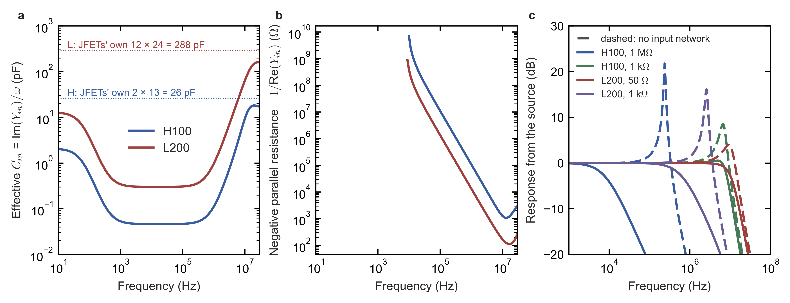

*Figure 10. (a) Effective input capacitance of the bare front ends (the other input grounded), against the JFETs' own capacitance $NC_{iss}$, 2 × 13 pF (H) and 12 × 24 pF (L) (SLPS730B and SLPS732B §6.5, p. 5). (b) The negative parallel resistance from the bootstrap's phase lag, Eq. (11). (c) Response from a 1 MΩ and a 1 kΩ source (H) and from a 50 Ω and a 1 kΩ source (L), without (dashed) and with the input network (`scripts/collect_curves.py`, `curves_zin.npz`, `curves_sources.npz`; numbers in `zin_numbers.json`).*

**Input protection, and what it costs.** The inputs need protection against static discharge, against a source that is connected while charged, and against overloads that the loop cannot follow. A protection network is a series resistor $R_{s}$ and clamp diodes, and each costs something.

*A series resistor* adds its thermal noise in full, since it sits in series with the source. Both inputs carry one, so the differential input gets $\sqrt{2\cdot 4kTR_s}$. It also forms a low-pass filter with the input capacitance, $1/(2\pi R_s C_{in})$. Table 6d gives the numbers, with the input capacitance of the input networks, $C_P + C_Z$ (20 pF for H, 250 pF for L).

*Table 6d. A series protection resistor in each input (closed forms, `scripts/protection.py`, `protection.json`: $\sqrt{2\cdot 4kTR_s}$ added in quadrature to the chain's simulated white floors at a total gain of 1000, 1.08 and 0.42 nV/√Hz, from `chain_noise.json`; the poles $1/(2\pi R_sC_{in})$; the noise figure for H with a 1 kΩ source).*

| $R_s$ per input | Added differential noise | H total | L total | Pole, H (20 pF) | Pole, L (250 pF) | Noise figure, H, 1 kΩ source |
|---|---|---|---|---|---|---|
| 0 | – | 1.08 nV/√Hz | 0.42 nV/√Hz | – | – | 0.30 dB |
| 1 Ω | 0.18 nV/√Hz | 1.10 | 0.46 | 8 GHz | 640 MHz | 0.30 dB |
| 10 Ω | 0.58 | 1.22 | 0.71 | 800 MHz | 64 MHz | 0.38 dB |
| 22 Ω | 0.85 | 1.38 | 0.95 | 360 MHz | 29 MHz | 0.47 dB |
| 47 Ω | 1.25 | 1.65 | 1.32 | 170 MHz | 13.5 MHz | 0.66 dB |
| 100 Ω | 1.82 | 2.12 | 1.87 | 80 MHz | 6.4 MHz | 1.04 dB |
| 1 kΩ | 5.76 | 5.86 | 5.77 | 8 MHz | 0.6 MHz | 4.9 dB |

For L, whose whole point is its 0.42 nV/√Hz, no series resistor above about 1 Ω is acceptable: 10 Ω already raises its floor by 70 %. For H, the quieter input above its crossovers with L (Section 6.2), 10–22 Ω costs 13–27 % of the floor but only 0.1–0.2 dB of noise figure with a 1 kΩ source, and its bandwidth is unaffected. A series resistor large enough to limit a real fault current (hundreds of ohms to kilohms) is possible on neither input: it would be the noisiest part of the amplifier.

*Clamp diodes* add three things:

- **Capacitance.** A clamp diode adds its junction capacitance to $C_P$: of the order of 1–3 pF for small-signal low-leakage diodes and a few nanofarads for TVS diodes (orders of magnitude assumed here; no diode data sheet was read). The latter can only sit outside a series resistor and, for H, would dominate the input capacitance.
- **Leakage.** Its leakage $I_L$ adds a current noise $\sqrt{2qI_L}$: 0.57, 1.8, 5.7 and 18 fA/√Hz at 1 pA, 10 pA, 100 pA and 1 nA. It also adds an offset $I_LR_S$ that typically doubles every 10 °C (Hill and Horowitz 2020, §2x.1, p. 102). H's own current noise is set by its 100 MΩ bias resistor, 12.9 fA/√Hz: a leakage of 10 pA adds 1 % to it and 100 pA adds 9 % (`protection.json`). Above 1 GΩ of bias, or with source impedances of that order, the leakage would dominate.
- **Nonlinearity.** The junction capacitance varies with the voltage across the diode. With a clamp to ground or to fixed rails, that voltage is the input's common mode and signal, so the capacitance becomes a source of distortion with high source impedances, and of common-mode-to-differential conversion where the two inputs' diodes differ.

A clamp to fixed rails must also sit outside the input's common-mode range, which is −12.8 V to +3.7 V for H and −9.0 V to +3.6 V for L (Eqs. (8c) and (9b); `protection.json`). Above +3.7 V (H) or +3.6 V (L) the cascodes run out of headroom below the +9 V summing node; below −12.8 V (H) or −9.0 V (L) the current sinks saturate. This range is estimated from the operating point, not simulated.

*Bootstrapped clamps* avoid both the capacitance and the nonlinearity. Diodes connected between each gate and the source node of its own side see only $V_{GS}$, which the loop holds constant (−0.36 V for H, −0.56 V for L), so in normal operation:

- their capacitance carries no signal current, being bootstrapped like $C_{gs}$;
- their leakage is constant;
- they conduct only when the loop has lost control and the gate moves away from its source.

The forward direction (gate above source) is already clamped by the JFET's own gate junction, which takes milliamperes. The reverse direction needs a string of two or three diodes, enough that the standing $|V_{GS}|$ leaves each of them below about 0.2 V of forward bias, a margin chosen here: two diodes take 0.18 V each for H and three take 0.19 V for L (`protection.json`). Such a clamp protects the JFETs against differential overloads at any common-mode voltage, but not against an input beyond the supply rails. That requires an outer clamp to the rails. For H it sits behind 10–22 Ω; for L it sits at the connector, and L relies on its source's own low impedance to limit the current.

**Recommendation:**

- **H:** 10–22 Ω per input, a pA-leakage clamp pair to ±15 V outside the common-mode range, and a bootstrapped gate-to-source clamp string per side.
- **L:** no series resistor, a low-leakage clamp pair to the rails at the input (its 250 pF of input capacitance makes the diodes' few picofarads irrelevant), and the same bootstrapped clamp.
- **Both:** the relay that selects H or L should leave the unused front end's gates terminated to ground.

None of this protection is in the simulated netlists, and none of it has been checked against a discharge or a fault (Section 7).

### 4.5 The rest of the chain

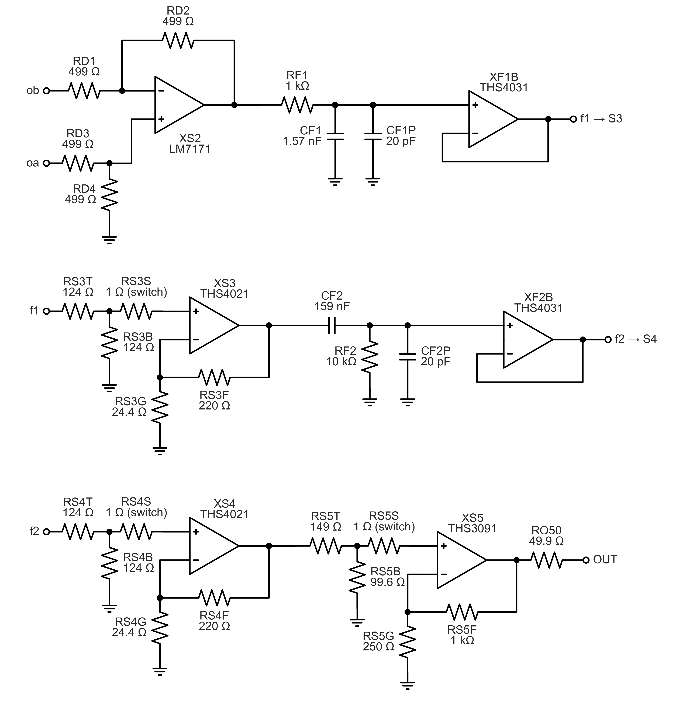

*Figure 11. The signal chain after the front end, drawn for the H front end at a total gain of 5000 ($G_{FE}$ = 100, $a_3 = a_4$ = 1/2 and $a_5$ = 2/5 in Eq. (7)) with a 100 kHz low-pass in F1 and a 100 Hz high-pass in F2 (the attenuators at the taps used in this example). Checked part by part against the simulated netlist.*

- **S2, the difference amplifier.** An LM7171 (A grade: 4100 V/µs and a unity-gain bandwidth of 160 MHz, SNOS760D §5.5, p. 5; it is not unity-gain stable but stable at gains of +2 or more, p. 1, which the difference amplifier's noise gain of 1 + 499/499 = 2 meets) with four 499 Ω resistors from one 0.01 % network. The LM7171 was chosen over the lower-noise THS4031 after the distortion comparison of Section 6.5 (Table 14): at a total gain of 100, where S2 carries the full output level, the THS4031 gave 1.3 % distortion at 10 MHz and 1 Vpp against 0.012 % for the LM7171 (`da_compare.json`), and it limited the 10 V step to 133 V/µs (`large_signal_THS4031.json`). The cost is noise in the H settings with the front end at a gain of 10 (Table 9).
- **F1 and F2, the filters.** One RC section each (1 kΩ above 1 kHz, 10 kΩ below), low-pass or high-pass, with 20 pF of relay and layout capacitance at the filter node (an assumed allowance) and a THS4031 follower; first-order, as in the SR560.
- **S3 and S4, the gain stages.** A 249 Ω attenuator tapped through a switch, simulated as 1 Ω, then a THS4021 at a gain of 10 (220 Ω and 24.4 Ω). The switch is idealised: a TMUX6219, for example, has 2.1 Ω typical and 148 pF on (SCDS420E §5.6–5.7, pp. 6–7), and no switch capacitance is simulated.
- **S5, the output stage.** An attenuator (1, 2/5 or 1/5) and a THS3091 at a gain of 5 (1 kΩ and 250 Ω), 49.9 Ω to the output, ±10 V into a high impedance and ±5 V into 50 Ω. The latter needs ±10 V and 100 mA at the THS3091, which swings at least ±12.1 V into 100 Ω and drives at least 200 mA at ±15 V (SLOS423K §7.5, p. 7); only a 1 MΩ load was simulated.

At the lowest gains the THS3091's inverting-input current noise in its 1 kΩ feedback resistor matters: 14 pA/√Hz white (SLOS423K §7.5, p. 6) and about 200 pA/√Hz at 10 Hz (Fig. 7-16, p. 12) give 14 nV/√Hz and, with the 1/f continued below 10 Hz as in the corrected model, about 630 nV/√Hz at 1 Hz. At a total gain of 1 the chain has 24.6 nV/√Hz white and 650 nV/√Hz at 1 Hz (`chain_noise.json`), so this term is a third of the white noise power and 94 % of it at 1 Hz (`scripts/numbers_s4b_5.py`). Below a gain of 10 a lower-noise output stage, or S5 bypassed for a unity-gain buffer, would help.

### 4.6 DC offset, JFET binning and trim

The front end amplifies the difference of the two sides' $V_{GS}$ by its gain. For H, the JFE2140's halves match to 4 mV at most and 1 mV typically, and drift apart by at most 10 µV/°C (SLPS730B §6.5, p. 5). The Monte Carlo of Section 6.4 (`scripts/cmrr_mc.py`) shifts the $V_{TO}$ and $\beta$ of each dual by a common amount (σ 100 mV and 5 %) and those of each half by its own (σ 0.85 mV and 1 %), so that the two halves of a dual differ by σ = 1.2 mV and 1.4 %. These σ are assumptions; for $\beta$ in particular the data sheet gives no matching, only an $I_{DSS}$ ratio. They put its limits, 4 mV and an $I_{DSS}$ ratio of 0.95–1.05 (p. 5), at 3.3σ and 3.5σ of the difference, and make the mean magnitude of the $V_{GS}$ difference, $\sigma\sqrt{2/\pi}$ = 0.96 mV, close to the typical 1 mV. The Monte Carlo gives an output offset of 3.4 V rms at a total gain of 1000, i.e. 3.4 mV at the input (`cmrr_mc.json`, 12 trials). Most of it comes from the assumed $\beta$ mismatch. At a fixed current $\Delta V_{GS} = \Delta V_{TO} - \tfrac12(V_{GS}-V_{TO})\,\Delta\beta/\beta$, with $V_{GS}-V_{TO} = \sqrt{I_D/\beta}$ = 0.59 V, so the two sides, with two duals each, differ by 3.0 mV rms from $\beta$ and by 0.85 mV rms from $V_{TO}$ (`scripts/numbers_s4b_5.py`). For L, unsorted JFE150 would not work. Taking the data sheet's $V_{GS(off)}$ range, −1.5 to −0.9 V (SLPS732B §6.5, p. 5), as ±3.5σ gives σ = 0.6 V/7 = 86 mV per device (an assumption); the means of the two sides' twelve then differ by $86\ \mathrm{mV}\cdot\sqrt{2/12}$ = 35 mV rms, which a total gain of 1000 turns into 35 V rms: the chain saturates. The 24 JFE150 must therefore come from one $V_{GS}$ bin, here ±5 mV at 5 mA (a design choice). The Monte Carlo draws each of them within the bin with σ 3 mV of $V_{TO}$ (a uniform ±5 mV spread has $5\ \mathrm{mV}/\sqrt3$ = 2.9 mV) and 2 % of $\beta$ (assumed), and leaves 2.3 V rms of offset at a total gain of 1000, i.e. 2.2 mV at the input (2.26 V/1005).

Both front ends therefore need an offset trim, which also cancels the drift of the later stages. A current $\Delta I$ injected into one summing node shifts the input by $\Delta I\,w$, with the weight of Eq. (9) for a current entering that node, $w = 1/(Ng_m) + R_F/G$. Read from the simulated noise of $R_D$, which enters the same node ($e_{R_D} = \sqrt2\,w\sqrt{4kT/R_D}$ for both sides, Table 8's runs, `curves_noise.npz`), $w$ is 38 Ω for H at a gain of 100, 83 Ω at a gain of 10 and 4.8 Ω for L. Eq. (9) gives these values only with the cards' source resistance in series with $1/g_m$: for H, $(1/17.26\ \mathrm{mS} + 8\ \Omega)/2 + 5.0\ \Omega$ = 38.0 Ω, against 34.0 Ω without it. For H, a 12-bit DAC at ±10 V through 50 kΩ gives ±200 µA, i.e. ±7.6 mV at the input at a gain of 100 and ±16.6 mV at a gain of 10, in steps ($2\Delta I\,w/2^{12}$) of 3.7 and 8.1 µV, and the 50 kΩ adds $\sqrt{4kT/50\ \mathrm{k\Omega}}$ = 0.58 pA/√Hz, i.e. 0.022 and 0.048 nV/√Hz at the input. For L, 10 kΩ gives ±1 mA, i.e. ±4.8 mV, in steps of 2.4 µV, and adds 1.29 pA/√Hz, i.e. 0.0062 nV/√Hz (`scripts/numbers_s4b_5.py`). These ranges are 2.3 (H at a gain of 100), 5.0 (H at 10) and 2.2 (L) times the rms input offsets of the Monte Carlo (3.4, 3.3 and 2.2 mV, `cmrr_mc.json`), so that, for a Gaussian spread, 2.3 % of H front ends at a gain of 100 would lie outside the range, against $5.6\times10^{-5}$ % at a gain of 10 and 3.1 % for L ($\mathrm{erfc}(r/\sqrt2)$ for a range of $r$ times the rms offset, `scripts/numbers_s4b_5.py`). With 100 kΩ, H's range at a gain of 100 would be only 1.1 times its rms offset, and 26 % would lie outside. The DAC's own output noise passes through the same resistor; it adds less than the resistor's thermal noise as long as it is below $\sqrt{4kTR}$, 29 nV/√Hz for 50 kΩ and 13 nV/√Hz for 10 kΩ. An AC-coupled mode, or an optional DC servo around the whole chain, handles the cases where the input's own offset is larger.

**Drift from the sinks' temperature difference.** A sink's current depends on its $V_{BE}$. The servo corrects the two sinks together, not their difference. A temperature difference $\Delta T$ between them therefore leaves a current difference, which flows through $R_F$ (Section 4.2) and appears at the input with the weight $R_F/G$:

$$
\frac{dV_{BE}}{dT} = -\frac{E_G - V_{BE} + X_{TI}V_T}{T}, \qquad \frac{dV_{in}}{d(\Delta T)} = \frac{\lvert dV_{BE}/dT\rvert}{R_T}\,\frac{R_F}{G}.
\tag{11a}
$$

With the MMBT3904 card's $E_G$ = 1.17 eV and $X_{TI}$ = 3, $dV_{BE}/dT$ is −1.7 mV/K for H's sinks at 11 mA and −1.5 mV/K for L's at 62 mA (`scripts/fe_closed_forms.py`). The simulation with ngspice's `dtemp` on one sink (`scripts/sink_power.py`) also includes the rest of the model's temperature dependence:

- H with 2 V across $R_T$: 49 µV/K at a gain of 100 and 486 µV/K at a gain of 10 (Eq. (11a): 47 and 470);
- L with its 6 V: 24 µV/K (Eq. (11a): 18), and 62 µV/K with the first design's 2 V (56).

At the front end's output, the simulated drift times the gain, this is 4.9 mV/K for H at either gain and for L, and 12.4 mV/K for L's first design. The error relative to full scale is therefore the same on both of H's ranges. For comparison, the JFE2140's two halves drift apart by at most 10 µV/°C (SLPS730B §6.5, p. 5). A build should therefore keep the two sinks in one thermal environment: side by side, with mirrored copper, out of air currents. The offset trim removes what remains at one temperature.

If that is not enough, there are two remedies, neither simulated:

- **More voltage across $R_T$.** H's drift falls to 18 and 180 µV/K at 6 V (simulated), at the cost of common-mode range (Section 6.1).
- **A sink whose current an op amp sets across $R_T$.** This removes $V_{BE}$ from the current altogether, but the op amp's voltage noise $e_n$ then enters at the input as

$$
e_{in} = \sqrt2\,\frac{e_n}{R_T}\,\frac{R_F}{G}:
\tag{11b}
$$

0.09 nV/√Hz for L with $e_n$ = 5 nV/√Hz across 98.4 Ω, but 1.9 nV/√Hz for H at a gain of 10, across 182 Ω.

### 4.7 Power

The preamplifier runs on ±15 V from LT3045 and LT3094 regulators fed with ±17 to ±18 V from an external linear supply, as for the SR560's battery-free operation. Each regulator's output is set by its 100 µA SET current in $R_{SET}$ = 150 kΩ; $C_{SET}$ = 4.7 µF and $C_{OUT}$ = 10 µF (ceramic). That is 100 µA × 150 kΩ = 15 V, the top of the LT3045's output range, and the SET current's ±1 % initial accuracy allows 1.01 × 15 V = 15.15 V (LT3045 data sheet Rev. D, p. 1). The LT3094 (data sheet Rev. 0, pp. 1, 4–5, a public mirror of ADI's document; ADI's Rev. B in `refs/literature/` gives the same values) gives, with the LT3045's values (Rev. D, pp. 1, 3) in parentheses:

- noise 70 nV/√Hz at 10 Hz and 0.8 µV rms from 10 Hz to 100 kHz with $C_{SET}$ = 4.7 µF, and 2.2 nV/√Hz at 10 kHz with $C_{SET}$ = 0.47 µF (LT3045: the same 70 nV/√Hz and 0.8 µV rms, and 2 nV/√Hz);
- ripple rejection, with 2 V of headroom and 500 mA, of 108 dB at 120 Hz ($C_{SET}$ = 4.7 µF), and 94 dB at 10 kHz, 75 dB at 100 kHz, 74 dB at 1 MHz and 28 dB at 10 MHz ($C_{SET}$ = 0.47 µF) (LT3045: 76 dB at 1 MHz);
- 235 mV of dropout at 500 mA (LT3045: 260 mV).

The preamplifier's own supply rejection, referred to its input, is 98–101 dB up to 100 kHz, 81–86 dB at 1 MHz and 61–66 dB at 10 MHz (H, gain 100, `large_signal.json`; L at 1000 with its 6 V sinks is better by 9–20 dB, `sink_power.json`; Section 6.5). The regulators' noise therefore reaches the input at a level of picovolts per root hertz: taking the rejection at 100 Hz, the lowest frequency simulated, 70 nV/√Hz at 10 Hz becomes $70\ \mathrm{nV}\cdot10^{-101.3/20}$ = 0.60 pV/√Hz on +15 V and 0.65 pV/√Hz on −15 V (100.7 dB), far below the amplifier's own nanovolts. The supply's ripple is rejected by the regulator and the amplifier in series: at 1 MHz by 76 + 81 = 157 dB on +15 V and 74 + 86 = 160 dB on −15 V. Above 10 MHz the regulators' rejection fades, so a ferrite and a few microfarads per rail at each stage are still needed. The L front end draws 120 mA from +15 V through its drain resistors alone; the preamplifier with L draws 177 mA from +15 V and 178 mA from −15 V, and 193 and 194 mA with both filters on (with H 76–92 mA; operating points with ideal references, `scripts/chain_extras.py`, `chain_extras.json`). With 2–3 V of headroom each regulator then dissipates 0.35–0.58 W with L (0.15–0.28 W with H), which raises the MSOP's junction by 19–20 K: its $\theta_{JA}$ is 33 °C/W with 2500 mm² and 35 °C/W with 100 mm² of top copper on the data sheets' four-layer test board (LT3094 Rev. 0, p. 3 and Table 4, p. 28; LT3045 Rev. D, p. 2 and Table 4, p. 22; `scripts/numbers_s4b_5.py`).

### 4.8 1/f noise against bandwidth: the two cases

At 1–10 Hz the front ends' noise has two sources (Table 8): the JFETs' own 1/f noise, and the loop op amps' 1/f noise, which the THS4021 brings with it. The THS4021 is there for its bandwidth: a decompensated amplifier, stable at gains of 10 or more, with a gain–bandwidth product of 2 GHz and 1.2 nV/√Hz (SLOS265F p. 1; 1.5 nV/√Hz in the DGN package, §5.7, p. 8). Its data sheet's 1/f is moderate (about 4 nV/√Hz and 18.6 pA/√Hz at 10 Hz, Figs. 5-11 and 5-12, p. 11), but in the front end its current noise appears with the weight $1/(Ng_m) + R_F/G$ of Eq. (9) per side and its voltage noise through the outer loop, and at a front-end gain of 10 the op amps contribute about as much as the JFETs at 1 and 10 Hz (7.3 against 7.0 and 2.3 against 2.4 nV/√Hz, `curves_noise.npz`).

**Case DC–10 MHz (this design).** The values of Table 8: H 2.7 nV/√Hz at 10 Hz and 7.8 at 1 Hz (gain 100), L 0.83 and 2.3.

**Case DC–1 MHz (a low-1/f variant).** With a tenfold lower bandwidth target, the loop op amps can be chosen for 1/f instead of speed: a FET-input op amp of 50–100 MHz on ±15 V removes the current-noise term (the OPA2810, 70 MHz, comes close but runs on 4.75–27 V, SBOS789C p. 1), and a bipolar one with a low 1/f corner (OPA1612-class, 40 MHz, SBOS450C p. 1) the voltage term. The projected noise is the simulated noise without the op amps' group, $\sqrt{e_n^2 - e_{n,op}^2}$ (`curves_noise.npz`, `scripts/numbers_s4b_5.py`): H at a gain of 100 falls from 2.67 to 2.45 nV/√Hz at 10 Hz and from 7.8 to 7.1 at 1 Hz; H at a gain of 10 from 3.7 to 2.9 at 10 Hz and from 10.2 to 7.2 at 1 Hz; L from 0.83 to 0.77 at 10 Hz and from 2.3 to 2.1 at 1 Hz. These are upper bounds on the benefit, since the slower op amp's own noise is not zero; for H at a gain of 100 and for L the JFETs dominate in either case. The larger lever at low frequencies is the JFET: JFE150 instead of JFE2140 in H (at 10 Hz and 2 mA, 1.6 against 2.4 nV/√Hz per device, and 1.8 for the JFE150 at 5 mA, SLPS732B and SLPS730B §6.5, p. 5; at 1.8 times the capacitance, 24 against 13 pF), or IF3601-class parts in L (0.6 nV/√Hz at 10 Hz per device at 5 mA, IF35076.R01, p. 3). The DC–1 MHz case also relaxes the compensation conflict of Section 4.3, so $C_{node}$ can be smaller and the noise above 1 MHz returns to the white floor.

---

## 5. How the design was simulated

### 5.1 Setup

All simulations ran in ngspice-46, loaded as the shared library that KiCad 10 installs, from Python (`scripts/ngspice_shared.py`, `scripts/spice.py`), with PSpice compatibility on, `.options reltol=1e-4 abstol=1e-15 vntol=1e-9 gmin=1e-14` for AC and noise, and Gear integration with abstol = 1e-12 A for transients. Every deck is written to its own folder in `sim/runs/` with its log and data. The models (Section 5.2) are prepared by `scripts/models.py` into `sim/models/_lib/`. The checks used:

- **operating point** of every JFET, cascode and op amp;
- **AC response** of the front end and of the chain, at every gain;
- **noise** with every generator kept (`noise … 1`, `wrdata noise.txt all`), referred to the input through the response at the same frequency and grouped by part;
- **loop gain** by Middlebrook's double injection, at $R_F$ (outer loop) and at the op amp's output pin (complete loop), in differential and common mode;
- **input admittance** and the response from sources of 50 Ω, 1 kΩ and 1 MΩ, with and without the input network;
- **CMRR** by Monte Carlo (12 trials per case, 6 for the cases with one class of mismatch and 4 for the $R_{UP}$ test) with toleranced resistors, capacitors and JFETs, each trial in its own process with a time limit;
- **transients**: distortion of 1 Vpp sines from 1 kHz to 10 MHz and of 10 Vpp sines from 1 kHz to 1 MHz, 1 V and 10 V steps, a threefold overload, and an oscillation check with quiet inputs;
- **supply rejection** from each rail to the output.

**A pitfall: a wrong operating point without an error.** For one variant of Section 4.3.1 (gain 30 with a smaller $R_F$), ngspice's operating point for the noise deck had both op amps at the negative rail and the input JFETs' gates conducting, and the noise came out at 64.0 nV/√Hz (`scripts/op_pitfall.py` reproduces both cases of this paragraph). The AC deck of the same circuit found the normal operating point. Kirchhoff's current law at the bootstrap node failed by 1.49 mA of $R_{UP}$'s 1.50 mA, the charging current of the 1 µF $C_{BS}$, so the solution was apparently taken from a transient with the bootstrap capacitors still uncharged. `scripts/gain_options.py` therefore compares each noise run's own gain with the AC run's at 1 kHz, and repeats any run that disagrees with `.nodeset` from the AC run's operating point. The other noise runs of Section 6 predate this check. None of them shows the symptom: their totals agree with the terms of Eq. (9). A wrong operating point can also be wrong in every deck alike, which this check cannot see. With a JFE150 as current sink at a gain of 100 (Section 6.1), every deck settled with the source nodes at −0.95 V. Only the AC response gave it away, with a bandwidth of 322 MHz instead of 15.0 MHz, and `scripts/sink_options.py` rejects such a result.

### 5.2 Models

- **JFETs:** TI's JFE150 (SLPM349I), JFE2140 (SLPM355) and JFE2325 (SLVMF24) cards, Linear Systems' LSBF862 (Rev 2, 2026) and the Linear Systems cards of LTspice's `standard.jft` (2N5564, LSK389, LSK170, LSK489; LTspice 26.1.1.0, library file of 20 September 2026, `model_defects.json`), each wrapped with a gate resistor RX and calibrated to its data sheet (Section 3.4). Only the NJF cards of the TI subcircuits are used; their ESD-clamp switches are left out.
- **Op amps in the new design:** TI's THS4021, THS4031, THS3091 and LM7171 macromodels, translated for ngspice and with their noise corrected (Section 5.3).
- **Op amps in the SR560 reproduction:** behavioural models (`scripts/blocks.py`, `opn`) with the data sheets' typical noise, 1/f corners, gain-bandwidth, slew rate and output limits: OP37, LF411, LT1028, LF356.
- **Bipolar transistors:** onsemi's MMBT3904 and MMBTH10 models, and for the current-sink study of Section 6.1 the BC817-25 card of LTspice's standard.bjt. The L front end's PZT3904 uses the MMBT3904's card: onsemi lists the same electrical characteristics for the two (PZT3904T1/D, p. 2; MMBT3904LT1/D, p. 2).

### 5.3 Vendor models that were wrong, and how

Every model was checked against its data sheet before use, and in this project most of them needed a correction. The errors are large and of several kinds, so the checks are worth repeating with any new model. Table 7 lists what was found; the explanations follow.

*Table 7. Defects found in the vendor models used, measured with each model alone in ngspice against its data sheet's typical values (`scripts/opamp_noise_check.py` and `scripts/model_defects.py`, with the results in `opamp_noise_check.json` and `model_defects.json`; the op-amp figures from two-gain noise runs that separate the voltage and current noise; the JFET calibration by `scripts/models.py`). Data-sheet values cited by figure are read by eye from its curves, except the JFETs' $C_{rss}$ and the THS4021's and THS4031's current noise, read from the curves' pixels (`scripts/ti_plot_check.py`).*

| Model | Quantity | Model gives | Data sheet | Error | Correction |
|---|---|---|---|---|---|
| TI JFE2140 (SLPM355) | 1/f, KF | 0.2e-18: 1.2 nV/√Hz at 10 Hz, 2 mA | 2.4 nV/√Hz (SLPS730B §6.5, p. 5) | 1/f power 14× too low | KF = 2.9e-18 |
| TI JFE2140 | $C_{iss}$, $C_{rss}$ at 5 V | 8.6 pF, 1.25 pF | 13 pF (§6.5, p. 5), 3.9 pF (Fig. 6-17, p. 8) | 0.67×, 0.32× | CGS, CGD refitted |
| TI JFE150 (SLPM349I) | 1/f, KF | 3.25e-18: 1.75 nV/√Hz at 10 Hz, 5 mA (with the calibrated white) | 1.8 nV/√Hz at 10 Hz, 5 mA (SLPS732B §6.5, p. 5) | consistent: the calibrated KF is 7.5 % higher | KF = 3.5e-18 |
| TI JFE150 | $C_{iss}$, $C_{rss}$ at 5 V | 17.8 pF, 2.3 pF | 24 pF (§6.5, p. 5), 4.1 pF (Fig. 6-12, p. 7) | 0.74×, 0.55× | refitted |
| Linear Systems LSBF862 (Rev 2, 2026) | 1/f, KF | 8.75e-17: 9.1 nV/√Hz at 10 Hz (Eq. (1)) | 1.4 nV/√Hz typ, 4.0 max (Doc 201195 Rev A2, p. 2) | 1/f power 50× too high (above the maximum) | KF = 1.74e-18 |
| Linear Systems LSBF862 | $C_{iss}$, $C_{rss}$ at 8 V | 6.5 pF, 0.87 pF | 11.5 pF, 3.5 pF (p. 2) | 0.56×, 0.25× | refitted |
| LTspice standard.jft 2N5564 | KF | 67860f = 6.786e-11 | Linear Systems' own listing (`sim/models/LinearSystems/2N5564/`): 6.786e-002f = 6.786e-17 | × 10⁶ (unit prefix); 1/f corner 1.14 GHz | KF refitted to Vishay's curve (70254 Rev. E, p. 5) |
| LTspice standard.jft J310 | KF | 46340f = 4.634e-11: 0.59 µV/√Hz gate-referred at 10 kHz (Eq. (1)), 0.54 in ngspice at 11 mA | – (data sheet not read) | implausible for any JFET; probably the same unit-prefix error as the 2N5564; as H's sink at a gain of 10, 60.7 nV/√Hz at 10 kHz | none; the J310 sink was dropped (`scripts/sink_options.py`) |
| Linear Systems LSK170/LSK389 cards (LTspice) | channel noise | NLEV = 3, GDSNOI = 5–8; in ngspice the LSK389B gives 1.41 nV/√Hz with them and 0.86 without (2 mA, 10 V) | 1.6 nV/√Hz at 1 kHz (LSK389, Doc 201122 Rev A27, p. 2) | white noise set by an optional equation: 0.88× the data sheet with it, 0.54× without | NLEV, GDSNOI removed, RX calibration |
| TI THS4021 (SLOJ004, 1999) | $e_n$, $i_n$ at 10 Hz; white $i_n$ | 18.2 nV/√Hz, 293 pA/√Hz; 1.18 pA/√Hz | 4 nV/√Hz, 18.6 pA/√Hz (SLOS265F Figs. 5-11, 5-12, p. 11); 2.3 pA/√Hz (§5.6, p. 6) | 4.6×, 16×; 0.52× | KF = 0, 1/f generators fitted; white kept |
| TI THS4031 (SLOJ005A) | $e_n$, $i_n$ at 10 Hz; white $i_n$ | 22.2 nV/√Hz, 300 pA/√Hz; 1.12 pA/√Hz | 4 nV/√Hz, 18.6 pA/√Hz (SLOS224L Figs. 5-13, 5-14, p. 12); 2.3 pA/√Hz (§5.6, p. 6) | 5.5×, 16×; 0.49× | KF = 0, 1/f generators fitted; white kept |
| TI THS4031 | HD3 at 10 MHz | −38 dBc at 1 Vpp (in S2) | about −50 dBc at 2 Vpp, G = 2 (SLOS224L Fig. 5-15, p. 12) | 12 dB above the curve as read; 24 dB after scaling to 2 Vpp (HD3 ∝ $V^2$) | none; LM7171 chosen |
| TI THS3091 (SLOM418) | $e_n$, $i_{n-}$ at 10 Hz | 37 nV/√Hz, 317 pA/√Hz | 6.5 nV/√Hz, 200 pA/√Hz (SLOS423K Fig. 7-16, p. 12) | 5.7×, 1.6× | KF = 0, 1/f generators fitted |
| TI THS3091 | white $i_{n-}$ | 1.5 pA/√Hz | 14 pA/√Hz (SLOS423K §7.5, p. 6) | 0.11× | white generator added |
| TI LM7171 (SNOM205A, National) | white $e_n$; 1/f | 4.1 nV/√Hz; none | 8.5 nV/√Hz (A grade, SNOS760D §5.5, p. 5); 43 nV/√Hz at 10 Hz (Fig. 5-16, p. 10, at ±5 V) | 0.48×; missing | white and 1/f generators added |

**How the TI JFET models are wrong.** In a SPICE JFET the input-referred 1/f density is $K_F/(4\beta f)$ (Eq. (1)), and within one process it scales as one over the gate area, i.e. as $1/\beta$, so KF is about the same for every geometry of a process. TI's JFE150 card has KF = 3.25e-18 with β = 31 mA/V², and with the calibrated white noise it gives 1.75 nV/√Hz at 10 Hz against its data sheet's 1.8. The JFE2140, presumably made in the same process with about half the gate area (β = 14.24 mA/V²), carries KF = 0.2e-18, sixteen times less, and gives 1.2 nV/√Hz at 10 Hz against its data sheet's 2.4 nV/√Hz at 2 mA. A KF of 2.9e-18, close to the JFE150's, reproduces the data sheet. The JFE2140's KF looks like a transcription error, though nothing in TI's file says so. With the card as published, a design would promise half the true 1/f noise. Both TI cards also understate the capacitances. ngspice ignores the cards' grading exponent M = 0.33: its JFET has no such parameter, and its junction capacitances vary as the −1/2 power of the junction voltage (ngspice-46 manual, §7.4.4, pp. 153–154). CGS and CGD evaluated with an exponent of 0.5 at 5 V are therefore too small, and the cards' zero-bias values are small to begin with: $C_{rss}$ comes out at 32–55 % of the data sheet's. A bootstrapped front end's negative conductance (Eq. (11)) and its HF noise both scale with these capacitances, so the refit matters.

**How the TI op-amp models are wrong.** The THS4021 and THS4031 macromodels of 1999 have transistor-level input stages whose transistors carry KF = 2.5e-13 and 2.75e-13. At 10 Hz this gives 18–22 nV/√Hz and about 300 pA/√Hz, against the data sheets' 4 nV/√Hz and 18.6 pA/√Hz: the model's current-noise 1/f corner, $f_0\,(i_n(f_0)/i_{n,w})^2$ with $f_0$ = 10 Hz and the model's own white $i_{n,w}$, sits at 0.61 MHz (THS4021) and 0.72 MHz (THS4031) instead of the data sheets' 0.65 kHz (`scripts/numbers_s4b_5.py`). The 1/f generators that replace it are fitted to the curves read from their pixels, 18.6 pA/√Hz at 10 Hz (`scripts/ti_plot_check.py` gives 18.7 at the 10 Hz frame edge and 18.3 at the curves' first visible point, about 10.3 Hz; a first reading by eye, 20 pA/√Hz, was 7 % high), over the curves' own white floors of 1.2 nV/√Hz and 2.1 pA/√Hz: 1/f parts of $\sqrt{4^2 - 1.2^2}$ = 3.82 nV/√Hz and $\sqrt{18.6^2 - 2.1^2}$ = 18.5 pA/√Hz at 10 Hz (`scripts/models.py`; the voltage curves read 4.06 nV/√Hz at 10 Hz and 1.18 white, which would give 3.89 nV/√Hz, 1.8 % more). In this front end the op amps' current noise appears at the input with the weight $1/(Ng_m) + R_F/G$ of Eq. (9). With the published THS4021 model, the H front end at a gain of 100 has 16.2 nV/√Hz at 10 Hz, six times the 2.67 nV/√Hz it has with the corrected model (`opamp_noise_check.json`). The correction sets every KF in the file to zero and adds pure 1/f generators (a diode's flicker noise, sensed through a large capacitor and copied into the input by controlled sources, `scripts/blocks.py`) sized to the data sheet's curves, over the model's own white noise. That white current noise, 1.18 pA/√Hz in the THS4021 and 1.12 in the THS4031, is 0.52 and 0.49 times the data sheets' 2.3 pA/√Hz (SLOS265F and SLOS224L §5.6, p. 6), and the correction keeps it: through Eq. (9) the THS4021's shortfall makes the front ends' simulated white noise 0.5 % too low for H at a gain of 100, 0.7 % at a gain of 10 and 0.05 % for L (`scripts/numbers_s4b_5.py`). The THS3091 model has the same kind of 1/f excess in its voltage noise, 0.11 times the data sheet's white inverting-input current noise, and a current-noise 1/f only 1.6 times high; at a total gain of 1, where its current noise sets the chain's noise at 1 Hz (Section 4.5), the published model puts that noise too high by a factor of 1.76 (1.65 at a gain of 10; `opamp_noise_check.json`). The LM7171 model, an old National macromodel, has no noise sources beyond its resistors and two transistors, so its white voltage noise is 0.48 times the data sheet's and its 1/f is missing; the correction adds both, but not the 1/f of the data sheet's current noise (Fig. 5-17, p. 10).

**How the Linear Systems and LTspice cards are wrong.** The LSBF862 card of February 2026 has the KF of NXP's old BF862 model (`BF862.prm`, file header of March 2007, KF = 87.5E-18; transcribed in `sim/models/README_InterFET_NXP_others.md`, the file itself not archived), 8.75e-17, which gives 9.1 nV/√Hz at 10 Hz by Eq. (1), above the data sheet's 4.0 nV/√Hz maximum. LTspice's library copy of Linear Systems' 2N5564 card (`lib/cmp/standard.jft` of LTspice 26.1.1.0, dated 20 September 2026, SHA-256 82bdc4a4…3557, whose change log's last JFET entry is "06/26/23 Updated JFET device models from Linear Systems"; `model_defects.json`, `ltspice_library`) lists KF as "67860f", 6.786e-11, where Linear Systems' own listing has "6.786e-002f", 6.786e-17. A factor of a million in KF puts the 1/f corner of a 2N5564 at 1.14 GHz (Eq. (1) with the calibrated white noise of 1.28 nV/√Hz; 43 nV/√Hz at 1 MHz), so an SR560 reproduction with the library card would be absurdly noisy. The library's J310 card has a value of the same kind, KF = "46340f", 4.634e-11. As a current sink at 11 mA it alone would set the H front end's noise at a gain of 10 to 60.7 nV/√Hz at 10 kHz (`scripts/model_defects.py`); it was dropped before the sink study of Section 6.1 (`scripts/sink_options.py`). The Linear Systems cards in LTspice's library also use NLEV = 3 and GDSNOI = 5–8, an alternative channel-noise equation that ngspice implements too (ngspice-46 manual, §7.4.4, p. 154): in ngspice the LSK389B card gives 1.41 nV/√Hz with them and 0.86 without, at 2 mA and 10 V, against the data sheet's 1.6 at 1 kHz (`model_defects.json`). Whether LTspice evaluates them the same way was not checked, so they are removed and the white noise is calibrated with RX instead.

**The checks that found them.** Each model alone, in a fixture that sets the data sheet's operating point. For a JFET, the drain held at $V_{DS}$ above the source by a voltage-controlled source and the drain current set by a current source in the source. For an op amp, a non-inverting stage at two feedback resistances, which separates the voltage noise from the inverting-input current noise. The noise was compared at the data sheet's white and 10 Hz points, and the capacitances from the gate current with the gate driven ($C_{iss}$) and with the drain driven ($C_{rss}$). Only after that was the model used in the circuit. Three of the corrections changed design decisions: the JFE2140's 1/f (the H front end's low-frequency floor), the THS4021's 1/f (which op-amp noise to blame at 10 Hz), and the THS4031's distortion (the choice of S2).

---

## 6. Results

### 6.1 Noise

*Table 8. Input-referred noise of the front ends alone (nV/√Hz) and its largest contributions (`scripts/collect_curves.py`, `noise`; `sim/results/curves_noise.npz`, read at the listed frequencies and rounded once by `scripts/numbers_s6_7.py`).*

| Front end | Frequency | Total | Input JFETs | $R_G$ | Loop op amps | $R_D$ | Current sinks | $R_F$ |
|---|---|---|---|---|---|---|---|---|
| H, gain 100 | 1 Hz | 7.81 | 7.04 | 0.41 | 3.33 | 0.28 | 0.08 | 0.04 |
| | 10 Hz | 2.67 | 2.40 | 0.41 | 1.06 | 0.28 | 0.08 | 0.04 |
| | 1 kHz | 1.10 | 0.96 | 0.40 | 0.17 | 0.28 | 0.08 | 0.04 |
| | 1 MHz | 1.07 | 0.93 | 0.40 | 0.17 | 0.28 | 0.08 | 0.04 |
| | 10 MHz | 1.50 | 0.93 | 0.40 | 1.06 | 0.28 | 0.08 | 0.04 |
| H, gain 10 | 10 Hz | 3.71 | 2.40 | 1.22 | 2.31 | 0.62 | 0.79 | 0.41 |
| | 1 kHz | 1.92 | 0.96 | 1.22 | 0.36 | 0.62 | 0.79 | 0.40 |
| | 10 MHz | 2.94 | 0.94 | 1.21 | 2.26 | 0.61 | 0.79 | 0.40 |
| L, gain 201 | 1 Hz | 2.33 | 2.13 | 0.20 | 0.92 | 0.09 | 0.04 | 0.01 |
| | 10 Hz | 0.83 | 0.74 | 0.20 | 0.30 | 0.09 | 0.04 | 0.01 |
| | 1 kHz | 0.41 | 0.33 | 0.20 | 0.09 | 0.09 | 0.04 | 0.01 |
| | 10 MHz | 0.50 | 0.33 | 0.20 | 0.31 | 0.09 | 0.04 | 0.01 |

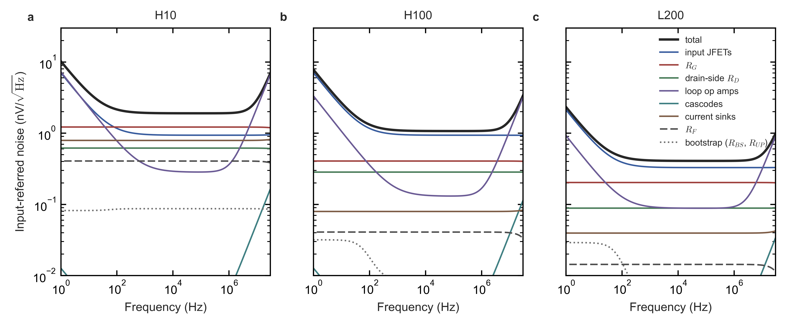

*Figure 12. Input-referred noise of the three front-end configurations with their contributions.*

In the white region the JFETs contribute 0.93 nV/√Hz (H) and 0.33 nV/√Hz (L). Eq. (2) gives $\sqrt2 \times 0.9/\sqrt2$ = 0.90 and $\sqrt2 \times 0.8/\sqrt{12}$ = 0.33 nV/√Hz from the data sheets' 0.9 nV/√Hz for a JFE2140 (SLPS730B p. 1) and 0.8 nV/√Hz for a JFE150 (SLPS732B p. 5, Table 6.5), both at 5 mA (`sim/results/noise_theory.json`); H's 0.93 is higher mainly because the calibrated JFE2140 card itself gives 0.92 nV/√Hz at 5 mA (`sim/results/jfet_model_check.json`). $R_G$ is next, then the drain resistors. At a front-end gain of 10, $R_G$ (111 Ω) and the current sinks become comparable with the JFETs, because a current injected at a source node develops a voltage across the larger $R_G$. Quieter sinks would gain little; the next paragraph shows why. Below 100 Hz the JFETs' 1/f dominates H at a gain of 100 and L, and at a gain of 10 the loop op amps' 1/f is about as large as the JFETs' (Section 4.8). Above a few MHz the op amps' voltage noise driving $C_{node}$ rises as $f$ (Section 4.3).

**What sets a current sink's noise.** At a front-end gain of 10 the current sinks give 0.79 nV/√Hz, the largest term after $R_G$ and the JFETs (Table 8), because their noise current enters the source node with the weight $R_F/G$ = 50 Ω (Eq. (9)). The sink's base is held at AC ground by the servo's filter. For noise, the transistor is therefore a common-base stage from its emitter node to its collector, i.e. to the source node (Figure 6c). A current injected into the emitter node cannot move the base: the transistor's $V_{BE}$ changes instead, and the current goes on to the collector. Of the sink's noise generators, two therefore pass in full, and the emitter resistor suppresses the third:

- **$R_T$'s thermal noise current, $\sqrt{4kT/R_T}$, passes in full.** It enters the emitter node directly.
- **The base current's shot noise, $\sqrt{2qI_C/\beta}$, passes in full.** The base cannot supply it, so it leaves through the emitter node.
- **The collector current's own shot noise, $\sqrt{2qI_C}$, is suppressed.** To pass, it would have to change the current in $R_T$, i.e. the voltage across it. The base holds the emitter, so $V_{BE}$ would have to change by as much, and the transistor's transconductance takes back all but $r_e/(r_e+R_T) = V_T/V_{RT}$ of it (and $1/\beta$ of it, through the base).

With $R_T = V_{RT}/I_T$ and $V_T = kT/q$ = 25.9 mV at 300.15 K (ngspice's 27 °C), the sink's noise current relative to the full shot noise of its current is

$$
\frac{i_{n,T}^2}{2qI_T} \approx \frac{2V_T}{V_{RT}} + \frac{1}{\beta} + \left(\frac{V_T}{V_{RT}} + \frac{1}{\beta}\right)^2,
\tag{12}
$$

with the three terms in the order above, plus the base resistance's thermal noise, $\sqrt{4kTr_b}/R_T$. The first term is the general rule for a resistor $R$ that sets a current $I$ with a voltage $V$ across it:

$$
\sqrt{\frac{4kT}{R}} = \sqrt{2qI}\,\sqrt{\frac{2V_T}{V}}.
\tag{12a}
$$

Such a resistor is quieter than the shot noise of its current by $\sqrt{2V_T/V}$, and only the voltage helps (`scripts/fe_closed_forms.py`):

- **H's sinks** (11.1 mA, 2 V, β = 122): the full shot noise is 59.7 pA/√Hz, and $\sqrt{2V_T/V_{RT}}$ = 0.16. $R_T$ contributes 9.6 pA/√Hz, the base current 5.4, the collector 1.3 and $r_b$ (10 Ω, the card's RBM) 2.3: 11.3 pA/√Hz in all. That is 0.80 nV/√Hz at the input at a gain of 10, against 0.79 simulated.
- **$R_D$** (10 mA from 6 V for H): 5.3 pA/√Hz, 0.093 of its current's shot noise of 56.6 pA/√Hz. This is the same thermal noise as $R_T$'s, with three times the voltage. It enters at the summing node instead, with the weight $1/(Ng_m) + R_F/G$ (Eq. (9)).

**Quieter sinks, and what they are worth.** More voltage across $R_T$ lowers the first term of Eq. (12), and a higher β the second (Table 8a). With 6 V, $\sqrt{2V_T/V_{RT}}$ = 0.093 and $R_T$'s part falls to 5.5 pA/√Hz, which leaves the base current's 5.4 as large. The higher-β part is the BC817-25, which cuts the base current's part to 3.2 pA/√Hz: β is 339 in its model, and 160–400 at 100 mA in onsemi's data sheet (BC817-16LT1/D, Rev. 19, p. 2). The JFE150 has no gate current at all.

- **On the front end alone the gain is small.** The best variants halve the sinks' term, but the floor at a gain of 10 falls only by 6.0 % (BC817-25 at 6 V) to 6.9 % (JFE150). Even noiseless sinks would leave $\sqrt{e_{tot}^2 - e_{sinks}^2}$ = 1.73 nV/√Hz. At a gain of 100 nothing changes, and the loop margins are the same in every variant.
- **In the chain the gain is smaller still.** The stages after a gain-10 front end add $\sqrt{e_{chain}^2 - e_{FE}^2} = \sqrt{2.78^2 - 1.92^2}$ = 2.0 nV/√Hz of their own at 1 kHz (`sim/results/fe_closed_forms.json`), mostly the LM7171 in S2; with the THS4031 in S2 they add only 0.74 nV/√Hz (`sim/results/da_compare.json`, `noise_H_HR`; below, and Section 6.5). That, not the sinks, is the lever for the high-reserve mode. In that mode at a gain of 100, a BC817-25 at 6 V lowers the noise at 1 kHz by 2.8 %, from 2.78 to 2.70 nV/√Hz; at a total gain of 10, it goes from 4.53 to 4.49.
- **The price is common-mode range.** Each volt more across $R_T$ costs a volt at the lower end (Eq. (9b)): −12.8 V becomes −8.8 V at 6 V. A separate, more negative rail for the sinks would avoid that.
- **With a JFE150 sink at a gain of 100, ngspice found only a latched operating point.** In every deck the source nodes sat at −0.95 V, with the input gates conducting (Section 5.1). That variant was not pursued.

The sinks are therefore left as they are.

**The larger lever at a gain of 10 is $R_G$ itself,** 1.22 of the 1.90 nV/√Hz. Halving $R_F$ for this range only (250 Ω, with $R_G = 2R_F/(G-1)$ = 55.6 Ω) lowers $R_G$'s noise, the sinks' weight $R_F/G$ and $R_F$'s own noise together. The front end's floor falls to 1.44 nV/√Hz, and the chain's in the high-reserve mode by 10.4 %, from 2.78 to 2.49 nV/√Hz. The compensation scales as $S' = S\,R_F/R_F'$ and $D' = D\,(R_F/R_F')(k'_{DM}/k_{DM})$, with $S = C_I + C_X$ and $D = C_I - C_X$: from 14 and 12 pF to 28 and 17.9 pF, with $k_{DM}$ falling from 0.66 to 0.49. That gives $C_I$ = 23 pF and $C_X$ = 5 pF, with $D$ rounded to 18 pF, and $C_{node}$ doubled to 440 pF, all switched with the range. It keeps the margins (differential 57°, 13 dB, 0.75; common mode 53°, 9.4 dB, 0.63) and the bandwidth (26 MHz). But the larger $C_{node}$ raises the noise at 10 MHz from 2.94 to 3.44 nV/√Hz, and the chain's from 4.86 to 5.11 (Section 4.3.1). It is a choice between the white and the high-frequency noise of one range, and it is not adopted here.

*Table 8a. Current-sink variants for H (`scripts/sink_options.py`, `sim/results/sink_options.json`). Columns: the sinks' input-referred noise at a gain of 10 and its two main parts; the front end's noise; the chain's in the high-reserve mode at a gain of 100; the lower end of the common-mode range that the sinks allow; and the dissipation of each sink transistor. Noise in nV/√Hz, at 10 kHz unless stated. The bound row's front-end noise is $\sqrt{e_{tot}^2 - e_{sinks}^2}$ (`scripts/fe_closed_forms.py`, `scripts/numbers_s6_7.py`).*

| Sink | $V_{RT}$ | Sinks, gain 10 ($R_T$ / transistor) | Front end, gain 10: white / 10 Hz / 10 MHz | Front end, gain 100 | Chain, high reserve, 1 kHz | $V_{CM,min}$ (V) | Transistor (mW) |
|---|---|---|---|---|---|---|---|
| MMBT3904 (adopted) | 2 V | 0.79 (0.65 / 0.44) | 1.90 / 3.71 / 2.94 | 1.07 | 2.78 | −12.8 | 148 |
| MMBT3904 | 4 V | 0.62 (0.47 / 0.41) | 1.84 / 3.67 / 2.90 | 1.07 | – | −10.8 | 126 |
| MMBT3904 | 6 V | 0.56 (0.38 / 0.40) | 1.82 / 3.66 / 2.89 | 1.07 | – | −8.8 | 103 |
| BC817-25 | 2 V | 0.70 (0.66 / 0.23) | 1.87 / 3.69 / 2.92 | 1.07 | – | −12.8 | 148 |
| BC817-25 | 4 V | 0.52 (0.47 / 0.23) | 1.81 / 3.66 / 2.88 | 1.07 | 2.72 | −10.8 | 125 |
| BC817-25 | 6 V | 0.45 (0.38 / 0.23) | 1.79 / 3.65 / 2.87 | 1.07 | 2.70 | −8.8 | 103 |
| JFE150 | 6 V | 0.38 (0.37 / 0.07) | 1.77 / 3.65 / 2.86 | not converged | 2.69 | −8.4 | 103 |
| No sink noise (bound) | – | 0 | 1.73 / – / – | 1.07 | – | – | – |
| MMBT3904, with $R_F$ 250 Ω for this range | 2 V | 0.40 | 1.44 / 3.09 / 3.44 | 1.07 | 2.49 | −12.8 | 148 |

*Table 9. Input-referred noise of the complete chain against the total gain (nV/√Hz), and the output noise from 1 Hz to 10 MHz (`scripts/chain.py noise`; `sim/results/chain_noise.json`).*

| Mode | Gain | 1 Hz | 10 Hz | 1 kHz | 100 kHz | 10 MHz | Output, 1 Hz–10 MHz |
|---|---|---|---|---|---|---|---|
| H (low noise) | 1 | 651 | 207 | 32.0 | 24.6 | 26.0 | 0.08 mV rms |
| | 10 | 72 | 23.1 | 4.53 | 3.93 | 5.74 | 0.14 mV rms |
| | 100 | 10.6 | 3.52 | 1.17 | 1.12 | 1.58 | 0.41 mV rms |
| | 1000 – 50 000 | 8.3 | 2.80–2.81 | 1.11 | 1.08 | 1.55 | 4.0 mV rms at 1000 |
| H (high reserve) | 100 – 1000 | 29 | 9.4–9.6 | 2.76–2.78 | 2.61–2.62 | 4.85–4.86 | 1.09 mV rms at 100 |
| L | 200 | 4.26 | 1.41 | 0.46 | 0.44 | 0.57 | 0.30 mV rms |
| | 1000 – 100 000 | 2.7–2.8 | 0.94–0.96 | 0.42–0.43 | 0.42 | 0.54 | 1.43 mV rms at 1000 |

Against the SR560 reproduced in the same simulator (Table 1), the H input is quieter at every gain: at 1 kHz 32 against 52 nV/√Hz at a gain of 1, 4.5 against 11.5 at 10, 1.2 against 5.7 at 100, and 1.1 against 5.7 from 1000 up. In the high-reserve mode, which keeps the front end at a gain of 10 instead of 100 for $20\log_{10}(100/10)$ = 20 dB more input headroom, the noise is 2.8 nV/√Hz at 1 kHz and 2.6 nV/√Hz white, against the SR560's 9.4–20 at 1 kHz. The H_HR figures include the LM7171's 8.5 nV/√Hz (A grade, SNOS760D §5.5, p. 5), which S2 sees behind a front-end gain of only 10. With the THS4031 in S2 they are 2.0–2.1 nV/√Hz from 1 kHz to 1 MHz, but 4.1–4.6 nV/√Hz at 10 Hz and 3.0 nV/√Hz at 10 MHz, against 9.4–9.6 and 4.85–4.86 with the LM7171 (`scripts/da_compare.py hr`, `sim/results/da_compare.json`, `noise_H_HR`; Section 6.5).

### 6.2 Noise with a source

The noise figure of Eq. (5) at 1 kHz is 9.3 dB with a 10 Ω source, 2.4 dB with 100 Ω, 0.97 dB with 300 Ω and 0.31 dB with 1 kΩ for H, and 3.2, 1.4 and 0.45 dB with 10, 30 and 100 Ω for L (Table 10, Figure 13). Which input has the lower noise figure depends on the frequency: L up to a source resistance between 10 and 100 kΩ at 10 Hz and 1 kHz, between 300 Ω and 1 kΩ at 1 MHz and between 30 and 100 Ω at 10 MHz, and H above it (Table 10). At high frequencies the input network's capacitance, together with the source resistance, adds the $e_nC$ term of Eq. (3), and high source resistances lose their signal and their own noise alike to the input capacitance. With 1 MΩ the input networks attenuate both by 41.9 dB (H) and 63.9 dB (L) at 1 MHz (21.9 and 43.8 dB at 100 kHz; `scripts/collect_curves.py zin`, `sim/results/zin_numbers.json`, `sources_archived`), so the noise figure there (10.9 dB for H) measures the amplifier against an attenuated source.

*Table 10. Noise figure (dB) against source resistance (`scripts/noise_vs_source.py`, `noise_vs_source.json`, rounded by `scripts/numbers_s6_7.py`; source resistance in series with input A, input B grounded).*

| $R_S$ | H, 10 Hz | H, 1 kHz | H, 1 MHz | H, 10 MHz | L, 10 Hz | L, 1 kHz | L, 1 MHz | L, 10 MHz |
|---|---|---|---|---|---|---|---|---|
| 10 Ω | 16.9 | 9.3 | 9.1 | 11.9 | 8.2 | 3.2 | 3.1 | 4.9 |
| 30 Ω | 12.3 | 5.4 | 5.3 | 7.7 | 4.6 | 1.4 | 1.3 | 3.4 |
| 100 Ω | 7.6 | 2.4 | 2.3 | 4.1 | 1.9 | 0.45 | 0.50 | 4.3 |
| 300 Ω | 4.1 | 0.97 | 0.94 | 2.5 | 0.74 | 0.16 | 0.33 | 7.1 |
| 1 kΩ | 1.7 | 0.31 | 0.35 | 2.9 | 0.24 | 0.05 | 0.61 | 11.6 |
| 10 kΩ | 0.20 | 0.03 | 0.50 | 9.3 | 0.03 | 0.01 | 3.8 | 21.2 |
| 100 kΩ | 0.03 | 0.01 | 3.3 | 18.8 | 0.05 | 0.04 | 11.7 | 31.2 |
| 1 MΩ | 0.05 | 0.04 | 10.9 | 28.8 | 0.41 | 0.41 | 21.4 | 41.2 |

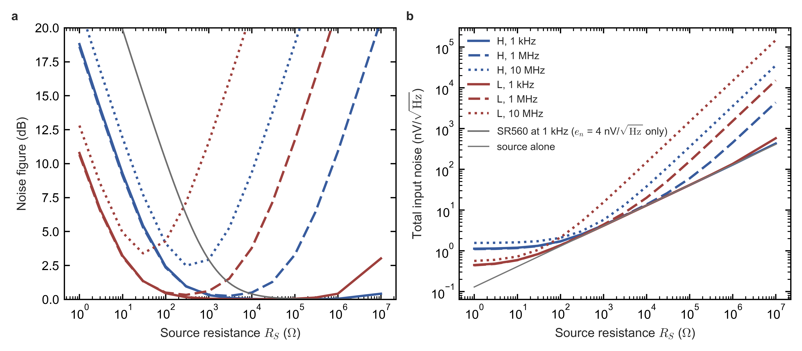

*Figure 13. (a) Noise figure against source resistance at 1 kHz, 1 MHz and 10 MHz, with the SR560's specified 4 nV/√Hz at 1 kHz alone for comparison (manual, specifications chart, printed p. 5; data sheet p. 3). (b) Total input noise against source resistance, with the source's own thermal noise.*

### 6.3 Frequency response and stability

*Table 11. Frequency response of the chain (`scripts/chain.py ac`, `sim/results/chain_ac.json`; the SR560 row from `scripts/sr560_chain.py`, `sim/results/sr560_chain.json`, its peaking from `sr560_chain_ac_*.npz` by `scripts/numbers_s6_7.py`). A range covers the gains of its row.*

| Mode | Gains | −3 dB | at 1 MHz | at 10 MHz | Peaking |
|---|---|---|---|---|---|
| H, front end ×10 | 1 – 10 (and H_HR up to 1000) | 24.9–25.0 MHz | 0.00 dB | −0.41 to −0.42 dB | none |
| H, front end ×100 | 100 – 50 000 | 14.82–14.84 MHz | +0.01 dB | −0.37 dB | 0.17 dB |
| L | 200 – 100 000 | 16.5 MHz | −0.01 dB | −0.82 dB | none |
| SR560 reproduction | 1 – 50 000 | 0.73–0.79 MHz | −4.2 to −4.8 dB | – | none |

The bandwidth is the same at every gain, because the gain is set by attenuators in front of fixed-gain stages and the front end's two settings, so the gain-bandwidth trade of a single op amp does not apply (Figure 14). Its limit is the front end's loop (Section 4.3); the stages after the front end, alone, reach −3 dB at 116–156 MHz (`scripts/chain_extras.py post`, `sim/results/chain_extras.json`). The stability checks are those of Table 6 and the transient oscillation check of Section 4.3; with the input networks, none of the simulated sources (50 Ω, 1 kΩ and 1 MΩ) peaks by more than 0.52 dB (H with 1 kΩ; Figure 10c, `zin_numbers.json`).

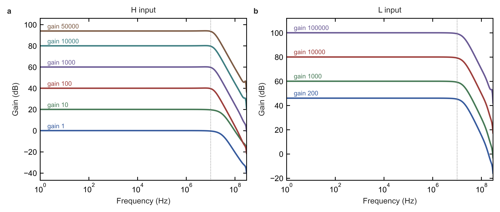

*Figure 14. Frequency response of the chain at every simulated gain: (a) H input, (b) L input. The dotted line marks 10 MHz.*

### 6.4 Common-mode rejection

The CMRR was estimated by Monte Carlo over 12 trials per case, 6 for the runs with one class of mismatch at a time (`scripts/cmrr_mc.py`, `sim/results/cmrr_mc.json`). Each trial draws from Gaussian distributions clipped at 3σ, whose widths are assumptions of this study unless a source is given:

- resistors with 0.05 % σ (for 0.1 % parts), and S2's network with 0.005 % σ (for a 0.01 % network);
- $C_I$ and $C_X$ with 1 % σ (for 2 % C0G parts); $C_{node}$ is not varied;
- the input networks' capacitors with 2.5 % σ (for 5 % parts), and $R_Z$ with 0.5 %;
- the JFETs: each JFE2140 half with σ 0.85 mV of $V_{TO}$ and 1 % of $\beta$ about its dual's common offset (σ 100 mV and 5 %). The two halves of a dual then differ by $\sqrt2 \times 0.85$ = 1.20 mV rms, a mean $\lvert\Delta V_{GS}\rvert$ of $1.20\sqrt{2/\pi}$ = 0.96 mV, against the data sheet's 1 mV typical and 4 mV maximum (SLPS730B p. 5, Table 6.5); the data sheet specifies no $\beta$ matching, only $I_{DSS1}/I_{DSS2}$ = 0.95–1.05. The JFE150s come from one ±5 mV $V_{GS}$ bin: σ 3 mV of $V_{TO}$ (a uniform ±5 mV spread has $5/\sqrt3$ = 2.9 mV) and 2 % of $\beta$ about the bin's common offset (σ 85 mV and 5 %);
- each LSBF862 cascode with σ 50 mV of $V_{TO}$ and 5 % of $\beta$.

Both inputs were driven from 50 Ω sources, and separately directly (0 Ω, the usual condition of a CMRR specification). A third set of trials kept 50 Ω sources but trimmed the input networks' capacitors to a residual mismatch of 0.1 %, as a single trimmer per input would. One class of mismatch at a time showed which limits the CMRR.

*Table 12. CMRR (dB), median of 12 trials (6 in the rows with one class of mismatch), at a total gain of 1000 (H, L) and 100 (H with the front end at ×10). The SR560 reproduction's row is from `scripts/sr560_chain.py` (`sim/results/sr560_chain.json`, ideal matching). The SR560's specification is 100 dB to 1 kHz, falling by 6 dB per octave above (data sheet p. 3), i.e. $100 - 20\log_{10}(f/1\ \mathrm{kHz})$ dB; its manual gives > 90 dB to 1 kHz (printed p. 5). The NF 5307 row is the gain-100 curve of Fig. 46 on NF's data-sheet page (`refs/commercial_preamps/NF_Corporation/NF_5307_datasheet_fig46.jpg`), read by eye at the table's frequencies and checked against the image's pixels (`scripts/nf5307_plot_check.py`, within 0.4 dB up to 100 kHz). The curve stops at about 0.9 MHz; its value at 1 MHz is the straight-line extrapolation of its last 0.4 decade.*

| Case | 10 Hz | 1 kHz | 10 kHz | 100 kHz | 1 MHz | 10 MHz |
|---|---|---|---|---|---|---|
| H ×100, 50 Ω sources | 114 | 124 | 116 | 98 | 78 | 62 |
| H ×100, inputs driven directly | 114 | 124 | 123 | 115 | 95 | 75 |
| H ×100, input networks trimmed | 114 | 124 | 123 | 115 | 97 | 75 |
| H ×10, 50 Ω sources | 104 | 104 | 104 | 95 | 77 | 61 |
| L, 50 Ω sources | 108 | 119 | 99 | 79 | 60 | 46 |
| L, inputs driven directly | 108 | 132 | 137 | 118 | 98 | 78 |
| L, input networks trimmed | 108 | 131 | 125 | 105 | 84 | 55 |
| H ×100, JFETs mismatched only | 106 | 128 | 130 | 113 | 93 | 72 |
| H ×100, resistors only | 132 | 125 | 125 | 124 | 112 | 86 |
| H ×100, capacitors only | 141 | 139 | 124 | 104 | 84 | 62 |
| L, capacitors only | 146 | 115 | 95 | 75 | 55 | 41 |
| SR560 reproduction, ideal matching | 105 | 102.5 | 86.5 | 67.7 | 61.6 | – |
| SR560 specification | 100 | 100 | 80 | 60 | 40 | – |
| NF 5307 (plot, gain 100) | 136 | 136 | 126 | 107 | 85 | – |

The class-by-class runs locate the limits:

- **Above 10 kHz, the capacitors, and above all the input networks against the source resistance.** A mismatch $\Delta C$ of the capacitance from each input to ground converts common-mode voltage into a differential one through the source resistance, with $\mathrm{CMRR} \approx 1/(\omega R_S \Delta C)$. For L, with $C_P$ = 30 pF and $C_Z$ = 220 pF per input, each with 2.5 % σ, the two inputs differ by $\Delta C = \sqrt2 \times 2.5\,\% \times \sqrt{30^2 + 220^2}$ pF = 7.9 pF rms. With 50 Ω sources this gives 52 dB at 1 MHz, and 56 dB for the median $\lvert\Delta C\rvert$, 0.674 times the rms value, against the 55 dB median of the capacitor-only runs (`scripts/numbers_s6_7.py`). The error is purely capacitive, so one trimmer per input nulls it at all frequencies for a given source: L recovers 25 dB at 1 MHz. Driven directly, both front ends reach 95–98 dB at 1 MHz, beyond the NF 5307's 85 dB.
- **At low frequencies, the bootstrap's supply resistor $R_{UP}$, together with the JFETs' mismatch.** At 10 Hz the front ends sit at 108 dB (L) and 114 dB (H), against 124 dB (H) and 132 dB (L) at 1 kHz with the inputs driven directly. $R_{UP}$ feeds the bootstrap from +15 V, so its current changes with the input common mode, by $\Delta V/R_{UP}$. Through $R_{BS}$ this moves the cascodes' gates by $-(R_{BS}/R_{UP})\,\Delta V$ = −(3.5 kΩ/10.9 kΩ) $\Delta V$ = −0.32 $\Delta V$ relative to the sources, and below the bootstrap's corner, $1/(2\pi R_{BS}C_{BS})$ = 45 Hz, where $C_{BS}$ no longer holds that voltage, the input JFETs' $V_{DS}$ follows about a third of the common mode. The JFETs' mismatched output conductances turn this into a differential error. With $R_{UP}$ replaced by an ideal 1 mA current source, the median CMRR of the JFET-only trials (H, inputs driven directly, 4 trials) rises from 106.2 to 138.0 dB at 10 Hz and from 111.8 to 137.9 dB at 100 Hz, by 31.8 and 26.1 dB, and changes by at most 0.33 dB from 10 kHz up (`scripts/cmrr_mc.py`, cases `H100_jfet_rs0_R_UP` and `H100_jfet_rs0_ideal_I_BS`, `sim/results/cmrr_mc.json`, `rup_test`; the same decks as the first test's in `sim/runs/cmrr_mc/test_rup_*`). The common-mode servo plays no part, since a common-mode signal leaves its error signal, Eq. (8b), unchanged. A build should therefore feed each bootstrap from a current source, a degenerated PNP transistor or a JFET current regulator, instead of $R_{UP}$; the simulated baseline keeps $R_{UP}$.
- **The resistors** (0.05 %) leave 124–132 dB up to 100 kHz and do not limit anywhere. Discrete 0.1 % resistors instead of a network in S2 cost 12 dB at 1 kHz (111.5 against 123.8 dB, case `H100_discrete`).

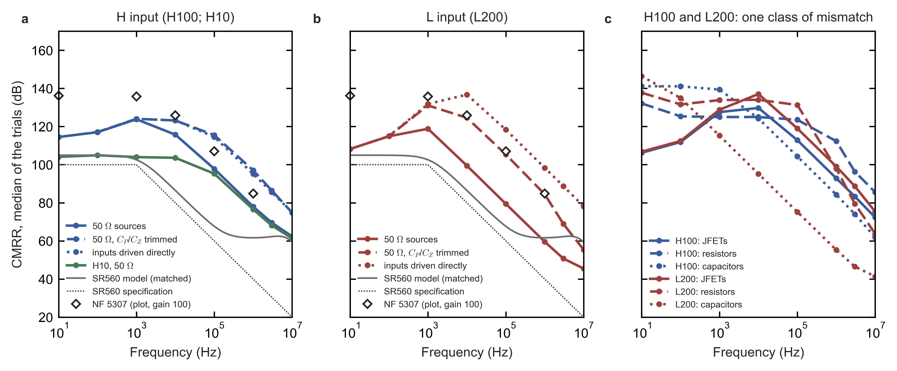

*Figure 15. CMRR against frequency, medians of 12 trials (6 in panel c): (a) H input, (b) L input, each with 50 Ω sources, with the input networks trimmed and with the inputs driven directly, against the SR560 (reproduction and specification) and the NF 5307's plot; (c) one class of mismatch at a time.*

### 6.5 Distortion, steps, overload and supply rejection

*Table 13. Large-signal results (`scripts/large_signal.py`; `sim/results/large_signal.json`; L's steps from `large_signal_L1000_step.json` and H's recovery from `large_signal_THS4031.json`, both reproduced by `scripts/large_signal.py repro`; rounded by `scripts/numbers_s6_7.py`). THD includes harmonics 2–9 of a differential sine, at the output; H at a total gain of 100 (front end ×100, S2 at the full output level), L at 1000. S2 is the LM7171 unless stated. L's entries are simulated with the 6 V PZT3904 sinks of Section 4.2.1, except the steps: with these sinks the step transients did not complete (Appendix, "Transients that stop or crawl"), so L's steps are those of the first design's 2 V sinks (MMBT3904), with which the loop margins and the bandwidth are the same (`sink_power.json`).*

| Test | H, gain 100 | L, gain 1000 |
|---|---|---|
| THD, 1 kHz, 1 / 10 Vpp | 0.0001 % / 0.0002 % | 0.0001 % / 0.0002 % |
| THD, 100 kHz, 1 / 10 Vpp | 0.0001 % / 0.0026 % | 0.0001 % / 0.0025 % |
| THD, 1 MHz, 1 / 10 Vpp | 0.0009 % / 0.025 % | 0.0009 % / 0.023 % |
| THD, 10 MHz, 1 Vpp | 0.012 % (fundamental 0.961 Vpp) | 0.0100 % (fundamental 0.916 Vpp) |
| 1 V step: 10–90 % rise, overshoot, settling to 1 % / 0.1 % | 23 ns, 7.7 %, 83 / 129 ns | 34 ns, 4.7 %, 106 / 163 ns (50 Ω sources; 2 V sinks) |
| 10 V step: rise, overshoot, settling to 1 % / 0.1 %, slew rate | 27 ns, 9.3 %, 84 / 131 ns, 312 V/µs | 34 ns, 4.7 %, 106 / 163 ns, 275 V/µs (50 Ω sources; 2 V sinks) |
| Recovery from a threefold overload held for 20 µs, to 1 % | 0.19 µs (THS4031 in S2; 1 Ω sources) | 0.15 µs (50 Ω sources) |
| Supply rejection referred to the input, +15 V / −15 V: 1 kHz; 1 MHz; 10 MHz | 101 / 101 dB; 81 / 86 dB; 61 / 66 dB | 117 / 120 dB; 90 / 98 dB; 70 / 78 dB (−15 V with the first design's 2 V sinks: 122, 102 and 80 dB, `sink_power.json`) |

The distortion stays below 0.001 % up to 1 MHz at 1 Vpp. At 10 Vpp and 1 MHz it rises to 0.025 %, and at 10 MHz and 1 Vpp to 0.012 %, both dominated by the third harmonic (0.018 % against 0.0014 % for the second, and 0.011 % against 0.0032 %; `large_signal.json`); which stage produces it was not simulated separately. L's value at 10 MHz depends on S2 and, less, on the sinks: 0.0100 % with the LM7171 and 0.0369 % with the THS4031 with the 6 V sinks, 0.0072 % and 0.0376 % with the first design's 2 V sinks (`scripts/large_signal.py floor`, `sim/results/large_signal_floor.json`). The 10 V step's 312 V/µs gives a full-power bandwidth of 312 V/µs / (π × 10 V) = 9.93 MHz for 10 Vpp. Its 9.3 % overshoot is mostly the front end's own: alone, with its outputs unloaded, the front end overshoots 8.7 % on the same step, and 9.4 % when S2 loads it. The stages after S2 limit the slew rate: 394 V/µs at the front end's outputs alone and 390 V/µs at S2's output, against 312 V/µs at the chain's output (`scripts/chain_extras.py step`, `sim/results/chain_extras.json`). The numerical floor of the THD measurement lies far below these values. The same sources, transient and harmonic analysis applied to a purely linear reference (an ideal gain and one RC low-pass at the chain's −3 dB frequency) give −158 to −180 dBc, and five integration settings (Gear, trapezoidal, two tighter tolerances, four times finer steps) change H's THD at 1 Vpp by at most 0.1 dB: −122.0 to −122.1 dBc at 1 kHz, −121.0 to −121.2 dBc at 100 kHz and −101.2 to −101.3 dBc at 1 MHz (`large_signal_floor.json`; at 100 kHz the setting with reltol = 1e-5 and abstol = 1e-11 stopped, Appendix).

**Overload and recovery.** The overload test applies a differential step of three times the full-scale input (30 V at the output) for 20 µs, then removes it. Recovery is the time after the input returns until the output stays within 1 % of full scale (0.1 V) of its final value. Where the chain clips depends on the gain allocation (Section 4.1):

- **L at a gain of 1000.** The front end (gain 201) stays linear, with 6.0 V between its outputs. S3, at a gain of 5, would need 30 V, so it and the stages after it clip, and the output stops at 11.4 V. When the input returns, the output undershoots by 1.31 V, stays more than 0.1 V below its final value for 33 ns, and settles within 0.15 µs (`sim/results/overload_numbers.json`).
- **H at a gain of 100.** The front end runs at its full gain, so it is the first stage to saturate. Its two op amps clip at +13.4 V and −13.0 V, 26.4 V between the outputs against the 30 V they would need, and the output stops at 11.4 V. When the input returns, the front end's outputs swing to −2.13 V (side A) and +2.86 V (side B), 2.49 and 2.51 V from rest, and are back within 12 mV of rest after 0.19 µs. The output is within 0.1 V after 0.19 µs: after a delay of 86 ns it returns with a 10–90 % slope of 111 V/µs and peaks of 268 V/µs over 5 ns, not at a constant slew rate (Figure 16d). (These waveforms are from the run with the THS4031 in S2, `sim/results/overload_curves_H100_THS4031.npz`, and the numbers from `scripts/overload_detail.py numbers`, `sim/results/overload_numbers.json`. The front end is the same with either S2, and S2 clips only after it. With the LM7171 in S2, the same transient stopped with "timestep too small" at the onset of the overload (in an input JFET or in the model of S3's op amp) or ran past its time limit, on both benches and with every integration setting tried (Appendix, "Transients that stop or crawl"); since the front end and the THS4031 version run normally, this is taken to be a numerical failure of the run, not a property of the circuit.)

Inside the front end, a saturated op amp opens the outer loop, and the source nodes no longer follow the gates exactly. In the H run they still follow to within +23.5 mV (side A) and −7.9 mV (side B), against the ±150 mV steps at the gates: the 26.4 V at the clipped outputs still drives most of the needed current through $R_F$ and $R_G$. These small $V_{GS}$ changes, far from the +0.36 V that would bring a gate to zero bias ($V_{GS}$ = −0.36 V at rest, Table 5), still shift the JFETs' current. The clipped integrators cannot cancel that, so each summing node moves until $R_D$ carries the difference: from 8.99 V to 8.56 V (side A) and 9.13 V (side B), i.e. $\Delta I = -\Delta V/R_D$ = +0.72 mA and −0.23 mA with $R_D$ = 600 Ω ($g_m\Delta V_{GS}$ gives +0.81 and −0.27 mA). Nothing winds up beyond this: the summing nodes are back within 10 mV of rest 0.11 µs after the input returns. The two op amps clip at different levels, so the outputs' mean (+0.23 V) leaves the sources' mean (+0.35 V) during the overload. The common-mode servo sees this −0.12 V as its error $e$ and integrates it, with its transconductance $G_{INT}$ = 1 µS into $C_{INT}$ = 1 µF (Section 4.2), at $G_{INT}e/C_{INT}$ = 0.12 V/s, which is 2.4 µV over 20 µs but would matter for an overload lasting seconds (below).

Several things are not simulated:

- **Larger overloads.** With the op amps clipped, the source nodes sit on the divider $R_F$–$R_G$–$R_F$ between the clipped outputs, so they differ by $(v_{oa} - v_{ob})\,R_G/(2R_F + R_G)$ = 26.4 V × 10.1 Ω / 1010.1 Ω = 0.26 V, and each side's $V_{GS}$ changes by about $(v_{in} - 0.26\ \mathrm{V})/2$ (the JFETs' own current change neglected): 0.37 V at ten times full scale on H (1 V differential). One gate reaches zero bias at 0.97 V, 9.7 times full scale (`overload_numbers.json`), and beyond that it approaches forward bias and the input draws gate current. No run at this level is archived.
- **Overloads lasting seconds.** Because the op amps clip unequally, the common-mode servo (Section 4.2) integrates a −0.12 V error during an overload. After one second it would have moved the sinks' reference by $G_{INT}e\,(1\ \mathrm{s})/C_{INT}$ = 0.12 V, i.e. the outputs' common mode by $R_F/R_T$ = 500 Ω/182 Ω = 2.75 times that, 0.33 V, which then decays with the servo loop's time constant $(C_{INT}/G_{INT})(R_T/R_F)$ = 0.36 s (`overload_numbers.json`). S2 rejects this common-mode shift, but it uses up swing. A build should freeze the servo while an overload detector is active.
- **The bootstrap.** $C_{BS}$ (1 µF behind $R_{BS}$ = 3.5 kΩ, $R_{BS}C_{BS}$ = 3.5 ms) would take milliseconds to recover from a change of the source node's average voltage. A symmetric differential overload does not cause one.
- **An overload indicator.** The SR560 has one; this design would need a window comparator on the front end's outputs and on S3–S5.

**The choice of S2.** S2 sees the full output level whenever the total gain equals the front end's gain, so its distortion and slew rate set the chain's at those gains. Table 14 compares three candidates in the same chain.

*Table 14. The difference amplifier S2 (H, total gain 100; `scripts/da_compare.py`, `sim/results/da_compare.json`; slew rates from `large_signal_THS4031.json` and `large_signal.json`). The first column gives data-sheet values: THS4031, SLOS224L pp. 1 and 6; LM7171 A grade, SNOS760D §5.5, p. 5; THS3091, SLOS423K pp. 1 and 6. Noise is the simulated input-referred white level (1 MHz) and the 1 kHz value, from each part's model (the LM7171's raised to its data sheet's, `scripts/models.py`).*

| S2 | THD, 10 MHz, 1 Vpp | THD, 1 MHz, 10 Vpp | Slew rate, 10 V step | Noise at gain 10 (H) | Noise at gain 100 (H) |
|---|---|---|---|---|---|
| THS4031 (1.2 nV/√Hz, 100 MHz at a gain of 2) | 1.30 % | 0.141 % | 133 V/µs | 3.56 / 4.13 | 1.11 / 1.16 |
| LM7171, A grade (8.5 nV/√Hz, 4100 V/µs, 160 MHz) | 0.012 % | 0.025 % | 312 V/µs | 3.94 / 4.53 | 1.13 / 1.17 |
| THS3091 (1.1 nV/√Hz, its model 1.9; current feedback, so S2's resistors are 1 kΩ instead of 499 Ω) | 0.012 % | 0.025 % | – | 4.16 / 5.16 | 1.14 / 1.20 |

The THS4031's third harmonic at 10 MHz (−38 dBc at 1 Vpp) is 12 dB above the data sheet's −50 dBc at 2 Vpp (SLOS224L Fig. 5-15, p. 12, read by eye), and 24 dB above it once that is scaled to 1 Vpp as $V^2$, i.e. to −62 dBc (Section 5.3, `model_defects.json`). Even −62 dBc would leave it 17 dB, 6.9 times, above the LM7171's −79 dBc. With the LM7171 or the THS3091 the remaining distortion, −79 dBc in the third harmonic, belongs to the rest of the chain. The price of the LM7171 is noise at the front-end gain of 10: 3.94 against 3.56 nV/√Hz at a total gain of 10, and in the high-reserve mode 2.6 against 2.0 nV/√Hz white and 2.8 against 2.0–2.1 nV/√Hz at 1 kHz (Section 6.1). If low-frequency, high-reserve operation matters more than 10 MHz distortion, the THS4031 is the better S2. Both fit the same footprint.

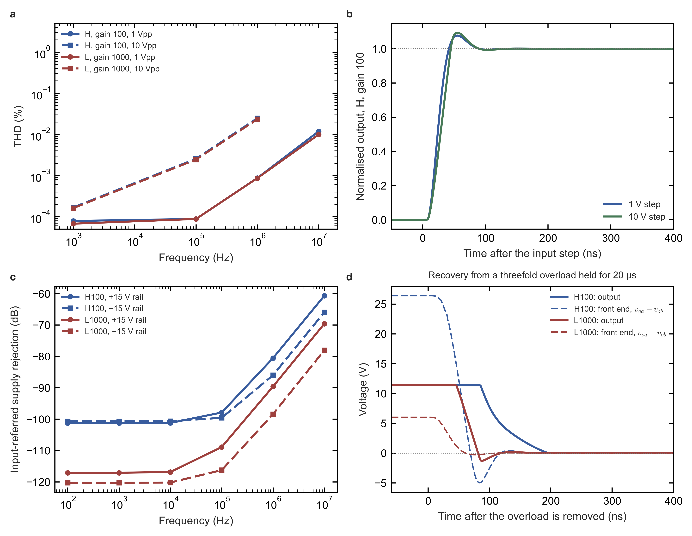

*Figure 16. (a) THD against frequency at 1 and 10 Vpp output, H at a gain of 100 and L at 1000. (b) The 1 V and 10 V steps of H at a gain of 100, normalised. (c) Supply rejection referred to the input. (d) Recovery from a threefold overload: the output and the front end's differential output after the overload is removed (H with the THS4031 in S2: after 86 ns the output returns with a 10–90 % slope of 111 V/µs; L with the LM7171, driven from 50 Ω; `overload_numbers.json`).*

### 6.6 How the design compares

*Table 15. The new design against the SR560 (its specification and its reproduction in ngspice) and the NF 5307 (its documents). Input noise in nV/√Hz. SR560: manual, specifications chart (printed p. 5), noise curve (printed p. 20) and noise table (printed p. 21), and data sheet p. 3. NF 5307: specifications sheet (`NF_5307_specifications_EN.pdf`); noise plot, instruction manual Fig. 4.7 (PDF p. 37, printed p. 25); CMRR plot, Fig. 46 of NF's data-sheet page; the plots read by eye and checked against the images' pixels (`scripts/nf5307_plot_check.py`). This design: Tables 9, 11 and 12; input capacitance $C_P + C_Z$ (`protection.json`).*

| | SR560 (specification) | SR560 (reproduction) | NF 5307 | This design, H | This design, L |
|---|---|---|---|---|---|
| Input noise, white / 1 kHz, gain ≥ 1000 | 4 (1 kHz) | 3.2 / 5.7 | 4 (spec., 1 kHz); ≈ 3 (plot, gain 100) | 1.08 / 1.11 | 0.42 / 0.42–0.43 |
| Input noise at 10 Hz, gain ≥ 1000 | ≈ 11 (typical curve) | 48 (model's 1/f overstated) | ≈ 6 (plot, gain 100) | 2.8 | 0.94–0.96 |
| Input noise at gain 10 | 13 | 11.5 | 15–16 (plot) | 3.9–4.5 | – |
| Input capacitance | 25 pF | – | < 35 pF | ≈ 20 pF | ≈ 250 pF |
| Bandwidth (−3 dB) | 1 MHz (1.2 MHz typ., data sheet) | 0.73–0.79 MHz | 10 MHz (+0.2/−3 dB) | 14.82–14.84 MHz (24.9–25.0 MHz at ×10) | 16.5 MHz |
| CMRR at 1 kHz / 1 MHz | 100 dB / 40 dB (data sheet; manual > 90 / > 30 dB) | 102.5 / 61.6 dB (matched) | ≥ 120 dB (DC–1 kHz, gain 1000) / 85 dB (plot, gain 100) | 124 / 95 dB (median, driven directly) | 132 / 98 dB |
| Gain range | 1–50 000 | – | 10–1000 | 1–50 000 | 200–100 000 |

The comparison has three caveats. The new design's figures are simulated, with corrected vendor models; the commercial ones are specified or plotted for real instruments. The SR560's input capacitance includes its input protection and connectors, which the new design represents only by its $C_P$ of 10 or 30 pF. And the NF 5307's CMRR plot does not state its source impedance, so it is compared here with the case of inputs driven directly.

---

## 7. What is not verified, and the next steps

**The common-mode local loop at 251 MHz (H) and 204 MHz (L).** The final front ends keep 8–10 dB of gain margin at the frequency where the common-mode return ratio at the op amp's output crosses −180° (`curves_loop.npz` with `frontend._margins`, interpolated by `scripts/numbers_s6_7.py`), in a mode that depends on the THS4021 model well beyond its specified bandwidth and on the summing node's layout capacitance (Section 4.3). At the corners of Table 6a the margin falls to 5.7 dB. A prototype must be checked for this mode before anything else, following the bench plan of Section 4.3.1, and $C_{node}$ fitted for at least 6 dB of measured gain margin. The low-voltage op-amp alternative of Table 6b has not been checked for distortion, overload, common-mode range or CMRR.

**The vendor models.** All op-amp noise models were corrected to their data sheets' typical curves, read by eye, except the THS4021's and THS4031's current noise, read from the curves' pixels (`scripts/ti_plot_check.py`). The THS4031 model's third harmonic at 10 MHz is 12 dB above its data sheet's as read, and 24 dB above once scaled to the same level (Sections 5.3 and 6.5); the LM7171's distortion and slew behaviour have not been checked against its data sheet. The JFET models reproduce their data sheets' noise and capacitance at the data sheets' bias points, with ngspice's fixed junction grading exponent of 0.5; the capacitances at other voltages, and their nonlinearity, are approximate.

**The current sinks' heat and drift.** Section 4.2.1 gives L sinks that survive their dissipation: a PZT3904 with 6 V across $R_T$, 0.59 W and 49 K above ambient. That figure is for onsemi's test board, not this one, and nothing was simulated thermally.

The L results of Sections 4 and 6 are simulated with the 6 V sinks, except the steps of Table 13, which did not complete with them (Appendix) and come from the first design's 2 V sinks; with either sink design the loop margins and the bandwidth are the same (`scripts/sink_power.py`), and the sinks' output impedance only rises with $R_T$.

The drift from the two sinks' temperature difference (Section 4.6) must be measured on a prototype.

**The input.** The input protection (proposed with its costs in Section 4.4, Table 6d), the H/L relay and the input connector are represented only by $C_P$; the common-mode range, −12.8 V to +3.7 V for H and −9.0 V to +3.6 V for L (Eqs. (8c) and (9b)), is estimated from the operating point, not simulated. The bias resistors (100 MΩ for H) add $\sqrt{4kT/R}$ = 13 fA/√Hz at 300.15 K, and the leakage of the protection and the relay adds its shot noise. For H, the total equals the voltage noise of 1.08 nV/√Hz at 84 kΩ of source impedance with the bias resistor alone, and at 49 kΩ with 1 nA of leakage (`scripts/protection.py`, `sim/results/protection.json`).

**Offsets and drift.** The DC offset trim of Section 4.6 is designed on paper only; with 50 kΩ its example range covers 2.3 times H's simulated rms offset at a gain of 100, which for a Gaussian spread leaves 2.3 % of front ends outside it. The temperature drift of the binned JFE150 array is unknown; the data sheet specifies no matching.

**Things not simulated.** The relays' and switches' charge injection and their distortion at high signal levels, the filters' switching, the overload indicators, the power-on behaviour of the common-mode servo, the thermal coupling between the paralleled JFETs, and the layout's parasitic inductance and capacitance.

**The bootstrap's current source.** Replacing $R_{UP}$ with a current source raises the low-frequency CMRR by 32 dB at 10 Hz and 26 dB at 100 Hz in the ideal test of Section 6.4; a real current source (its output impedance, noise and headroom) has not been simulated.

**Next steps.** A board of one front end (H, then L) with its difference amplifier, to measure the noise with shorted inputs by cross-correlation of two units (Rubiola and Vernotte 2010), the stability, and the CMRR; then the full chain.

---

## 8. Files

All paths are relative to this folder.

| Path | Content |
|---|---|
| `netlists/` | standalone netlists written by `scripts/export_netlists.py` from the same generators as the simulations, each run once after writing: front ends H (gain 100 and 10) and L, the complete chain with H and with L at a total gain of 1000, and the SR560's front end and chain; they include the prepared models from `sim/models/_lib/` and run with `ngspice -b <file>` |
| `scripts/frontend.py` | the front ends H and L as a netlist generator (`FE`, `CASES`), and their checks: operating point, AC, noise with groups, loop gain broken at $R_F$ and at the op amp's output (`check_loop_out`), input admittance, sources |
| `scripts/chain.py` | the complete chain (Section 4.5), the gain allocation of Eq. (7) and its AC and noise runs (`chain_ac.json`, `chain_noise.json`) |
| `scripts/comp_search.py`, `scripts/osc_check.py`, `scripts/stability_corners.py` | Sections 4.3 and 4.3.1: the scan of $C_I$, $C_X$ and $C_{node}$, the transient oscillation check, and the margins at corners and with an isolation resistor (`comp_search_*.json`, `osc_check.json`, `stability_corners.json`); `python osc_check.py first` reruns the first versions (the `*_first` entries); the low-voltage option of Table 6b is `scripts/lv_option.py` (`lv_option_scan.json`, `lv_option.json`, `lv_option_range.json`), run with the `oa_rail` option of `FE` in `scripts/frontend.py` |
| `scripts/fe_closed_forms.py` | Eqs. (8c), (9a)–(9c), (11a)–(11b), (12)–(12a): the closed forms of Sections 4.2, 4.2.1, 4.6 and 6.1, from the archived results (`fe_closed_forms.json`) |
| `scripts/op_pitfall.py` | Section 5.1: the two wrong operating points, reproduced, with Kirchhoff's current law at the bootstrap node (`op_pitfall.json`) |
| `scripts/protection.py` | Section 4.4 and Table 6d: the closed forms of the input protection and the input network (`protection.json`) |
| `scripts/sink_power.py` | Section 4.2.1, Table 5a, and Section 4.6: the sinks' dissipation for L against the voltage across $R_T$, the drift per kelvin of temperature difference between the two sinks (also for H), loop margins, noise and supply rejection; `python sink_power.py tab` adds the copper capacitance at the source nodes (`sink_power.json`) |
| `scripts/sink_options.py` | Section 6.1, Table 8a: current-sink variants (their noise, the common-mode range they allow, their dissipation, also for L), the $R_F$ = 250 Ω comparison for the gain-10 range, and the chain's noise for each (`python sink_options.py chain`); results in `sink_options.json` |
| `scripts/gain_options.py` | Section 4.3.1, Tables 6b and 6c (`python gain_options.py derived`: the shares, ratios and currents of its text, `fe_gain_derived.json`): the front end's gain lowered with a larger $R_G$ or a smaller $R_F$; margins, bandwidth, and the noise split by contributor, with each noise run's operating point checked against its AC run (`fe_gain_scan.json`, `fe_gain_options.json`) |
| `scripts/collect_curves.py` | the curves behind Figures 9, 10, 12 and 14 (`curves_*.npz`), and Figure 10's numbers with and without the input network (`zin_numbers.json`) |
| `scripts/cmrr_mc.py` | the CMRR Monte Carlo of Section 6.4 and its $R_{UP}$ test (`cmrr_mc.json`) |
| `scripts/large_signal.py`, `scripts/overload_detail.py`, `scripts/da_compare.py`, `scripts/chain_extras.py` | Section 6.5: distortion and the method's floor, steps, overload and its numbers, supply rejection, the choice of S2 and the high-reserve noise with each S2, the stages after the front end alone, and the supply currents (`large_signal*.json`, `overload_numbers.json`, `da_compare.json`, `chain_extras.json`) |
| `scripts/noise_vs_source.py` | Table 10 and Figure 13 (`noise_vs_source.json`) |
| `scripts/sr560_frontend.py`, `scripts/sr560_chain.py`, `scripts/sr560_bw_check.py` | the SR560 reproduction of Section 2 (`sr560_frontend.json`, `sr560_chain.json`), and what sets its bandwidth: each op amp faster or ideal, or fitted to its data sheet's open-loop curves, and the netlist's departures from the schematics (`sr560_bw_check.json`) |
| `scripts/models.py` | model preparation and calibration (Sections 3.4 and 5.3): JFET wrappers and fits, op-amp translation and noise correction, the vendor op-amp models as published for Table 7, BJT cards; writes `sim/models/_lib/` and `sim/results/jfet_calibration.json` |
| `scripts/jfet_model_check.py`, `scripts/jfet_data.py`, `scripts/noise_theory.py` | Figure 5 and the calibration check, Tables 2 and 3, and the closed forms of Section 1 (`jfet_model_check.json`, `jfet_table3.json`, `noise_theory.json`) |
| `scripts/opamp_noise_check.py`, `scripts/model_defects.py` | Section 5.3 and Table 7: the vendor models' noise against their data sheets, as published and as corrected (`opamp_noise_check.json`, `model_defects.json`) |
| `scripts/numbers_s1_3.py`, `scripts/numbers_s4a.py`, `scripts/numbers_s4b_5.py`, `scripts/numbers_s6_7.py` | the derived numbers of the summary and Sections 1–3, of Sections 4.1–4.3.1, 4.4–5, and 6–7 with the Appendix: each rounding, ratio, range and data-sheet or plot reading of the text, with its formula and source, from the archived results (`numbers_*.json`); no simulation |
| `scripts/nf5307_plot_check.py`, `scripts/ti_plot_check.py` | the NF 5307's CMRR and noise plots read from their pixels, a check of the readings by eye (`nf5307_plot_check.json`); TI's capacitance and op-amp noise plots read from their pixels, the source of the JFE150's and JFE2140's $C_{rss}$ and of the THS4021's and THS4031's current noise at 10 Hz (`ti_plot_check.json`) |
| `scripts/blocks.py` | behavioural op amps with calibrated noise, and the 1/f generators used in the corrections |
| `scripts/make_figures.py`, `scripts/plot_style.py` | Figures 1, 3–5, 9, 10 and 12–16 |
| `scripts/make_schematics.py`, `scripts/schematics.py`, `scripts/schematic_style.py` | Figures 2, 6–8 and 11, each checked against its netlist |
| `scripts/spice.py`, `scripts/ngspice_shared.py` | running ngspice-46 (KiCad 10's shared library) from Python |
| `scripts/README.md` | every script with its results, and the order to reproduce everything |
| `scripts/build_note.py`, `scripts/make_web_html.py`, `scripts/note.css` | the build of this note: Markdown → HTML (pandoc, MathML) → PDF (headless Chrome), and the web page `index.html` |
| `sim/models/` | the vendors' models as downloaded (not redistributed; sources in `README_*.md`) and the prepared copies in `_lib/` |
| `sim/runs/`, `sim/results/` | every deck with its log and data, and the summaries |
| `figures/` | Figures 1–16 as PNG and PDF |
| `audit/` | the number audit of 21–22 November 2026: its findings (`number_audit_2026-11-21.md`), the archived results it added and the changes it made (`phase1_*.md`, `phase2_reports.md`), and the patches that applied it to this note (`patch_*.py`) |
| `refs/` | the SR560's manual and data sheet (`benchmark/`), the JFET, op-amp, switch, relay and regulator data sheets (`datasheets/`), the commercial instruments' documents (`commercial_preamps/`), and the literature (`literature/`), each folder with a README of sources and a survey of what was read |

---

## Appendix. ngspice pitfalls and techniques

The pitfalls and techniques below are those met in this work. Those shared with the companion high-voltage amplifier note are given only briefly.

### Pitfalls

- **A loop broken at the wrong place.** A Middlebrook injection at the feedback resistor measures the outer loop with the op amp's local loop closed. An unstable local loop does not show in it, nor in the AC response or the noise analysis, which linearise around an operating point whether it is stable or not. Only a transient run, or a return ratio at a point that every loop passes through (here the op amp's output pin), shows it. The first front ends of this note oscillated in common mode for that reason, H at 293 MHz with 50 Ω sources and 283 MHz with its inputs tied through 1 mΩ, L at 276 and 227 MHz (`scripts/osc_check.py first`, `sim/results/osc_check.json`; Section 4.3).
- **Tiny resistors and abstol.** With abstol = 1e-15 A, a 1 mΩ source resistor asks ngspice to resolve about 1e-18 V across it. AC and noise runs were unaffected, but transients stopped with "timestep too small" at the gate nodes. Transients use 1 Ω (or the real source) and abstol = 1e-12 A.
- **A deck with no DC solution can hang the shared library.** A Monte Carlo trial with unsorted JFE150 (Section 4.6) hung in ngspice's dynamic gmin stepping, and the shared library cannot be interrupted from Python. Each trial now runs in a child process with a time limit (`guarded_trial` in `scripts/cmrr_mc.py`). Fixed-step gmin stepping (`gminsteps`) failed fast but also made good trials fail; no deck of that attempt is archived.
- **Transients that fail at the start.** A few decks stopped with "timestep too small" in the first tens of nanoseconds with one set of options and ran with another. The large-signal benches try three sets of options in turn and then the inputs driven from 50 Ω (`tran` in `scripts/large_signal.py`), and record which one ran.
- **Transients that stop or crawl after a model change.** When every simulation was re-run after the JFETs' capacitances and the op amps' 1/f current noise had been recalibrated (Sections 3.4 and 5.3), some transients behaved differently, although nothing else in their circuits had changed:
  - The oscillation check of the final L front end (C_node 470 pF, 50 Ω sources and the input network, Gear integration, abstol = 1e-12 A) stopped at 744 ns with "timestep too small" in an input JFE150. It is a numerical failure, not an oscillation: the same deck run under Gear to 0.7 µs is quiet (0.19 µV peak to peak at the outputs), Gear with maxord = 2 stops at the same instant, and trapezoidal integration runs the full 1 µs at 0.075 µV. `scripts/osc_check.py` now repeats a run that Gear stops in this way with trapezoidal integration, in its own folder, and records it in the entry (`integration`).
  - H's threefold overload with the LM7171 in S2 converged with none of the attempts, as it had not before the recalibration either. In `scripts/large_signal.py` the first two option sets stopped with "timestep too small" (the second at 2.07 µs, just after the overload begins), and the third (Gear, itl4 = 1000, reltol = 2e-4) ran for 24 minutes without finishing. A transient inside ngspice's shared library cannot be interrupted from Python, so that process was stopped and its other tests run on their own. In `scripts/overload_detail.py`, whose attempts run in child processes with a 300 s limit, Gear stopped at 2.07 µs (in the model of S3's THS4021), and at 2.10 µs with 100 ns edges (in an input JFE2140); Gear with reltol = 1e-3, trapezoidal integration with reltol = 1e-3, and Gear with reltol = 1e-3 and 100 ns edges each reached the limit. H's overload figures therefore come from the same front end with the THS4031 in S2 and 1 Ω sources, which runs in a few seconds (`overload_detail.py --h-ths4031`; S2 clips only after the front end). L's overload ran with the first attempt.
  - In the floor study of Section 6.5, L at 10 MHz with the LM7171 and the first design's sinks needed the third option set instead of the second, and the variant with reltol = 1e-5 and abstol = 1e-11 stopped at 8.3 ns for H at 100 kHz, where it had run before.
  - L's steps with the 6 V sinks (`scripts/large_signal.py`): the 1 V step stopped at once with ngspice's "memory required" error, and the 10 V step ran for more than 30 minutes without finishing and was stopped by hand. With the first design's sinks (`large_signal.py repro L1000_step`) both steps ran on the 50 Ω bench, where before the recalibration the 1 V step had failed on every bench; Table 13 quotes those. H's steps ran as before.

  Each result records the options and the bench it ran with.
- **Libraries rewritten while other runs read them.** Several scripts regenerate the model libraries at start-up. Writing to a temporary file and renaming it (`_atomic_write` in `scripts/models.py`) keeps a concurrent run from reading a half-written file.
- **Cached runs that outlive a model change.** `scripts/da_compare.py` reused a run folder's results whenever one existed, so after the recalibration its distortion figures still came from the old models (Table 14's THS4031 at 10 MHz: 1.31 % before the fresh run, 1.30 % after). A cache must key on the deck and on the content of every library it includes; the script now runs every transient anew.
- **LTspice-only parameters.** NLEV, GDSNOI, MFG, ISR, NR, ALPHA, VK, M and MJ in LTspice's JFET cards are removed; NLEV and GDSNOI change the channel noise in ngspice (Section 5.3).
- **A unit prefix in a library card.** LTspice's 2N5564 card has KF = 67860f where Linear Systems' own listing has 6.786e-002f, a factor of 10⁶ (Section 5.3). The card read is in `lib/cmp/standard.jft` of LTspice 26.1.1.0 (file dated 20 September 2026, SHA-256 82bdc4a4…3557; the change log's last JFET entry is "06/26/23 Updated JFET device models from Linear Systems"), recorded in `sim/results/model_defects.json` (`ltspice_library`). Compare library cards with their vendor's listing.
- **Capacitance measured the wrong way.** $C_{rss}$ taken from the drain current with the gate driven includes the transcapacitance and came out negative; it must be taken from the gate current with the drain driven, and $C_{iss}$ from the gate current with the gate driven, and CGS and CGD solved together.
- **A test fixture that circulates current.** A voltage source from drain to source to set $V_{DS}$ lets the drain current circulate and forward-biases the gate. The fixture uses a voltage-controlled source that holds the drain at $V_{DS}$ above the source and a current source in the source.
- **A servo with two states.** The common-mode servo of the sinks has a second, latched state with the sinks saturated, where the loop's sign reverses; its output is clamped (Section 4.2).
- **Names that are element types.** A potentiometer named P101A was read as a P element (coupled transmission line). Every element name in the netlists starts with its SPICE type letter.
- **Complex data in `wrdata`.** An AC vector takes two columns, real and imaginary, under one name; the reader must pair them.
- **TI's "noiseless" resistors** (T_ABS = −273.15) are noisy in ngspice and are translated to `noisy=0` (from the companion notes; none of the models used here contains them after translation).

### Techniques

- **Noise by groups.** `noise v(out) VIN dec 20 0.1 100meg 1` with `wrdata noise.txt all` writes every generator's contribution; grouping them by name pattern and referring them to the input through the response at the same frequency gives Tables 8 and 9 directly.
- **Two-gain op-amp noise check.** Two non-inverting stages with the same gain but feedback resistors differing by a factor of two, with noiseless resistors, separate the voltage noise from the inverting-input current noise: $v_{out}^2 = (Ge_n)^2 + (i_nR_F)^2$.
- **Pure 1/f generators.** A diode biased at 10 µA, its flicker noise sensed through a 1000 F capacitor by a zero-volt source and copied by an H or F source, gives a 1/f voltage or current of any density with a negligible white part (`scripts/blocks.py`).
- **Oscillation check.** A 1 µs transient at 0.05 ns steps with quiet inputs and realistic sources; the peak-to-peak swing at the outputs and its dominant frequency (`scripts/osc_check.py`).
- **Monte Carlo in child processes.** Each trial is a separate process with a time limit, so one trial without a DC solution cannot stop the run.
- **Drawings checked against netlists.** Every schematic is rebuilt into nets from its own geometry and compared with the simulated netlist part by part, value by value and pin by pin (`scripts/schematics.py`); paralleled devices are drawn once with their count and collapsed to one in the comparison. The check caught a difference amplifier labelled THS4031 in the drawing after the netlist had changed to the LM7171. It compares connections, names and values, not symbols or where a label sits. Two faults passed it and were found by eye. Every N-channel JFET was drawn with schemdraw 0.23's JFetN, whose gate arrow points out of the channel: that is the P-channel symbol (IEEE 315, IEC 60617), and the JFETs are now drawn with the arrow into the channel (`JFetNStd` in `scripts/schematic_style.py`). In Figure 2, R118's label (1 kΩ) sat on R102's ground symbol and R129's label (100 kΩ) directly under R118, where it read as R118's value; both labels now sit by their own resistors.

---

## References

**The benchmark and commercial instruments.**
- Stanford Research Systems, *Model SR560 Low-Noise Preamplifier*, operating manual and programming reference, Revision 3.1 (4/2023) (specifications chart on printed p. 5, PDF p. 9; input noise curve and noise table on printed pp. 20–21, PDF pp. 24–25; board layout on PDF p. 46 and schematics on PDF pp. 47–56), and the SR560 data sheet.
- NF Corporation, 5307 differential amplifier: specifications sheet, catalogue (current as of 1 April 2025), *5307 Differential Amplifier Operation Manual* (English edition, D: 507571: Section 3.2.1 on PDF p. 21; Fig. 4.7, equivalent input noise density, on printed p. 25, PDF p. 37; Section 5.1, input specifications, on printed p. 31, PDF p. 43; and the Japanese edition), and the CMRR plot, Fig. 46, of NF's 5307 data-sheet web page; NF technical note on preamplifiers (2020). The two plots are read in `scripts/nf5307_plot_check.py`. Further instruments in `refs/commercial_preamps/survey.md`.

**Books and lecture notes.**
- P. Horowitz and W. Hill, *The Art of Electronics*, 3rd ed., Cambridge University Press, 2015, ISBN 978-0-521-80926-9: Ch. 8, "Low-Noise Techniques", §8.6 "Low-noise design with JFETs" (§8.6.4 "Designs by the masters: SR560 low-noise preamplifier", §8.6.5 "Selecting low-noise JFETs"), Table 8.2. Only the table of contents and indexes were read for this note.
- W. Hill and P. Horowitz, *The Art of Electronics: The x-Chapters*, Cambridge University Press, 2020: §2x.1 "What's the Actual Leakage Current of BJTs and JFETs?", p. 102 (read in the authors' free sample of that section), and §3x.4.6 "A low-noise open-loop differential amplifier" (table of contents only).
- V. Radeka, "Signal Processing for Particle Detectors", in C. W. Fabjan and H. Schopper (eds.), *Particle Physics Reference Library, Vol. 2: Detectors for Particles and Radiation*, Springer, Cham, 2020, pp. 439–484, https://doi.org/10.1007/978-3-030-35318-6_10.
- H. Spieler, "IX.5. A Semiconductor Device Primer – Noise in Transistors", course notes, *Introduction to Radiation Detectors and Electronics*, UC Berkeley Physics 198, 1999, https://www-physics.lbl.gov/~spieler/physics_198_notes_1999/PDF/IX-5-Noise.pdf; and "III. Electronic Noise", in *Radiation Detectors and Signal Processing*, lecture notes, Heidelberg University, 2001, https://www-physics.lbl.gov/~spieler/Heidelberg_Notes_2001/pdf/III_Electronic_Noise.pdf.
- P. O'Connor, P. Rehak and G. Gramegna, "Monolithic Preamplifiers for Low-Capacitance Detectors", workshop slides, Taos, 5 November 1997, Brookhaven National Laboratory, originally at http://www.inst.bnl.gov/programs/microelec/PDF/taos.pdf (read from a web-archive capture).
- W. M. Leach, Jr., "Fundamentals of low-noise analog circuit design", *Proc. IEEE* 82(10), 1515–1538 (1994), https://doi.org/10.1109/5.326411.
- Brookhaven National Laboratory, Instrumentation Division, "Capacitive matching for MOSFET Charge-Sensitive Preamplifiers with Constant Current" (the "ICFA95" slides; author not stated), originally at http://www.inst.bnl.gov/programs/microelec/PDF/ICFA95.fm.pdf, read from the University of North Texas web-archive capture of 16 September 2008.

**Papers and application notes on low-noise JFET amplifiers.**
- E. M. Spinelli and M. A. Haberman, "An Ultralow-Noise Fully Differential Amplifier", *IEEE Trans. Instrum. Meas.* 73, 1–8 (2024), https://doi.org/10.1109/TIM.2024.3485398. Read in the authors' accepted version, CONICET Digital, http://hdl.handle.net/11336/262504.
- R. Demrow, "Evolution from Operational Amplifier to Data Amplifier", Analog Devices, 1968. Not read; cited as Spinelli and Haberman (2024) cite it (their ref. [17]).
- G. Scandurra, G. Cannatà and C. Ciofi, "Differential ultra low noise amplifier for low frequency noise measurements", *AIP Advances* 1(2), 022144 (2011), https://doi.org/10.1063/1.3605716.
- G. Scandurra, G. Giusi and C. Ciofi, "Single JFET Front-End Amplifier for Low Frequency Noise Measurements with Cross Correlation-Based Gain Calibration", *Electronics* 8(10), 1197 (2019), https://doi.org/10.3390/electronics8101197.
- L. Callegaro, M. Pisani and A. Pollarolo, "Very simple FET amplifier with a voltage noise floor less than 1 nV/√Hz", arXiv:0811.2866 (2008), https://doi.org/10.48550/arXiv.0811.2866.
- S. R. Jefferts and F. L. Walls, "A very low-noise FET input amplifier", *Rev. Sci. Instrum.* 60(6), 1194–1196 (1989), https://doi.org/10.1063/1.1140285.
- F. A. Levinzon, "Noise of the JFET amplifier", *IEEE Trans. Circuits Syst. I* 47(7), 981–985 (2000), https://doi.org/10.1109/81.855453 (abstract only).
- F. A. Levinzon, "Measurement of low-frequency noise of modern low-noise junction field effect transistors", *IEEE Trans. Instrum. Meas.* 54(6), 2427–2432 (2005), https://doi.org/10.1109/TIM.2005.858534 (abstract only).
- E. Rubiola and F. Vernotte, "The cross-spectrum experimental method", arXiv:1003.0113 (2010), https://doi.org/10.48550/arXiv.1003.0113.
- B. Cordell, "Dual Monolithic JFET for Ultra-Low Noise Applications — LSK389 Application Note", Rev. A4, and "LSK489 Application Note", Rev. A2, Linear Integrated Systems, https://www.linearsystems.com/applicationnotes/lsk389-app-note and https://www.linearsystems.com/applicationnotes/lsk489-app-note.
- C. Featherstone, Texas Instruments application notes "JFE150 Ultra-Low-Noise Pre-Amp" (SLPA018, 2021), "JFE2140 Ultra-Low-Noise Preamplifier" (SBOA563, 2023) and application brief "Ultra-Low-Noise JFET Preamplifier Design for High Impedance Sensors" (SBOA589, 2024), https://www.ti.com/lit/pdf/SLPA018, https://www.ti.com/lit/pdf/SBOA563 and https://www.ti.com/lit/pdf/SBOA589.
- The full list of sources read, with what was read of each, is in `refs/literature/literature_notes.md`.

**Data sheets.**
- JFETs: TI JFE150 (SLPS732B), JFE2140 (SLPS730B), JFE2325 (SLPS816A); Linear Systems LSK389 (Doc 201122 Rev A27), LSK170, LSK489, LSBF862 (Doc 201195 Rev A2); InterFET IF3601 (IF35076.R01), IF4500, IF9030, IF170, IF150; Vishay 2N5564 (70254 Rev. E); and the others listed in `refs/datasheets/jfet/README_*.md`.
- Op amps: TI THS4021 (SLOS265F), THS4031 (SLOS224L), THS3091 (SLOS423K), LM7171 (SNOS760D), OPA1612 (SBOS450C), OPA2810 (SBOS789C), OPA855; for the SR560 reproduction, Analog Devices OP37 (Rev. B, 2002) and LT1028 (Rev. D, 2015), TI LF356 (SNOSBH0D), LF411 (National's SNOSBH6E, the source of its model, and TI's SLOS011D), LM6321 (SNOSC10B) and OPA37 (SBOS135D); and the others in `refs/datasheets/opamp/README.md`.
- Bipolar transistors: onsemi MMBT3904L (MMBT3904LT1/D, Rev. 15, 2026), BC817-16L/-25L/-40L (BC817-16LT1/D, Rev. 19, 2026), PZT3904T1G (PZT3904T1/D, Rev. 7, 2024) and BCP56 (BCP56T1/D, Rev. 16, 2024), in `refs/datasheets/bjt/`.
- Analog switches: TI TMUX6219 (SCDS420E), and the others in `refs/datasheets/switches/README.md`.
- Regulators: Analog Devices LT3045 (Rev. D, 2022) and LT3094 (Rev. 0, 2018, read from a public mirror; Rev. B, 2020, also archived), in `refs/literature/` and `refs/datasheets/regulators/`; TI TPS7A47 (SBVS204G), TPS7A33 (SBVS169D), TPS7A94 (SBVS336C).

**SPICE models.** TI SLPM349I (JFE150), SLPM355 (JFE2140), SLVMF24 (JFE2325), SLOJ004 (THS4021), SLOJ005A (THS4031), SLOM418 (THS3091), SNOM205A (LM7171); Linear Systems LSBF862 Rev 2 (9 February 2026) and the Linear Systems cards in LTspice's `standard.jft`; onsemi MMBT3904 and MMBTH10; NXP's BF862 model (`BF862.prm`, file header of March 2007), transcribed in `sim/models/README_InterFET_NXP_others.md` but not archived. Sources and dates in `sim/models/README_*.md`.

**Simulator.** H. Vogt, G. Atkinson, D. Warning and P. Nenzi, *Ngspice User's Manual*, Version 46, 31 March 2026, §7.4.4 (the JFET level 1 model), pp. 152–154 (`refs/literature/ngspice_2026_Users_Manual_v46.pdf`).

